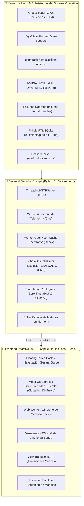

<div align="center">

# 🛸 SYSTEM COCKPIT · TELEMETRÍA & CONTROL DE MISIÓN
### *Centro de Mando de Alto Rendimiento para Servidores Linux & Homelabs*

[](./VERSION)
[](#-filosof%C3%ADa-de-dise%C3%B1o)
[](#-principio-estricto-100-zero-hardcoding)
[](#-app-nativa-linux-deb--proyecci%C3%B3n-usb-dex--modo-escritorio-android)
[](#-app-nativa-android-apk--jetpack-compose)
[](#-compilación-continua-en-github-actions)
[](#-rendimiento-y-motor-desacoplado)
[](#-ciberdefensa-activa-ips-y-seguridad-zero-trust)
[](#-licencia)

<p align="center">
  <b>System Cockpit</b> es una plataforma integral de monitorización y ciberdefensa en tiempo real que transforma la gestión de servidores Linux y entornos homelab en una experiencia táctil fluida, combinando la óptica multicapa de <b>Apple Liquid Glass</b> con la ergonomía automotriz de <b>Tesla Touch Cockpit</b> y un cliente 100% nativo para Linux en GTK3 con soporte interactivo de dispositivos por hardware.
</p>

</div>

---

```
╔══════════════════════════════════════════════════════════════════════════════════════════════════════════════╗
║  🟢 NODO PRINCIPAL ACTIVO  │  ⚡ 60 FPS RAF  │  🛡️ IPS ACTIVO (FAIL2BAN)  │  📡 PI-HOLE DNS FLOWS  │ v8.5.2 ║
╠══════════════════════════════════════════════════════════════════════════════════════════════════════════════╣
║                                                                                                              ║
║   ┌──────────────────────┐  ┌──────────────────────────────────────────────┐  ┌──────────────────────────┐   ║
║   │  🧠 CPU TELEMETRÍA   │  │       🌍 MAPA MUNDIAL GEOESPACIAL EN VIVO    │  │  🍩 D3.JS TRÁFICO DE RED │   ║
║   │  ████████░░░  74.2%  │  │         . _..::__:  ,-"-"._                  │  │      ╭────────────╮      │   ║
║   │  3.80 GHz · 52.0°C   │  │       /  🌍 NODO LOCAL ──► 🗽 WAN DESTINO    │  │    ╭─┤ 192.168.50 ├─╮    │   ║
║   ├──────────────────────┤  │       \      ╰──────────► 🗼 SERVICIOS NUBE  │  │    │ ╰────────────╯ │    │   ║
║   │  💾 RAM + ZRAM       │  │        `._ .._,-'                            │  │    ╰─── 68.4% RX ───╯    │   ║
║   │  ██████░░░░░  58.1%  │  │  [✓] OpenStreetMap Libre · Cluster Dinámico │  │  Interpolación Cúbica    │   ║
║   └──────────────────────┘  └──────────────────────────────────────────────┘  └──────────────────────────┘   ║
║                                                                                                              ║
║           ╔══════════════════════════════════════════════════════════════════════════════════════╗           ║
║           ║  🏠 Cockpit   🧠 CPU   💾 RAM   🎮 GPU   💿 Discos   🌐 Red   🛡️ IPS   🐳 Docker ║           ║
║           ╚══════════════════════════════════════════════════════════════════════════════════════╝           ║
║                                     ▲ FLOATING TOUCH DOCK (TESLA UI)                                         ║
╚══════════════════════════════════════════════════════════════════════════════════════════════════════════════╝
```

---

## 📑 Tabla de Contenidos

1. [Arquitectura General](#-arquitectura-general)
2. [Filosofía de Diseño: Apple Liquid Glass + Tesla UI](#-filosofía-de-diseño)
3. [Características Principales](#-características-principales)
   - [Pilares de Telemetría de Hardware](#1-pilares-de-telemetría-de-hardware)
   - [Inteligencia Geoespacial en Vivo (100% Libre)](#2-inteligencia-geoespacial-en-vivo-100-libre)
   - [Flujos de Red de Dispositivos del Hogar (Pi-hole DNS)](#3-flujos-de-red-de-dispositivos-del-hogar-pi-hole-dns)
   - [Ciberdefensa Activa IPS y Seguridad Zero-Trust](#4-ciberdefensa-activa-ips-y-seguridad-zero-trust)
   - [Analítica de Ancho de Banda con D3.js](#5-analítica-de-ancho-de-banda-con-d3js)
   - [Ecosistema Multimedia y Docker](#6-ecosistema-multimedia-y-docker)
   - [Centro Unificado de Registro de Fallos del Sistema (Apps, Servicios & Kernel)](#7-centro-unificado-de-registro-de-fallos-del-sistema-apps-servicios--kernel)
   - [App Nativa Linux (.deb) & Proyección USB DeX / Modo Escritorio Android](#8-app-nativa-linux-deb--proyección-usb-dex--modo-escritorio-android)
4. [Principio Estricto 100% Zero-Hardcoding](#-principio-estricto-100-zero-hardcoding)
5. [Mapa de Vistas SPA (12 Pantallas Web)](#-mapa-de-vistas-spa-12-pantallas-web)
6. [Referencia de la API REST](#-referencia-de-la-api-rest)
7. [Guía de Instalación y Despliegue](#-guía-de-instalación-y-despliegue)
8. [Historial de Versiones](#-historial-de-versiones)
9. [Licencia](#-licencia)

---

## 🏛 Arquitectura General

El sistema opera bajo un modelo **desacoplado y de latencia ultrabaja**, donde el backend en Python orquesta múltiples hilos especializados que interactúan directamente con subsistemas del kernel de Linux, volcando la telemetría en cachés atómicas en memoria consumidas de forma reactiva por el cliente web:



---

## 🎨 Filosofía de Diseño

System Cockpit rompe con la estética tradicional de paneles de administración y adopta una interfaz inspirada en dos referentes de clase mundial:

### 🍏 Apple visionOS / macOS Liquid Glass
- **Óptica Translúcida Multicapa**: Fondos de cristal esmerilado impulsados por aceleración de GPU (`backdrop-filter: blur(36px) saturate(190%)`).
- **Bordes Especulares**: Reflejos de luz dinámicos en los contornos (`border: 1px solid rgba(255, 255, 255, 0.14)`).
- **Tarjetas Bento Grid**: Disposición geométrica modular con radios continuos (`border-radius: 24px`).
- **Temas de Titanio**: *Space Black Titanium* (por defecto, negro profundo con acentos esmeralda/zafiro) y *Natural Brushed Titanium* (modo claro de alta legibilidad).

### ⚡ Tesla Touch Cockpit Ergonomics
- **Floating Touch Dock**: Barra de navegación flotante inferior (`#floatingTouchDock`) adaptada ergonómicamente al alcance del pulgar en pantallas móviles o consolas táctiles.
- **Hitboxes Táctiles Generosos**: Todos los botones interactivos cuentan con una zona de impacto táctil `≥ 48px`, eliminando la dependencia del puntero de ratón.
- **Navegación Gestual (Touch Swipe)**: Deslizamiento lateral con inercia para alternar fluidamente entre las 12 vistas del sistema.
- **Scrubbing Táctil en Tiempo Real**: Gráficas históricas con inspección interactiva continua punto a punto en modales `<dialog>`.

---

## 🚀 Características Principales

### 1. Pilares de Telemetría de Hardware
* **CPU en Tiempo Real**: Monitorización de uso global y por núcleo independiente, detección dinámica de frecuencias (`psutil.cpu_freq()`) y sensores térmicos de silicio leídos directamente desde `/sys/class/thermal` y controladores `coretemp`.
* **Memoria RAM & ZRAM**: Desglose visual instantáneo de memoria física activa, en búfer, en caché, SWAP en disco y compresión ultra-rápida ZRAM.
* **GPU Heterogénea**: Detección dinámica automática para GPUs dedicadas (NVIDIA NVML) e integradas (Intel / AMD Radeon), mostrando carga de cómputo, VRAM consumida, potencia en vatios y temperatura.
* **Almacenamiento & Rendimiento I/O**: Detección dinámica de todas las particiones montadas (`df`), uso porcentual, espacio libre y tasa de transferencia I/O en tiempo real (MB/s de lectura/escritura e IOPS).

### 2. Inteligencia Geoespacial en Vivo (100% Libre)
* **Motor Cartográfico OpenStreetMap + Leaflet**: Sistema cartográfico 100% libre, sin cuotas ni dependencias de APIs propietarias de pago como Google Maps.
* **Clustering Dinámico Inteligente**: Los nodos geográficos se agrupan o separan de forma fluida y natural al ajustar el zoom, evaluando distancias relativas en pantalla sin ubicaciones predefinidas.
* **Popups Persistentes Multinivel**: Arquitectura de retención de popups de hasta 5 niveles que previene cierres involuntarios al navegar, interactuar o refrescar datos.
* **Resolución GeoIP Asíncrona sin Bloqueos**: Motor de resolución en segundo plano protegido con cerrojos reentrantes (`threading.RLock()`), caché LRU acotada en el navegador y almacenamiento persistente en disco en el servidor (`geoip_cache.json`).

### 3. Flujos de Red de Dispositivos del Hogar (Pi-hole DNS)
* **Traducción Dinámica de IPs (`PiholeDnsTranslator`)**: Módulo avanzado que analiza la base de datos `/etc/pihole/pihole-FTL.db`, listas estáticas y tablas DHCP para traducir IPs locales anónimas a nombres de dispositivos reconocibles (`tv-de-la-sala-de-estar`, `xbox-series-s`, `Redmi-A3`, etc.).
* **Visibilidad Total de la Red Doméstica**: Permite observar en el mapa mundial y en la tabla de conexiones qué destinos remotos están consumiendo los distintos dispositivos del hogar.
* **Filtros Segmentados en Vivo**: Conmutador rápido entre conexiones locales del servidor, flujos de dispositivos del hogar y tráfico global consolidado.

### 4. Ciberdefensa Activa IPS y Seguridad Zero-Trust
* **Integración Nativa con Fail2ban**: Monitorización de cárceles activas (`sshd`, `recidive`, etc.), registro cronológico de intrusiones e inspección de direcciones IP hostiles.
* **Bloqueo / Desbloqueo en 1 Clic**: Acciones directas para expulsar atacantes o revocar sanciones directamente desde el mapa geográfico o desde la tabla de conexiones.
* **Arquitectura Zero-Trust**:
  - **Acceso en LAN**: Emparejamiento automático transparente para dispositivos conectados a la red local.
  - **Acceso WAN (Exterior / Móvil)**: Verificación estricta mediante credenciales criptográficas HMAC-SHA256 (`X-Device-Token` / `_sysmon_trust`). Los dispositivos deben haber sido vinculados previamente en LAN o desbloqueados mediante clave maestra protegida contra fuerza bruta.

### 5. Analítica de Ancho de Banda con D3.js
* **Gráfico de Anillo Animado con D3.js v7**: Renderizado vectorial fluido con interpolación cúbica suave (`d3.interpolate` + `attrTween`, 550ms cubic-out).
* **Distribución Multidimensional**:
  - `🌐 Subredes IP`: Visualización por segmento y rangos `/24`.
  - `📶 Grupos de Enlace`: Desglose entre enlaces cableados Ethernet y bandas Wi-Fi 5 GHz / 2.4 GHz.
  - `🖥️ Categorías`: Clasificación funcional (Servidores, Smart TVs, Smartphones, IoT, etc.).
  - `📱 Dispositivos de Red`: Visualización directa de cada dispositivo cliente individual de la red con sus consumos reales medidos (`tx_bytes`, `rx_bytes`, caudal de subida/bajada en tiempo real), segregando de forma inteligente contadores de hardware acumulados de interfaces troncales para una lectura fidedigna.
* **Alerta Visual por Umbral NIC**: Notificaciones visuales en tiempo real configurables cuando una interfaz de red sobrepasa un caudal de tráfico determinado (por ejemplo, `eth0 > 150 Mbps`).

### 6. Ecosistema Multimedia y Docker
* **Contenedores Docker**: Estado de salud, tiempo de actividad, CPU y consumo de memoria por contenedor consultando directamente el socket de Docker.
* **Descargas qBittorrent & Emby**: Seguimiento de torrents activos, velocidades de descarga/subida, ratios de compartición y sesiones activas en el servidor multimedia.
* **DuckDNS & Proxy Inverso Caddy**: Integración con DNS dinámico DuckDNS y proxy inverso Caddy con certificados SSL TLS automáticos.

### 7. Centro Unificado de Registro de Fallos del Sistema (Apps, Servicios & Kernel)
* **Agregador Global de Diagnóstico**: Recolecta en tiempo real todos los eventos con nivel de severidad `emerg`, `alert`, `crit`, `err` (y opcionalmente `warning`) generados por:
  - **Contenedores de Aplicaciones**: Registros de salida estándar y error de Docker (`Immich`, `Postgres`, `Nextcloud`, `Collabora`, `HomeAssistant`, etc.) capturados por el journal de Docker.
  - **Servicios del Sistema Systemd**: Fallos y excepciones de daemons como `pxe-dnsmasq`, `fail2ban`, `caddy`, `smbd`, `systemd-resolved`, etc., junto con la detección en tiempo real de unidades en estado `failed`.
  - **Núcleo del Sistema Operativo (Kernel)**: Eventos de I/O de almacenamiento, errores de módulos, `dmesg`, eventos térmicos y del subsistema de red.
* **Decodificación Binaria Segura**: Resiliente ante buffers de salida de aplicaciones (como Postgres o Collabora) que emiten secuencias de bytes binarios en JSON.
* **Diseño Plegable y Modal Panorámico**:
  - Indicador rápido en la cabecera de la Vista General (`📋 Fallos: X detectados`) con resaltado de color dinámico ante incidencias.
  - Tarjeta Bento colapsable (`#systemLogsCenterCard`) con filtros por categoría (`🐳 Apps & Docker`, `⚙️ Servicios`, `🐧 Kernel`), búsqueda en vivo y cambio de severidad.
  - Visor nativo HTML5 `<dialog>` a pantalla completa para auditorías exhaustivas.

### 8. App Nativa Linux (.deb) & Proyección USB DeX / Modo Escritorio Android
* **Separación Estricta Web vs. Nativa**: La pestaña de **Dispositivo** NO aparece en la versión web (ni en el menú lateral, ni en la cabecera, ni en la Vista General, ni en el Touch Dock). Existe **exclusivamente en la App Nativa para Linux (`recursos-cockpit`)**.
* **Interfaz de Espera y Proyección Directa por USB**: En la aplicación nativa GTK 3, la pestaña **📱 Dispositivo (USB DeX)** presenta una interfaz limpia y enfocada que permanece esperando la conexión por cable USB de un teléfono móvil compatible con **Samsung DeX** o el **Modo Escritorio de Android**, iniciando automáticamente (o con 1 clic) la proyección de vídeo e interfaz de escritorio por USB mediante `scrcpy` y periféricos físicos `/dev/uhid`.
* **Rendimiento 100% Nativo (GTK3 Puro)**: Construida sobre la pila nativa del sistema en Python y GNOME con widgets nativos reales (sin WebKit ni navegadores embebidos), pesando **~11 KB** empaquetada en formato Debian y consumiendo **< 30 MB de RAM**.
* **Compilación CI/CD en GitHub**: Infraestructura de empaquetado reproducible en `packaging/debian/` y workflow automatizado en `.github/workflows/build-deb.yml` para compilar paquetes `.deb` auditados y publicarlos como artefactos en cada release.

---

## 🧭 Principio Estricto 100% Zero-Hardcoding

System Cockpit se rige por una regla arquitectónica absoluta: **cero valores estáticos o suposiciones cableadas en el código fuente**.

1. **Ubicaciones, Ciudades y Proveedores**: Queda prohibido codificar nombres de ciudades, países o proveedores fijos. Todo dato geográfico se calcula dinámicamente en tiempo de ejecución a partir de la telemetría viva de red (`remote_ip`, `city`, `country`, `isp`, `asn`).
2. **Hardware e Interfaces**: El número de núcleos, sensores térmicos, discos duros, tarjetas de red (NICs), particiones y aceleradoras GPU se detectan y renderizan en base a las lecturas reales del sistema en `/sys` y `/proc`.
3. **Clustering y Agrupamientos**: Los clusters del mapa se computan matemáticamente por proximidad en pantalla según el nivel de zoom actual, sin identificadores artificiales.

---

## 📱 Mapa de Vistas SPA (12 Pantallas Web)

El frontend opera como una Single Page Application (SPA) desacoplada con animaciones mediante **View Transitions API**:

| Ruta | Nombre de Vista | Descripción Operativa |
| :--- | :--- | :--- |
| `/` | **Vista General** | Cockpit panorámico con los pilares de hardware, bento grid de 10 tarjetas y accesos rápidos. |
| `/procesador` | **CPU & Frecuencias** | Monitor detallado por hilo lógico, frecuencias dinámicas y termografía del procesador. |
| `/memoria` | **RAM & ZRAM** | Desglose de memoria física, swap, búferes y compresión ZRAM en tiempo real. |
| `/grafica` | **GPU & Aceleración** | Carga de GPU, reloj de núcleo, temperatura y consumo de memoria VRAM. |
| `/almacenamiento` | **Discos & Particiones** | Monitor de espacio en disco, particiones montadas y tasas de I/O en MB/s. |
| `/red` | **Mapa Mundial & Tráfico** | Cartografía interactiva OpenStreetMap, flujos de Pi-hole y sockets del kernel. |
| `/procesos` | **Gestor de Procesos** | Monitor de procesos activos por CPU/RAM con capacidad de filtrado y señales. |
| `/servicios` | **Servicios Systemd** | Catálogo interactivo de servicios del sistema, estados y reinicios. |
| `/contenedores` | **Docker Runtime** | Monitor de contenedores Docker activos, memoria, CPU y tiempos de actividad. |
| `/seguridad` | **Ciberdefensa IPS** | Centro de control Fail2ban, cárceles, IPs bloqueadas y gestión Zero-Trust. |
| `/descargas` | **Multimedia & Torrents**| Panel unificado para descargas qBittorrent, streaming y gestor del bot de Telegram. |
| `/dns` | **DNS & Tráfico por IP** | Sincronización DuckDNS, resolución por clientes de la red y tabla de tráfico DNS. |
| `/version` | **Control de Versión** | Información de versión canónica, hash de Git y actualización OTA en 1 clic. |

---

## 🔌 Referencia de la API REST

El servidor expone una API REST ligera en formato JSON:

| Método | Endpoint | Descripción | Acceso / Auth |
| :--- | :--- | :--- | :--- |
| `GET` | `/api/metrics` | Telemetría consolidada del sistema (CPU, RAM, GPU, Red, Discos, Versión). | Público (LAN / Token WAN) |
| `GET` | `/api/version` | Versión canónica activa (`VERSION`), hash Git y estado del repo remoto. | Público |
| `GET` | `/api/system/logs` | Registro unificado de fallos y errores (filtros: `level`, `category`, `limit`, `refresh`). | Público (LAN / Token WAN) |
| `GET` | `/download/recursos-cockpit.deb` | Descarga directa del paquete Debian oficial compilado para Linux amd64. | Público |
| `POST` | `/api/net/geoip/resolve` | Resolución en lote de coordenadas geográficas para el mapa. | Abierto para clientes del mapa |
| `POST` | `/api/net/geoip/clear-errors`| Limpia el historial de eventos del Worker GeoIP en el servidor. | Requiere sesión de confianza |
| `POST` | `/api/fail2ban/ban` | Bloquea una dirección IP maliciosa en una cárcel de Fail2ban. | Requiere sesión de confianza |
| `POST` | `/api/fail2ban/unban` | Desbloquea una IP previamente sancionada en Fail2ban. | Requiere sesión de confianza |
| `POST` | `/api/auth/unlock` | Desbloqueo remoto de cliente WAN mediante clave maestra HMAC. | Protegido contra fuerza bruta |
| `GET` | `/api/trust/status` | Comprueba el estado de confianza y emparejamiento del cliente. | Público |
| `POST` | `/api/custom-logos` | Actualiza o restablece logos personalizados de servicios/equipos. | Requiere sesión de confianza |
| `GET` | `/api/dex/status` | Estado en tiempo real del puerto USB y dispositivos conectados para proyección Samsung DeX / Android Desktop. | Requiere sesión de confianza |
| `POST` | `/api/dex/start` | Inicia la proyección de vídeo por USB en baja latencia (`scrcpy` + UHID). | Requiere sesión de confianza |
| `POST` | `/api/dex/stop` | Detiene la sesión activa de proyección de vídeo por USB. | Requiere sesión de confianza |

---

## 🛠 Guía de Instalación y Despliegue

### Requisitos del Sistema
- **Sistema Operativo**: Linux (Ubuntu 22.04+, Debian 12+, Arch Linux o similar).
- **Python**: Versión 3.10 o superior.
- **Herramientas del Sistema**: `conntrack`, `fail2ban`, `iproute2`, `sqlite3` (para Pi-hole).

### 1. Clonar el Repositorio
```bash
git clone https://github.com/cminewarIA/recursos-ui.git /home/servidor/servicios/dashboard
cd /home/servidor/servicios/dashboard
```

### 2. Instalar Dependencias de Python
```bash
pip3 install -r requirements.txt || pip3 install psutil
```

### 3. Configuración de Variables de Entorno (`.env`)
Crea un archivo `.env` en el directorio raíz si deseas personalizar puertos o credenciales maestras:
```env
PORT=8085
ADMIN_MASTER_KEY=tu_clave_maestra_segura_aqui
DUCKDNS_DOMAIN=tu-dominio.duckdns.org
DUCKDNS_TOKEN=tu-token-duckdns
```

### 4. Despliegue como Servicio Systemd
Crea el archivo de servicio `/etc/systemd/system/system-dashboard.service`:
```ini
[Unit]
Description=System Cockpit - Telemetría y Ciberdefensa en Tiempo Real
After=network.target

[Service]
Type=simple
User=servidor
WorkingDirectory=/home/servidor/servicios/dashboard
ExecStart=/usr/bin/python3 /home/servidor/servicios/dashboard/server.py
Restart=always
RestartSec=3

[Install]
WantedBy=multi-user.target
```

Habilita e inicia el servicio:
```bash
sudo systemctl daemon-reload
sudo systemctl enable --now system-dashboard.service
```

### 5. Configuración con Caddy (Proxy Inverso SSL)
Ejemplo de directiva para `/etc/caddy/Caddyfile`:
```caddy
tu-dominio.duckdns.org {
    reverse_proxy 127.0.0.1:8085
}
```
Recarga Caddy:
```bash
sudo systemctl reload caddy
```

---

## 📜 Historial de Versiones

El proyecto sigue un criterio estricto de incremento semántico (`MAJOR.MINOR.PATCH`):
* `X.0.0`: Rediseño completo de la aplicación (cambio integral de arquitectura visual o sistema de diseño global).
* `0.X.0`: Actualización intermedia: adición o retiro de funcionalidades, o rediseño/ajuste de una función o aspecto concreto de la interfaz.
* `0.0.X`: Ajustes de rendimiento, corrección de errores (bugfixes) o actualización documental.

| Versión | Tipo | Descripción de Cambios |
| :--- | :---: | :--- |
| **`v8.5.2`** | `PATCH` | **Formalización Contractual de Simetría Total, Homogeneidad y Cohesión en Interfaces y Submenús (Regla 8 en `GEMINI.md`)**: (1) **Principio de Simetría y Homogeneidad Estricta en Todas las Interfaces (Regla 8)**: Inclusión contractual obligatoria de la Regla 8 en [`GEMINI.md`](./GEMINI.md) exigiendo que todos los componentes, vistas, tarjetas Bento, barras de herramientas, HUDs, paneles flotantes, modales y submenús (incluyendo la interfaz cartográfica geoespacial, catálogo de servicios, selectores de subredes, gráficos y tablas) mantengan una simetría visual y estructural rigurosa, limpia y equilibrada en cualquier resolución; (2) **Ecosistema Homogéneo Universal**: Cohesión absoluta de diseño entre la plataforma web y los clientes nativos de Ubuntu (GTK 3/Cairo) y Android (Jetpack Compose), compartiendo alineación simétrica, radios de curvatura, estética *Apple Liquid Glass*, contraste, tipografía monoespaciada tabular y ergonomía táctil *Tesla Touch Cockpit*; (3) **Simetría Contractual en Nuevas Funcionalidades**: Obligatoriedad de simetría y coherencia visual para cualquier función, control o vista añadida a futuro; (4) **Sincronización Canónica**: Actualización de `./VERSION`, `package.json`, `packaging/debian/control`, `android_app/app/build.gradle.kts` y [`README.md`](./README.md) a `8.5.2`. |
| **`v8.5.1`** | `PATCH` | **Supresión del Logotipo de Apple en el Badge de Versión Canónica de README.md**: (1) **Eliminación del Logo de Apple**: Supresión de los parámetros `&logo=apple&logoColor=white` en el badge principal de versión canónica en la cabecera de [`README.md`](./README.md); (2) **Sincronización Canónica**: Actualización de `./VERSION`, `package.json`, `packaging/debian/control` y `app/build.gradle.kts` a `8.5.1`. |
| **`v8.5.0`** | `MINOR` | **Autodescubrimiento Dinámico en Red Local (LAN), Persistencia Criptográfica Zero-Trust (Android & Ubuntu), Paridad Completa de Interfaz y Modo DeX Diferenciado**: (1) **Autodescubrimiento LAN Dinámico sin Configuración Manual**: Implementación de escaneo concurrente y dinámico de subred `/24` en Android (`DiscoveryManager.kt`) y Ubuntu Linux (`desktop_app/recursos_app.py` vía `ServerConnectionManager`) sin IPs fijas ni hardcodeadas; detección en milisegundos del nodo servidor con conmutación transparente a WAN (`recursos.cminewar.duckdns.org`); (2) **Persistencia Criptográfica Zero-Trust y Resiliencia**: Almacenamiento seguro del token criptográfico emitido por el servidor (`X-Device-Token` / `Bearer`) en `EncryptedSharedPreferences` (Android) y configuración cifrada local (Ubuntu); retención permanente de la sesión autorizada hasta su revocación explícita desde el panel de control (`HTTP 403 / locked`), desplegando banner visual de bloqueo de acceso; (3) **Paridad Total de Interfaz en Android (Bento Grid 100% Nativo)**: Incorporación de todas las vistas y pestañas operativas del servidor en Jetpack Compose puro sin WebViews (Cockpit Bento Grid, CPU con frecuencias dinámicas y silicio, Memoria RAM & ZRAM, Discos I/O, Red en vivo, Ciberdefensa Activa / IPS Fail2ban, Contenedores Docker y Monitor de Procesos del Kernel); (4) **Diferenciación Contractual Estricta de Modo DeX**: El submenú de control DeX / Proyección USB por hardware permanece estrictamente desactivado y ausente en la app Android y la web, y desbloqueado exclusivamente en la app nativa de Ubuntu con soporte `/dev/uhid` y `scrcpy`; (5) **Sincronización Canónica**: Actualización de `./VERSION`, `package.json`, `packaging/debian/control` y `app/build.gradle.kts` a `8.5.0`. |
| **`v8.4.1`** | `PATCH` | **Carpeta de Paquetes de Compilación Offline (`packages/`) y Aceleración de Rendimiento en CI/CD y Entorno Local**: (1) **Suite de Paquetes Offline (`packages/debian/`)**: Inclusión de paquetes `.deb` predescargados para el conjunto de herramientas de compilación Linux (`dpkg-dev`, `binutils`, `binutils-common`, `binutils-x86-64-linux-gnu`, `libbinutils`, `libdpkg-perl`, `make`, `patch`, `fakeroot`) con instalación ultrarrápida offline (<1s) sin necesidad de descargas remotas ni `apt-get update`; (2) **Scripts de Aceleración y Diagnóstico (`packages/scripts/`)**: Creación de `install_packages.sh` para instalación no bloqueante offline-first con resolución inteligente de dependencias y `verify_packages.sh` para auditoría de salud del compilador; (3) **Aceleración de Compilación Android**: Optimización de `android_app/gradle.properties` con directivas de alto rendimiento (`org.gradle.caching=true`, `org.gradle.parallel=true`, `org.gradle.vfs.watch=true`) y aceleración en GitHub Actions con `gradle/actions/setup-gradle@v4` para caché permanente de dependencias y wrapper; (4) **Sincronización Canónica**: Actualización de `./VERSION`, `package.json`, `packaging/debian/control` y `app/build.gradle.kts` a `8.4.1`. |
| **`v8.4.0`** | `MINOR` | **Cliente Nativo Android (Kotlin + Jetpack Compose 100% Nativo), Compilación Automática de APK en GitHub Releases y Despliegue en Samsung Galaxy Tab S9**: (1) **Aplicación Nativa Pura para Android (`android_app/`)**: Desarrollo del cliente nativo en Kotlin y Jetpack Compose (Material 3) sin WebViews ni navegadores embebidos (cumplimiento estricto de la Regla 7); diseño *Apple Liquid Glass + Tesla Touch Cockpit*, Bento Grid adaptativo responsivo para tablets (Samsung Galaxy Tab S9 en resolución 2960×1848) y móviles con tarjetas en tiempo real para CPU (uso %, núcleos, GHz y temperatura), memoria RAM (GB usados/totales y ZRAM activa), almacenamiento NVMe y caudal de red RX/TX en vivo; (2) **Autodescubrimiento y Enlace LAN ↔ WAN Transparente**: Detección dinámica de nodo en red local (`http://192.168.50.2:8085` a latencia mínima <1ms) y conmutación automática hacia el nodo público/DDNS (`https://recursos.cminewar.duckdns.org`) con almacenamiento seguro de tokens en `EncryptedSharedPreferences` / Android KeyStore; (3) **Pipeline Dual en GitHub Actions (`build-deb.yml`)**: Workflow de CI/CD actualizado con Java 17 para compilar de forma paralela el paquete Debian `dist/*.deb` y el APK Android `dist/*.apk`, calculando firmas SHA256 unificadas y publicando ambos binarios descargables públicamente en GitHub Releases; (4) **Compilación e Instalación Local Exitosa**: Compilación de `recursos-cockpit_8.4.0.apk` con Gradle 8.5 en el servidor e instalación directa vía ADB (`192.168.50.16:5555`) en la tablet Samsung Galaxy Tab S9 Ultra (`SM-X916B`) con arranque validado; (5) **Sincronización Canónica**: Actualización de `./VERSION`, `package.json`, `packaging/debian/control` y `app/build.gradle.kts` a `8.4.0`. |
| **`v8.3.8`** | `PATCH` | **Optimización y Consolidación de Reglas del Proyecto (`GEMINI.md`)**: (1) **Eliminación de Redundancias y Duplicidades**: Supresión de repeticiones de rutas físicas absolutas locales (`/home/servidor/...`) en múltiples apartados, unificando la política de compatibilidad y zero-hardcoding en la Regla 2; (2) **Consolidación de Seguridad en Apps Nativas**: Fusión de los puntos de certificación criptográfica y consumo de APIs (antiguos 9.3 y 9.5) en una directiva única, robusta y sin repetición de cifrado TLS; (3) **Sincronización Total de Empaquetado**: Inclusión explícita de `packaging/debian/control` en la regla de sincronización canónica de versiones junto a `./VERSION` y `package.json`; (4) **Flujo de Trabajo Estructurado**: Organización del documento en 8 directrices secuenciales según el ciclo de vida del proyecto (Pull ➔ Zero-Hardcoding ➔ Versión ➔ Planes ➔ README ➔ Build .deb ➔ Arquitectura Nativa ➔ Push). |
| **`v8.3.7`** | `PATCH` | **Formalización Contractual de Paridad Visual de Interfaces y Desbloqueo Exclusivo de DeX en la App de Ubuntu (Regla 9, Punto 6 en `GEMINI.md`)**: (1) **Paridad Estética y Estructural Absoluta**: Establecimiento del principio de que todas las interfaces (web y clientes nativos para Linux y Android) deben compartir idéntica identidad visual, diseño Apple Liquid Glass + Tesla Touch Cockpit, disposición de tarjetas bento y gráficas de silicio fluidas a 60 FPS; (2) **Diferenciación Contractual y Desbloqueo de DeX**: La única divergencia permitida es que **desde la app de Ubuntu se desbloquea el submenú de DeX / Modo Escritorio Android** con acceso por hardware (`/dev/uhid`, `scrcpy`, pantalla virtual), mientras que en la web permanece estrictamente bloqueado/oculto mostrando únicamente el estado pasivo *"Esperando dispositivo para conectarse en su versión nativa"*; (3) **Sincronización Canónica**: Actualización de `./VERSION`, `package.json` y `packaging/debian/control` a `8.3.7`. |
| **`v8.3.6`** | `PATCH` | **Incorporación de la Regla 9 en `GEMINI.md`: Arquitectura Contractual de Aplicaciones Nativas (Linux & Android)**: (1) **Norma Arquitectónica de Aplicaciones Nativas**: Formalización de la Regla 9 en las directrices maestras del proyecto ([`GEMINI.md`](./GEMINI.md)), estableciendo los 5 pilares obligatorios para el desarrollo de clientes nativos (Linux GTK3/GTK4 y Android Kotlin/Compose): UI 100% nativa pura con widgets propios del SO y Cairo sin WebViews ni navegadores embebidos, autodescubrimiento dinámico en red local (mDNS/Zeroconf/SSDP o sondeo LAN) con handshake de enlace, certificación criptográfica de dispositivo mediante el sistema web y almacenamiento seguro en Keyring/KeyStore, acceso dual transparente y reconexión automática inmediata al abrir (baja latencia en LAN y conexión TLS cifrada desde el exterior WAN / DDNS), e interacción segura con APIs y base de datos sin exposición de secretos; (2) **Sincronización Canónica**: Actualización de `./VERSION`, `package.json` y `packaging/debian/control` a `8.3.6`. |
| **`v8.3.5`** | `PATCH` | **Corrección Definitiva de Renderizado Nativo GTK3 (Cairo/PyGObject) y Supresión de Lanzadores Auxiliares en el Box de Aplicaciones**: (1) **Corrección de Renderizado Cairo en PyGObject (`desktop_app/recursos_app.py`)**: Solución de la causa raíz que dejaba la ventana en blanco sin dibujar nada (`TypeError: Couldn't find foreign struct converter for 'cairo.Context'`), integrando la importación canónica de `cairo` en Python, envolviendo `CairoSparkline.on_draw()` en bloques de ejecución protegidos y asegurando la invocación explícita de `self.show_all()` en el constructor de la ventana y en el evento `do_activate()` de `Gtk.Application`; (2) **Dependencias Completas de Cairo en Debian (`packaging/debian/control`)**: Adición obligatoria de los paquetes `python3-gi-cairo` y `python3-cairo` a las directivas `Depends:` del paquete Debian canónico, garantizando que el conversor nativo de tipos C-Cairo a GObject esté siempre disponible en cualquier distribución base; (3) **Supresión de Lanzadores Duplicados en el Box de Aplicaciones (`packaging/debian/postinst`)**: Inyección automatizada de `NoDisplay=true` inmediatamente bajo la cabecera `[Desktop Entry]` en `/usr/share/applications/scrcpy.desktop` y `/usr/share/applications/scrcpy-console.desktop` durante la instalación, erradicando los lanzadores secundarios de `scrcpy` en el Application Picker de GNOME y garantizando que el único lanzador visible en el box sea el oficial de *Recursos Cockpit*; (4) **Compilación e Instalación Automática (Regla 8)**: Generación del paquete Debian `dist/recursos-cockpit_8.3.5_amd64.deb` con sumas SHA256 e instalación física en el servidor local verificada mediante `--test-mode` y sondeo `Gio.AppInfo`. |
| **`v8.3.4`** | `PATCH` | **Restauración del Layout Nativo Completo con 3 Pestañas, Lanzador Único e Icono Oficial del Dragón Rojo en el Box de Aplicaciones**: (1) **Restauración de la Interfaz Nativa Completa (`desktop_app/recursos_app.py`)**: Corrección en `_build_main_layout()` que impedía cargar las pestañas de Telemetría y Procesos en entornos nativos por una condición inversa errónea; la aplicación GTK 3 despliega ahora incondicionalmente sus tres pestañas operativas en el `Gtk.Stack` con conmutador visible en el HeaderBar: 📊 *Telemetría* (métricas de silicio en tiempo real a 60 FPS con gráficos vectoriales Cairo), ⚙️ *Procesos* (monitoreo interactivo de la tabla de procesos del kernel) y 📱 *Conexión USB* (proyección interactiva por hardware Samsung DeX / Android Desktop mediante Scrcpy y UHID); (2) **Lanzador Único sin Duplicados en el Box de Aplicaciones (`desktop_app/recursos-cockpit.desktop`)**: Normalización del archivo de escritorio según especificaciones FreeDesktop XDG, eliminando acciones secundarias redundantes (`Actions=LaunchDeX`), simplificando categorías a `Categories=System;Monitor;` para evitar que el gestor de ventanas duplique la entrada, e integrando un bucle de purga en `packaging/debian/postinst` para limpiar automáticamente lanzadores PWA residuales (`cminewar-recursos.desktop`) en todos los perfiles de usuario; (3) **Icono Oficial del Dragón Rojo en la Ventana y Tarea (`GLib.set_prgname`)**: Configuración explícita de `GLib.set_prgname("recursos-cockpit")` y `GLib.set_application_name("Recursos Cockpit")` en el arranque del ciclo de vida (`do_startup` y `main()`) para que el Window Manager asocie de forma inmediata el proceso nativo con el archivo `.desktop` y el icono oficial del Dragón Rojo (`recursos-cockpit.png`), erradicando el icono genérico de ajustes (`preferences-system`); (4) **Compilación e Instalación Automática (Regla 8)**: Recompilación del paquete Debian `dist/recursos-cockpit_8.3.4_amd64.deb` con sumas criptográficas SHA256 e instalación física en el servidor local verificada con `recursos-cockpit --test-mode`. |
| **`v8.3.3`** | `PATCH` | **Incorporación de la Regla 8 en `GEMINI.md`: Compilación e Instalación Local Obligatoria de la App Nativa Linux (.deb)**: (1) **Norma de Ingeniería Obligatoria**: Establecimiento estricto de la Regla 8 en las directrices del proyecto (`GEMINI.md`), exigiendo que en cada modificación, actualización o release del sistema se compile de forma automática el paquete canónico `dist/recursos-cockpit_${VERSION}_amd64.deb` mediante `packaging/build_deb.sh`, se instale localmente en el servidor físico con `sudo apt-get install -y` y se verifique mediante `--test-mode` y `dpkg -l`, erradicando desfases de versión entre el cliente nativo y la interfaz web; (2) **Sincronización Canónica**: Actualización de `./VERSION`, `package.json` y `packaging/debian/control` a `8.3.3`. |
| **`v8.3.2`** | `PATCH` | **Corrección de Discrepancia en el Centro Unificado de Registro de Fallos (`SystemLogsCenter`)**: (1) **Consumo Resiliente de Logs y Fallos**: Corrección del método `fetchLogs()` en el frontend (`index.html` y `static/index.html`) para consumir `data.logs || data.entries`, resolviendo el problema donde la cabecera indicaba 49 fallos detectados pero el visor los mostraba en 0 debido a que la API devolvía la clave `logs` en lugar de `entries`; (2) **Doble Compatibilidad en Backend (`server.py`)**: `fetch_system_logs()` y `/api/system/logs` devuelven simultáneamente las propiedades `"logs"` y `"entries"`, sincronizan `total_errors` ante filtrado por categorías y añaden `"total"` a `counts_by_category`; (3) **Metadatos y Filtro Sincronizado**: Inclusión de `date_str`, `source` y `container` en cada evento, formateo robusto de fecha/hora y sincronización bidireccional del cuadro de búsqueda en el visor integrado y el modal a pantalla completa (`#modalSysLogsSearchInput`); (4) **Sincronización Canónica**: Actualización de `./VERSION`, `package.json` y `packaging/debian/control` a `8.3.2`. |
| **`v8.3.1`** | `PATCH` | **Instalación Local de la Aplicación Nativa Linux y Publicación Pública de Releases en GitHub Actions**: (1) **Instalación del Paquete Nativo en el Servidor**: Compilación e instalación satisfactoria de `recursos-cockpit_8.3.1_amd64.deb` (`/usr/bin/recursos-cockpit`) validada mediante `--test-mode` con subsistemas GTK3, Scrcpy 3.3.4, ADB y detección de entorno; (2) **Automatización de GitHub Releases Públicas**: Desbloqueo del paso de publicación en `.github/workflows/build-deb.yml` eliminando la condición exclusiva de tags e integrando `softprops/action-gh-release@v3` parametrizado con `tag_name: v${{ steps.pkg_info.outputs.version }}`, `generate_release_notes: true`, `draft: false` y `prerelease: false` para que cada compilación en `main` cree/actualice de forma inmediata y pública la Release oficial con el paquete `.deb` y sumas SHA256 descargables por cualquier usuario sin autenticación; (3) **Sincronización Canónica**: Actualización de `./VERSION`, `package.json` y `packaging/debian/control` a `8.3.1`. |
| **`v8.3.0`** | `MINOR` | **Identidad Visual Oficial del Dragón Rojo: Icono Nativo Multirresolución para la App .deb y Subsistema de Favicons Web**: (1) **Iconografía Oficial de la App de Escritorio (`recursos-cockpit.png` & .deb)**: Integración del nuevo logotipo oficial del Dragón Rojo con emblema blanco de alto contraste sobre fondo negro en insignia Squircle (estilo GNOME / macOS / Apple Liquid Glass); empaquetado nativo en todas las resoluciones estándar de FreeDesktop XDG (`16x16`, `32x32`, `48x48`, `64x64`, `128x128`, `256x256`, `512x512` en `/usr/share/icons/hicolor/`, `/usr/share/pixmaps/` y `/usr/lib/recursos-cockpit/assets/`), asignación dinámica como icono de ventana GTK 3 y visualización en el diálogo nativo `Gtk.AboutDialog`; (2) **Subsistema Web de Favicons Multirresolución**: Generación de `favicon.ico` (16×16, 32×32, 48×48, 64×64), `favicon.png` y `apple-touch-icon.png` (180×180); endpoints dedicados en `server.py` con cabeceras de caché eficiente (`max-age=86400`) y presencia del icono oficial en la pestaña del navegador y en la barra de navegación del cajón lateral; (3) **Sincronización Canónica**: Sincronización en `VERSION`, `package.json` y `packaging/debian/control`. |
| **`v8.2.0`** | `MINOR` | **Sincronización Total de Filtros del Mapa con el Detalle de Flujos y Sockets Geolocalizados**: (1) **Filtrado Reactivo Estricto (`mapConns`)**: El contenedor de "Detalle de Flujos y Sockets Geolocalizados" muestra de forma estricta y reactiva únicamente los sockets y flujos activos según todos los filtros aplicados en el mapa (dirección/tipo de tráfico `Todas`/`Entrantes`/`Salientes`/`Equipos LAN`/`Bloqueadas`, dispositivo LAN aislado, servicio del catálogo, rango temporal SQLite y búsqueda), erradicando inconsistencias y garantizando que cada cápsula coincida con una coordenada y marcador real del mapa; (2) **Chips de Filtros Activos Interactivos (`#connTableFilterChips`)**: En la cabecera de la sección se despliegan chips clicables en tiempo real para cada filtro activo con botón `✕` para removerlo individualmente o un botón `Restablecer todo`; (3) **Enfoque Bidireccional Interactivo Mapa ↔ Cápsula (`.conn-capsule.is-focused`)**: Al pulsar un marcador o clúster en el mapa se ilumina y enfoca la cápsula correspondiente en la cuadrícula y viceversa; (4) **Filtros Combinables No Destructivos**: Corrección de exclusión mutua para permitir filtrar simultáneamente por equipo y dirección sin borrar el dispositivo seleccionado. |
| **`v8.1.0`** | `MINOR` | **Cuadrícula de Cápsulas para Flujos y Sockets Geolocalizados y Grupos Compactos Colapsables en Distribución de Ancho de Banda** *(Actualización Intermedia de Componentes)*: (1) **Cuadrícula de Cápsulas de Alta Densidad para Flujos y Sockets (`.conn-capsules-grid` & `.conn-capsule`)**: En "Detalle de Flujos y Sockets Geolocalizados", se sustituyó la lista vertical unicolumna por una rejilla responsiva de tarjetas/cápsulas compactas (`repeat(auto-fill, minmax(290px, 1fr))`) que aprovecha de manera óptima el ancho de pantalla para mostrar decenas de conexiones simultáneas en el mismo espacio vertical; cada cápsula organiza en un formato limpio la dirección (`↓ IN`/`↑ OUT`/`🛡️ BLK`), servicio DNS/Pi-hole, protocolo/estado, IP:puerto remoto y dominio, dispositivo LAN local de origen, ubicación/ISP y botones de acción (`📜 Historial` y `🚫`/`🔓 Bloquear`), con celda expandible de ancho completo (`grid-column: 1 / -1`) para el historial SQLite sin alterar la cuadrícula; (2) **Grupos Compactos y Desglose Plegable en Distribución de Ancho de Banda (`NetworkBandwidthPieChart`)**: En "Desglose de Ancho de Banda por...", las tarjetas de grupos son ahora compactas y minimalistas por defecto (~58px de altura con nombre, swatch, porcentaje, total y barra de progreso), y al pulsar sobre la tarjeta o su botón `▼ Desglose (N)` se despliega/pliega de forma interactiva la lista de dispositivos y consumos individuales (`↓`, `↑` y total). |
| **`v8.0.0`** | `MAJOR` | **Menú Lateral Desplegable Adaptativo en el Mapa (`#mapSideDrawer`), Tabla de Flujos de Alta Densidad con Historial SQLite por Dispositivo y Desglose Completo de Dispositivos por Subcategoría de Ancho de Banda**: (1) **Menú Lateral Izquierdo Desplegable en el Mapa (`#mapSideDrawer` + `#btnMapDrawerToggle`)**: Sustitución de la barra horizontal flotante por un panel lateral izquierdo retráctil (`width: min(350px, calc(100% - 24px))`) activado desde un botón flotante compacto en la esquina superior izquierda (con chips rápidos para limpiar filtros activos sin abrir el panel) y una barra compacta unificada de cámara y Pantalla Completa en la esquina superior derecha (`.map-camera-toolbar`), adaptándose a cualquier resolución de escritorio, tablet o móvil y eliminando botones duplicados de pantalla completa; (2) **Tabla de Flujos Geolocalizados de Alta Densidad con Historial SQLite Desplegable por Dispositivo**: Rediseño de `#networkConnectionsTableList` en filas tabulares compactas de 5 columnas (`36px` por fila) con un botón `📜 Historial` por cada dispositivo que despliega en línea (`.conn-dev-history-drawer`) su catálogo de servicios e historial completo de conexiones almacenadas en SQLite (`/api/net/history?device=<ip>`), permitiendo filtrar por servicio o volar directamente a la coordenada en el mapa; (3) **Lista Desglosada Siempre Visible con Todos los Dispositivos en Distribución de Ancho de Banda**: En `NetworkBandwidthPieChart` (`Subredes`, `Grupos`, `Categorías` y `Dispositivos`), cada subcategoría muestra de forma permanente la lista completa (`.bw-pie-devices-breakdown`) de todos sus dispositivos con icono, nombre, IP, medio (`Eth`/`5G`/`2.4G`), barra de proporción, descarga (`↓`), subida (`↑`) y consumo total, sin truncar ni ocultar equipos detrás de puntos suspensivos. |
| **`v7.0.1`** | `PATCH` | **Modo Pantalla Completa Garantizado (`100vw × 100dvh`) y Límite Dinámico de Zoom Mundial sin Fondo Vacío en el Mapa**: (1) **Desbloqueo de `position: fixed` en Pantalla Completa (`body.map-fullscreen-active`)**: Eliminación de `backdrop-filter`, `transform`, `filter` y `contain` en los contenedores ancestros (`.connections-map-card`, `.view-page`, `.viewport-scroll`) cuando se activa la pantalla completa, garantizando que el mapa cubra el 100% del viewport tanto en modo nativo como dentro de contenedores `<iframe>` restringidos; (2) **Zona Derecha Fija en el HUD (`.map-hud-pinned-right`) + Botones de Acceso Rápido**: Los controles de `Zoom +`, `Zoom −`, `Encuadrar`, `Host` y `Pantalla Completa` permanecen anclados a la derecha de la barra superior sin ocultarse jamás fuera de pantalla en monitores estrechos, añadiendo además un botón flotante en la esquina inferior derecha (`#btnMapCornerFullscreen`) y otro en la cabecera de la sección (`#btnMapHeaderFullscreen`); (3) **Bloqueo Dinámico de Zoom-Out Mundial (`enforceMapWorldBounds`)**: Cálculo matemático en tiempo real del `minZoom` según las dimensiones del contenedor (`256 * 2^z >= max(w, h) + 20`) junto a `maxBounds` (`[-85.05°, -179.99°]` a `[85.05°, 179.99°]`) y `maxBoundsViscosity: 1.0`, impidiendo que el usuario aleje o arrastre el mapa más allá de los bordes del mundo hacia el fondo vacío. |
| **`v7.0.0`** | `MAJOR` | **Rediseño Integral de Precisión del HUD Flotante del Mapa, Panel Desplegable de Servicios y Modo Pantalla Completa**: (1) **Barra Superior Flotante de Una Sola Línea (`.map-hud-primary-bar`)**: Rediseño completo en cristal oscuro de alta densidad (`rgba(9, 13, 22, 0.86)`, `backdrop-filter: blur(22px) saturate(185%)`) simétrico de lado a lado (`left: 12px; right: 12px;`) sin colisiones con controles nativos de Leaflet e incorporando iconografía vectorial SVG limpia y contadores `tabular-nums`; (2) **Panel Desplegable Flotante de Servicios (`#mapHudServiceCatalogDrawer`)**: Popover flotante de cristal oscuro (`max-width: 720px`) activable desde el botón `Servicios` en cualquier modo (`En Vivo` o `Historial SQLite`), con cuadrícula CSS responsiva de tarjetas de servicio, selector temporal (`Todo`, `6h`, `24h`, `7d`), buscador instantáneo, botón rápido `×` para limpiar el servicio activo y cierre automático al pulsar sobre el lienzo del mapa; (3) **Tira Adaptativa de Dispositivos LAN (`#mapHudDeviceFilterBar`)**: Tira horizontal compacta que se despliega únicamente al filtrar por `Dispositivos` o aislar un equipo, evitando obstruir el lienzo cartográfico; (4) **Controles Integrados de Zoom, Encuadre, Host y Pantalla Completa (`100vw × 100vh`)**: Botones vectoriales de zoom `+`/`−`, encuadre global, enfoque en el nodo servidor y conmutador de Pantalla Completa con soporte de teclado (`Escape`). |
| **`v6.3.0`** | `MINOR` | **Persistencia SQLite de Historial por Servicios (`geoip_history.db`), Geolocalización Dual de Alta Precisión y HUD Adaptativo a Pantalla Completa en el Mapa**: (1) **Base de Datos SQLite (`geoip_history.db` en `server.py`)**: Persistencia en modo WAL de dos tablas (`geoip_locations` y `connection_history`) para almacenar ubicaciones exactas de IPs y el historial acumulado de conexiones catalogado dinámicamente por servicios (`service`, `hit_count`, `first_seen`, `last_seen`, `local_ip`, `domain`, coordenadas, región y código postal); (2) **Geolocalización Dual de Mayor Exactitud (`ip-api.com` + `ipwho.is`)**: Enriquecimiento de coordenadas con código postal (`zip`), región (`regionName`) y refinamiento cruzado mediante `ipwho.is` (`_enrich_ip_precision_with_ipwhois`) con trazabilidad de fuente de precisión (`accuracy_source`); (3) **HUD Adaptativo Integrado dentro del Mapa y Modo Pantalla Completa (`index.html` / `static/index.html`)**: Todos los controles de filtrado (`Todas`, `↓ Entrantes`, `↑ Salientes`, `📱 Dispositivos`, `🛡️ Bloqueadas`), la barra dinámica de chips de filtrado por dispositivo (`#mapHudDeviceFilterBar`), el selector de modo (`🟢 En Vivo` vs `📚 Historial por Servicios`), el cajón interactivo del catálogo de servicios (`#mapHudServiceCatalogDrawer`) y el botón `⛶ Pantalla Completa` están integrados directamente dentro del lienzo del mapa (`#networkConnectionsMapStageWrap`); (4) **Nuevos Endpoints REST**: `GET /api/net/history` (catálogo agrupado por servicios, dispositivos y conexiones históricas filtrables) y `POST /api/net/history/clear`. |
| **`v6.2.0`** | `MINOR` | **Motor Dinámico de Detección de Entorno (Web vs Móvil / Nativo) y Pantalla de Espera de Proyección USB**: (1) **`EnvironmentDetector` en Frontend (`index.html` / `static/index.html`)**: Detección automática en tiempo de ejecución del entorno activo (`web`, `mobile`, `native`); en la versión **Web** garantiza que la pestaña `'Dispositivo'` (y cualquier pestaña no web) esté ausente de toda la navegación (sidebar, dock táctil, paginación swipe y tabla de rutas); en entorno **Móvil o Nativo** oculta automáticamente cualquier pestaña `'Dispositivo'` o no web y renderiza en su lugar la pantalla de espera optimizada para proyección por USB (`#usbProjectionWaitScreen` — Samsung DeX / Android Desktop) con sondeo en vivo cada 2.5s; (2) **`detect_runtime_environment()` en App Nativa GTK 3 (`desktop_app/recursos_app.py`)**: Oculta automáticamente el conmutador de pestañas (`Gtk.StackSwitcher`) y cualquier pestaña `'Dispositivo'` al detectar ejecución nativa/móvil, renderizando directamente la interfaz de espera de conexión por cable USB para proyectar vídeo; (3) **Nuevos Endpoints Backend (`server.py`)**: Adición de `GET /api/dex/status`, `POST /api/dex/start` y `POST /api/dex/stop` conectados a `DexController` (`usb_only=True`). |
| **`v6.1.0`** | `MINOR` | **Retiro Total de la Pestaña de Dispositivo en Web, Proyección USB (Samsung DeX / Modo Escritorio Android) en App Nativa y Auditoría Integral de Errores**: (1) **Eliminación Completa de la Pestaña de Dispositivo en la Versión Web**: Retiro total de `#navDex`, botón de cabecera `#btnHeaderNativeApp`, tarjeta Bento #11, vista `#viewDex`, icono `#dockDex` del Floating Touch Dock, punto de paginación y rutas `/dex`, `/app`, `/dispositivo` tanto en `index.html` / `static/index.html` como en `VALID_WEB_ROUTES` de `server.py`; (2) **Interfaz de Espera USB en App Nativa GTK 3 (`desktop_app/`)**: Rediseño de la pestaña de Dispositivo en `recursos_app.py` y `dex_controller.py` para mostrar exclusivamente una pantalla limpia esperando la conexión por cable USB de un móvil para proyectar vídeo con **Samsung DeX** o **Modo Escritorio de Android** mediante `scrcpy` + UHID, con auto-lanzamiento configurable, soporte de argumentos CLI (`--dex`, `--test-mode`) y lectura 100% dinámica de `VERSION`; (3) **Auditoría y Corrección de Errores de Código**: Unificación de firmas entre `recursos_app.py` y `dex_controller.py` (`list_connected_devices`, `start_dex_session`), adición de variables CSS `--accent-purple`, `--accent-purple-bright` y `--glass-shadow`, reemplazo de `window.confirm` bloqueante por `showConfirmModal` asíncrono, inclusión de cabeceras `X-Device-Token` en `GeoIpBackgroundWorker` y `SystemLogsCenter`, verificación de confianza en `POST /api/net/geoip/resolve`, normalización de `clean_path` en `do_POST` y eliminación de IPs hardcodeadas residuales (`192.168.50.2`). |
| **`v6.0.3`** | `PATCH` | **Corrección de Comentarios HTML Anidados (`parse5 nested-comment`) y Placeholders 100% Zero-Hardcoding**: (1) **Solución al Error de Parseo HTML en Vite (`parse5 error code nested-comment`)**: Eliminación de la apertura de comentario HTML duplicada (`<!-- ===...`) en la sección 12 (`#viewDex`) tanto en `index.html` como en `static/index.html`; (2) **Zero-Hardcoding en Placeholders Iniciales**: Sustitución de referencias estáticas iniciales en el DOM (`v...`, `/download/recursos-cockpit.deb`, `recursos-cockpit.deb`) para que sean hidratadas de forma 100% dinámica por `applyVersionToUI()` desde `/api/version` y `/api/metrics`; (3) **Sincronización Canónica**: Actualización de `./VERSION`, `package.json` y `packaging/debian/control` a `6.0.3`. |
| **`v6.0.2`** | `PATCH` | **Sincronización Estricta de Versión del Paquete .deb, Build Limpio y Frontend Reactivo**: (1) **Sincronización Canónica**: El paquete Debian compilado `recursos-cockpit_${VERSION}_amd64.deb`, su archivo de control y metadatos internos coinciden estrictamente con `./VERSION` (`6.0.2`); (2) **Limpieza Automática en Build**: `packaging/build_deb.sh` purga archivos `.deb` obsoletos acumulados en `dist/` antes de compilar, empaqueta el punto de verdad en `/usr/lib/recursos-cockpit/VERSION` y genera el symlink canónico `recursos-cockpit.deb`; (3) **Servidor con Auto-Build y Endpoints Específicos**: `server.py` sirve dinámicamente tanto `/download/recursos-cockpit.deb` (con Content-Disposition apuntando a `recursos-cockpit_6.0.2_amd64.deb`) como URLs versionadas `/download/recursos-cockpit_6.0.2_amd64.deb`, ejecutando el empaquetado al vuelo si el binario no existiese; (4) **Frontend Reactivo Zero-Hardcoding**: `static/index.html` e `index.html` actualizan de forma reactiva mediante `/api/version` el botón de descarga, badges de versión y comandos de terminal `wget`; (5) **App Nativa GTK 3**: `desktop_app/recursos_app.py` detecta dinámicamente la versión canónica desde `VERSION`, la expone en el subtítulo del HeaderBar e incorpora un diálogo estándar 'Acerca de' (`Gtk.AboutDialog`). |
| **`v6.0.1`** | `PATCH` | **Modernización y Corrección de CI/CD en GitHub Actions (Node.js 24 & Ubuntu 24.04)**: Actualización del workflow `.github/workflows/build-deb.yml`: (1) Migración a versiones nativas con Node.js 24 (`actions/checkout@v7`, `actions/upload-artifact@v7`, `softprops/action-gh-release@v3`), erradicando las advertencias de Node.js 20 deprecated; (2) Fijación de runner estable en `ubuntu-24.04` eliminando las alertas de migración de la etiqueta `ubuntu-latest`; (3) Recompilación del paquete `.deb` a la versión `6.0.1`. |
| **`v6.0.0`** | `MAJOR` | **App Nativa 100% GTK3 Pura y Purga Total de DeX en Web**: (1) **Rediseño Completo de la App Nativa**: Transformación a aplicación de escritorio 100% nativa en GTK 3 sin WebKit ni navegadores embebidos, con paneles nativos de monitorización de silicio (CPU, RAM, swap, discos y red en tiempo real con `psutil`) y centro de conexión interactiva por hardware con Scrcpy/UHID; (2) **Purga en Web**: Eliminación de cualquier mención de la palabra 'DeX' en la interfaz web, desplegando de forma prominente en la cabecera, tarjeta Bento y vista dedicada el estado exacto: *'Esperando dispositivo para conectarse en su versión nativa'*; (3) **Optimización de Paquete Debian**: Eliminación de la dependencia `gir1.2-webkit2-4.1` en `packaging/debian/control`, dejando un paquete Debian ultraligero y compatible; (4) **Servidor y Endpoints**: Sincronización de rutas `/app`, `/dispositivo` y `/download/recursos-cockpit.deb`. |
| **`v5.0.0`** | `MAJOR` | **Rediseño Completo, App Nativa para Linux (.deb) con Modo Samsung DeX y Compilación Automatizada en GitHub Actions**: (1) **Rediseño Visual & Cockpit**: Evolución a Apple Liquid Glass 2.0 y Tesla Touch Cockpit, bento grid modular de 11 tarjetas, acceso directo a la app nativa en cabecera, touch dock ampliado y vista dedicada `/dex`; (2) **App Nativa para Linux (`recursos-cockpit`)**: Cliente de escritorio ultraligero con GTK 3.0 + WebKit2GTK (< 10 KB deb, < 30 MB RAM) sin la sobrecarga de Electron; (3) **Modo Samsung DeX Exclusivo por Hardware**: Integración de la lógica del proyecto Lapdock OS (`kiosk-manager.py`) con control directo por `/dev/uhid`, proyección interactiva por `scrcpy`, creación dinámica de pantallas virtuales y soporte USB / Wi-Fi (`adb tcpip 5555`), reservado estrictamente a la app nativa por motivos de latencia cero y privilegios de hardware; (4) **Compilación CI/CD en GitHub Actions**: Pipeline automatizado en `.github/workflows/build-deb.yml` e infraestructura local en `packaging/build_deb.sh` con cálculo de sumas SHA256; (5) **Distribución Integrada**: Endpoint `/download/recursos-cockpit.deb` que sirve dinámicamente el binario compilado. |
| **`v4.19.0`** | `MINOR` | **Panel de Ajustes, Emisor Directo e Historial de Mensajes del Bot de Telegram**: Creación de una interfaz visual completa por pestañas para el Bot de Telegram integrado en `/aplicaciones`: (1) **📋 Historial de Mensajes**: Registro auditado en tiempo real de "lo que manda el bot" (alertas de descargas qBittorrent completadas, respuestas a comandos `/status`, `/red`, `/sync`, `/help`, pings de prueba) y "lo que recibe" (comandos, enlaces magnet, archivos `.torrent`) con filtros por dirección, badges de estado, remitente/destinatario y fecha/hora; (2) **⚙️ Ajustes & Admins**: Gestión dinámica de la lista blanca de Telegram Chat IDs autorizados (alta, baja y visualización sin hardcoding) y conmutador para activar o pausar avisos automáticos de torrents completados; (3) **📢 Emisor a Telegram**: Compositor con plantillas rápidas para difundir comunicados o avisos a los administradores directamente desde el panel web; nuevos endpoints REST `/api/telegram_bot/activity`, `/api/telegram_bot/send`, `/api/telegram_bot/whitelist/add`, `/api/telegram_bot/whitelist/remove`, `/api/telegram_bot/config` y `/api/telegram_bot/activity/clear`. |
| **`v4.18.1`** | `PATCH` | **Optimización Integral del Subsistema de Red, Backend y Payloads JSON**: Eliminación de la triplicación del historial de 2h por interfaz (`history_2h`) en `/api/metrics` reduciendo en ~66% el peso del payload de red; índice inverso $O(1)$ (`dom_to_ip_cache`), caché TTL de 12s para flujos SQLite de Pi-hole y presupuesto acotado de consultas DNS/rDNS síncronas por ciclo en `PiholeDnsTranslator` y `fetch_connections_geo_worker`; caché por `mtime` en `load_custom_logos()` y pre-cálculo asíncrono de `system_errors_summary` fuera del hilo HTTP; compilación previa de expresiones regulares (`ss`, `conntrack`, `pihole.log`); actualización in-place de tarjetas NIC y `<canvas>` sin destruir el DOM cada 2s; hidratación única por sesión en `NicBandwidthStorageManager`; y firmas de cambio (`change signatures`) con renderizado perezoso en el mapa Leaflet, tabla de conexiones, lista de dispositivos y gráfico D3.js. |
| **`v4.18.0`** | `MINOR` | **Bot de Telegram Integrado 100% Nativo en Backend**: Integración completa del bot de descargas qBittorrent y vigilancia LAN directamente dentro del servidor web (`server.py`) sin intermediarios ni scripts delegados; soporte completo para recepción de archivos `.torrent` (descarga binaria e inyección directa en el cliente P2P), enlaces magnet y URLs; monitor continuo de finalización de descargas en qBittorrent con alertas push automáticas a la lista blanca; comandos interactivos `/status`, `/red`, `/actualizar_red` y `/help`; endpoints REST `/api/telegram_bot` y `/api/telegram_bot/test`; tarjeta visual en el panel de control con estado de long-polling, administradores registrados y botón de ping de prueba; desactivación de `telegram-comic-bot.service` para eliminar colisiones de API. |
| **`v4.17.1`** | `PATCH` | **Mapa de conexiones: leyenda y desglose por dispositivo**: la leyenda inferior izquierda (Nodo Host, Entrante/Saliente, IP Bloqueada, Umbral NIC, OpenStreetMap) vuelve a mostrarse por encima de las capas de Leaflet (contexto de apilamiento aislado + `z-index` 1050); el filtro `📱 Dispositivos` ahora desglosa dispositivo por dispositivo (cabecera con icono, nombre, IP/MAC, nº de conexiones y destinos, caudal y totales reales de `wifi_clients`), con chips para enfocar un único dispositivo en el mapa y marcadores que indican el dispositivo origen. |
| **`v4.17.0`** | `MINOR` | **Distribución de Ancho de Banda con Dispositivos y Consumos Reales**: Incorporación del modo de agrupación `📱 Dispositivos` en el gráfico interactivo D3 de distribución de ancho de banda; cálculo basado en los consumos reales medidos de cada dispositivo (`tx_bytes`, `rx_bytes`, caudal de subida/bajada en vivo); segregación inteligente de contadores de hardware acumulados de interfaces troncales; desglose detallado en leyenda con iconos y métricas de dispositivos por segmento. |
| **`v4.16.0`** | `MINOR` | **Centro Unificado de Registro de Fallos (Apps, Servicios & Kernel)**: Agregador de diagnósticos en tiempo real que recolecta fallos de contenedores Docker (Immich, Postgres, Nextcloud, Collabora), servicios Systemd y eventos críticos del kernel en una sola vista unificada; decodificación resiliente de buffers binarios en streams de contenedores; categorización 100% dinámica sin nombres fijos; nuevo endpoint REST `/api/system/logs` con filtrado por categoría y nivel de severidad; visor Bento colapsable en Vista General y modal a pantalla completa. |
| **`v4.15.0`** | `MINOR` | **Corrección de Deadlock GeoIP & Limpieza de Interfaz**: Se reemplazó `GEOIP_LOCK` por un cerrojo reentrante (`threading.RLock()`) resolviendo el bloqueo que congelaba el servidor; se retiraron los volcados invasivos de logs y tarjetas de terminal de la Vista General y Red; se desactivó el interceptor global de fetch; se eliminó el fallback inseguro a ip-api.com desde el navegador; rediseño integral del README a nivel de ingeniería de producción. |
| **`v4.14.0`** | `MINOR` | Adición del terminal de errores en tiempo real del nodo principal y endpoints de diagnóstico del worker. |
| **`v4.13.1`** | `PATCH` | Ajustes de documentación y sincronización de planes en el repositorio. |
| **`v4.13.0`** | `MINOR` | **Ingesta de Flujos de Red vía Pi-hole**: Integración de conexiones activas de dispositivos del hogar mediante lectura de `/etc/pihole/pihole-FTL.db` y filtro dinámico de dispositivos en el mapa. |
| **`v4.12.0`** | `MINOR` | Traducción en tiempo real de IPs locales y externas mediante Pi-hole DNS y alertas por umbral en tarjetas NIC. |
| **`v4.11.2`** | `PATCH` | Solución a la desaparición involuntaria de popups en el mapa mundial e incorporación de la regla de Zero-Hardcoding. |
| **`v4.11.0`** | `MINOR` | Integración de gráfico interactivo tipo donut con D3.js v7 con animaciones cubic-out de 550ms. |
| **`v4.10.0`** | `MINOR` | Implementación de persistencia de popups en 5 niveles e historial de navegación geoespacial. |
| **`v4.9.0`** | `MINOR` | Detección de dispositivos domésticos por tabla DHCP y resolución rDNS inversa. |
| **`v4.5.0`** | `MINOR` | Módulo de Ciberdefensa Activa con bloqueo en 1 clic mediante Fail2ban e iptables. |
| **`v4.0.0`** | `MAJOR` | **Rediseño Completo Apple Liquid Glass + Tesla UI**: Introducción del Floating Touch Dock, óptica translúcida y navegación por gestos táctiles. |

---

## 📄 Licencia

Este proyecto está bajo la Licencia **MIT**. Consulta el archivo `LICENSE` para más detalles.

---

<div align="center">
  <b>System Cockpit</b> · Desarrollado con pasión para la comunidad de Linux y Homelab.
</div>
