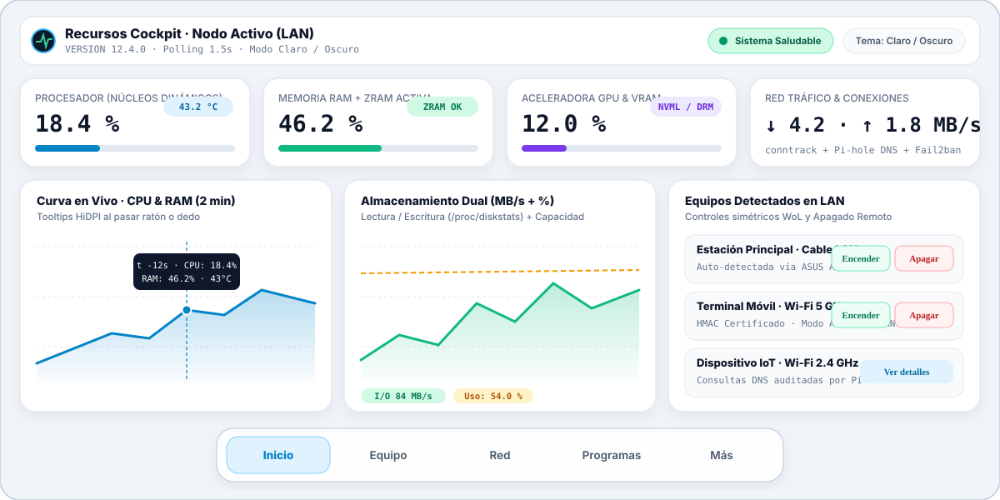
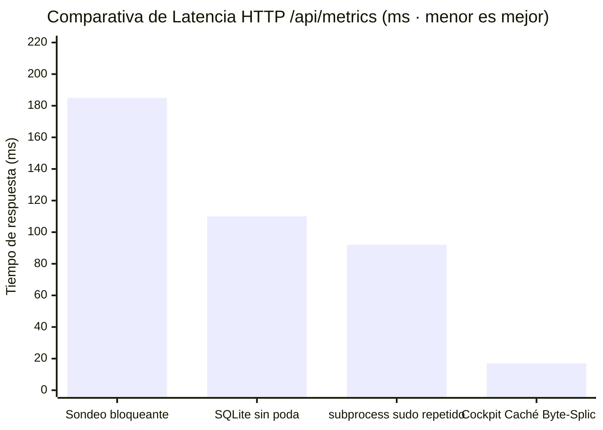
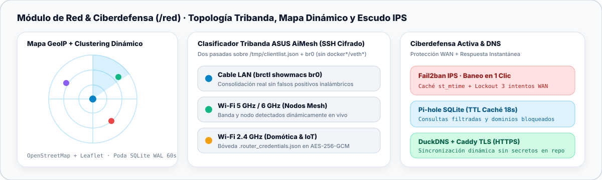
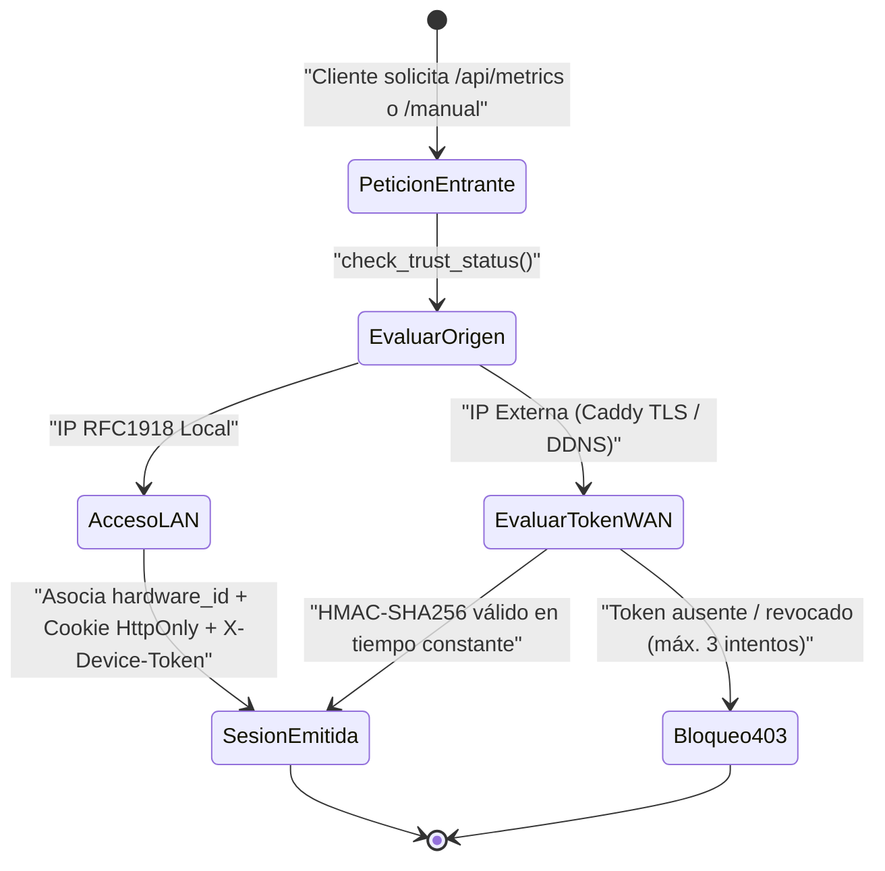
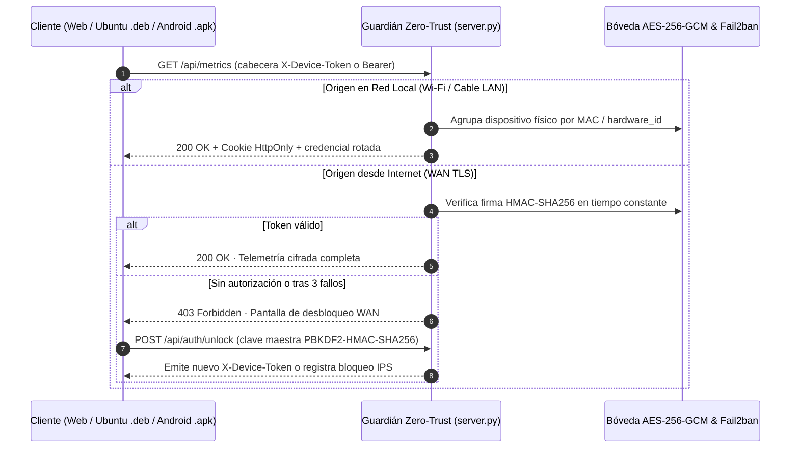

<div align="center">

<a href="./docs/index.html">
  
</a>

# Panel de Recursos · Manual Interactivo (`v12.4.0`)

[](./VERSION)
[](./docs/index.html)
[](#-cap%C3%ADtulo-1--tour-visual-e-interactivo-por-las-5-pantallas)
[](#-cap%C3%ADtulo-4--manual-de-aplicaciones-nativas-deb--apk-y-dex-usb)
[](#-cap%C3%ADtulo-4--manual-de-aplicaciones-nativas-deb--apk-y-dex-usb)
[](#-cap%C3%ADtulo-3--topolog%C3%ADa-aimesh-mapa-geoip-y-zero-trust)

<p align="center">
  <b>Guía visual e interactiva paso a paso de Recursos Cockpit</b>: abre cualquier tarjeta desplegable de este documento para aprender a usar cada gráfica, simulador, herramienta de red, endpoint REST y cliente nativo. Si prefieres probar simuladores en vivo sobre <code>&lt;canvas&gt;</code> y consultar tu propio servidor en directo, accede al <a href="./docs/index.html"><b>Manual HTML5 Interactivo</b></a> (o visita <code>/manual</code> desde el panel).
</p>

</div>

---

## 🧭 Índice Interactivo del Manual

<table>
  <tr>
    <td width="33%" valign="top">
      <b>📺 1. Tour por las 5 Pantallas</b><br/>
      Aprende a interpretar cada tarjeta Bento, curva HiDPI, tooltip flotante y control de <code>/inicio</code>, <code>/equipo</code>, <code>/red</code>, <code>/programas</code> y <code>/mas</code>.<br/><br/>
      <a href="#-cap%C3%ADtulo-1--tour-visual-e-interactivo-por-las-5-pantallas">Ir al Capítulo 1 →</a>
    </td>
    <td width="33%" valign="top">
      <b>⚡ 2. Arquitectura y Caché ~17 ms</b><br/>
      Explora las 3 capas desacopladas, la comparativa visual de latencia, los 8 recolectores daemon y el acceso al kernel sin spam <code>sudo</code>.<br/><br/>
      <a href="#-cap%C3%ADtulo-2--motor-de-telemetr%C3%ADa-y-arquitectura-en-3-capas">Ir al Capítulo 2 →</a>
    </td>
    <td width="33%" valign="top">
      <b>🛡️ 3. Red Mesh y Zero-Trust</b><br/>
      Entiende el mapa GeoIP dinámico, la detección real <code>Cable LAN</code> / <code>5 GHz</code> / <code>2.4 GHz</code>, HMAC-SHA256 y la bóveda <code>AES-256-GCM</code>.<br/><br/>
      <a href="#-cap%C3%ADtulo-3--topolog%C3%ADa-aimesh-mapa-geoip-y-zero-trust">Ir al Capítulo 3 →</a>
    </td>
  </tr>
  <tr>
    <td width="33%" valign="top">
      <b>📱 4. Apps Nativas y DeX USB</b><br/>
      Domina el lanzador de Ubuntu (<code>.deb</code>), la conmutación automática <code>LAN ↔ WAN</code>, Android Zero-Config y <b>Pantalla móvil USB (DeX)</b>.<br/><br/>
      <a href="#-cap%C3%ADtulo-4--manual-de-aplicaciones-nativas-deb--apk-y-dex-usb">Ir al Capítulo 4 →</a>
    </td>
    <td width="33%" valign="top">
      <b>🔌 5. Explorador de API REST</b><br/>
      Despliega cada endpoint con su comando <code>curl</code> listo para probar y la estructura JSON exacta devuelta por el backend.<br/><br/>
      <a href="#-cap%C3%ADtulo-5--explorador-interactivo-de-endpoints-rest">Ir al Capítulo 5 →</a>
    </td>
    <td width="33%" valign="top">
      <b>📦 6. Descargas y Despliegue</b><br/>
      Descarga los instaladores oficiales <code>12.4.0</code>, configura <code>systemd</code> con capacidades POSIX y consulta las diferencias clave de arquitectura.<br/><br/>
      <a href="#-cap%C3%ADtulo-6--descargas-oficiales-e-instalaci%C3%B3n-guiada">Ir al Capítulo 6 →</a>
    </td>
  </tr>
</table>

> [!TIP]
> **¿Buscas el manual interactivo con gráficos `<canvas>` ejecutándose en directo?**
> 1. **Desde tu servidor**: abre `http://<tu-nodo>:8085/manual` (o `/readme`), o entra dentro de la interfaz en **Más → Manual interactivo**.
> 2. **Offline o desde navegador**: abre [`./docs/index.html`](./docs/index.html) o el [**Manual Web en GitHub Pages**](https://cminewaria.github.io/recursos-ui/) con buscador instantáneo (`Ctrl+K`), simulador HiDPI de CPU/RAM/Disco, gráfico Donut interactivo y consola REST en vivo.

---

## 📺 Capítulo 1 · Tour Visual e Interactivo por las 5 Pantallas



Toda la plataforma se organiza en **5 vistas simétricas** conectadas por una barra inferior táctil fija. Su diseño se adapta automáticamente a cualquier ventana o resolución mediante `ResizeObserver`, manteniendo la información cotidiana al frente y los detalles avanzados de ingeniería ordenados en desplegables (*Ver detalles técnicos*).

<details open>
<summary><b>🟢 Vista 1 · <code>/inicio</code> — Tablero Principal, Almacenamiento Dual y Control de Equipos</b> <i>(Desplegado por defecto · Pulsa otras vistas para explorar)</i></summary>

1. **Barra de Estado y Tema**: Muestra el modo de conexión (`LAN` directa o `WAN` cifrada TLS), la salud agregada del sistema y el botón para alternar entre diseño **Claro Minimalista** y **Modo Oscuro** (`recursos_theme`).
2. **Tarjetas KPI Instantáneas (`1.5s`)**: Lecturas numéricas tabulares (`tabular-nums`) de procesador, memoria RAM + ZRAM, GPU/VRAM y tráfico de red saliente/entrante.
3. **Gráficas HiDPI de 20 Minutos con Escalas X/Y y Pico Máximo Automático**: Todas las gráficas en vivo muestran exactamente los últimos **20 minutos** en cubetas de `5s` que preservan picos reales, incorporan **escala horaria visible (eje X)** y **escala de datos/velocidad (eje Y)**, y en velocidades de disco y red autoajustan el techo de la escala exactamente al **punto más alto registrado en esos 20 minutos** refrescándose al instante. Al pulsar sobre cualquier gráfica se abre la **Pantalla de Inspección Táctil** para retroceder por todo el historial guardado en `recursos_history.db`.
4. **Encendido y Apagado Simétrico de Equipos**: Junto a cada equipo detectado dinámicamente en la LAN dispones de dos botones simétricos:
   - **`Encender`**: envía paquetes mágicos **Wake-on-LAN (WoL)** a todas las subredes activas.
   - **`Apagar`**: abre confirmación segura y lanza señal remota **Sleep-on-LAN / SSH `BatchMode` / RPC / Webhook**, protegiendo automáticamente al propio servidor anfitrión frente a auto-apagados accidentales.

</details>

<details>
<summary><b>🔵 Vista 2 · <code>/equipo</code> — Silicio por Núcleo, ZRAM, Térmica Dinámica y Procesos</b></summary>

1. **Descubrimiento Dinámico de Hardware (`Zero-Hardcoding`)**: Los hilos lógicos del procesador, sensores térmicos (`/sys/class/hwmon`, `/sys/class/thermal`), GPUs (NVIDIA `NVML` / `sysfs DRM`) y particiones físicas (`psutil.disk_partitions(all=True)`) se detectan al vuelo sin listas estáticas.
2. **Desglose RAM + ZRAM**: Separa memoria física ocupada, caché recuperable y tasa de compresión ZRAM activa.
3. **Tabla de Procesos y Detalles Técnicos**: Ordenación en tiempo real por consumo CPU o memoria RAM, con PID, usuario e identificador agrupados bajo el desplegable *Ver detalles técnicos* para mantener la vista limpia.

</details>

<details>
<summary><b>🟣 Vista 3 · <code>/red</code> — Mapa Geoespacial, ASUS AiMesh, Pi-hole DNS y Escudo Fail2ban</b></summary>

1. **Mapa OpenStreetMap + Leaflet con Clustering Dinámico**: Agrupa automáticamente las conexiones remotas activas según coordenadas calculadas en vivo (`GeoIP` + `conntrack`), mostrando latencia, ISP, ASN y flujo de red sin nombres ni ciudades hardcodeadas.
2. **Auditoría ASUS AiMesh en 2 Pasadas**: Distingue con precisión clientes conectados por **`Cable LAN`** (via `brctl showmacs br0`), **`Wi-Fi 5 GHz / 6 GHz`** y **`Wi-Fi 2.4 GHz`**, ocultando interfaces virtuales de contenedor (`docker*`, `br-*`, `veth*`, `tailscale*`).
3. **Filtros DNS y Baneo en 1 Clic**: Integra estadísticas de **Pi-hole** (con caché TTL de `18s` para cero contención SQLite), estado de sincronización **DuckDNS** y listado de cárceles **Fail2ban** con botones de baneo/desbaneo inmediato.

</details>

<details>
<summary><b>🟠 Vista 4 · <code>/programas</code> — Docker, Unidades Systemd, qBittorrent, Emby y Bot Telegram</b></summary>

1. **Contenedores Docker e Hilos Systemd**: Monitoriza el estado real (`active` / `running`), consumo numérico seguro de CPU/RAM e imagen de cada contenedor, permitiendo reiniciar servicios autorizados con confirmación.
2. **Ecosistema Multimedia (`qBittorrent` y `Emby`)**: Muestra progreso porcentual normalizado (`0..100 %`), velocidades de descarga/subida, catálogo indexado y añadidos recientes.
3. **Control del Bot de Telegram**: Estado en vivo (`online`/`running`), marca temporal de última actividad, gestión de lista blanca autorizada y prueba de envío de alertas.

</details>

<details>
<summary><b>⚙️ Vista 5 · <code>/mas</code> — Actualizador GitHub OTA, Dispositivos HMAC, Manual Interactivo y DeX USB</b></summary>

1. **Actualizador GitHub OTA**: Compara el commit local y remoto de forma asíncrona (`get_version_info_cached_async()`), realiza respaldo de cambios si es necesario y aplica la actualización evitando bucles repetitivos mediante cooldown.
2. **Inventario Agrupado de Dispositivos (`HMAC`)**: Agrupa clientes navegadores y apps nativas bajo el mismo dispositivo físico (`MAC` / `hardware_id`) mostrando su certificado vigente y nivel de acceso (`FULL_NATIVE_ACCESS` vs `WEB_SANDBOX`).
3. **Manual Interactivo Embebido**: Integra directamente `/manual` dentro del panel sin salir de la sesión y sincronizando el tema Claro/Oscuro vía `postMessage`.
4. **Pantalla Móvil USB (`DeX` — Exclusivo Ubuntu `.deb`)**: Desbloquea resolución, tasa a `60 FPS`, auto-conexión USB y pantalla completa únicamente en la aplicación nativa de Ubuntu Linux.

</details>

---

## ⚡ Capítulo 2 · Motor de Telemetría y Arquitectura en 3 Capas


Para evitar bloqueos cuando múltiples navegadores y aplicaciones consultan `/api/metrics` a la vez, [`server.py`](./server.py) separa completamente la **recolección en segundo plano** de la **respuesta HTTP**:



<details>
<summary><b>🔬 Inspeccionar los 3 mecanismos clave de optimización en <code>server.py</code></b></summary>

1. **Empalme Atómico de Bytes (`METRICS_CACHE_BYTES`)**:
   - El hilo recolector central `background_collector()` ensambla y serializa una única vez cada `1.5s` la instantánea completa de CPU, RAM, GPU, discos, red, Docker, `version_info`, `custom_logos` y `maps_engine`.
   - Cada petición `GET /api/metrics` responde en **~17 ms** inyectando únicamente el estado específico de sesión del cliente (*byte-splicing*) sin re-serializar todo el diccionario JSON.
2. **Erradicación del Spam `sudo` PAM mediante Capacidades POSIX**:
   - Al ejecutar `server.py` bajo `systemd` con `AmbientCapabilities=CAP_NET_ADMIN CAP_DAC_READ_SEARCH CAP_SYS_PTRACE`, el servidor lee sockets (`ss -tulpn -H`) y tabla de conexiones (`conntrack -L`) directamente a nivel kernel.
   - El uso de `sudo -n` queda estrictamente reservado como respaldo automático en entornos sin capacidades configuradas.
3. **Base de Datos Unificada SQLite WAL (`recursos_history.db`) + Persistencia Incremental**:
   - La base de datos `recursos_history.db` **se crea automáticamente al instalar** y **nunca se sobrescribe ni reinicia al actualizar**: cualquier actualización de código o del paquete `.deb` la mantiene intacta añadiendo únicamente nuevas filas en `geoip_locations`, `connection_history` y `telemetry_history` (y migrando sin pérdidas un `geoip_history.db` previo si existiera).
   - Opera en modo `WAL` con buffering de muestras y poda acotada cada `60s`, además de caché `/var/log/fail2ban.log` por par `(st_mtime, st_size)` y TTL de `18s` en consultas Pi-hole.

</details>

---

## 🛡️ Capítulo 3 · Topología AiMesh, Mapa GeoIP y Zero-Trust



### Flujo Interactivo de Autenticación `LAN ↔ WAN`





<details>
<summary><b>🔐 Cómo se protegen tus credenciales del router, claves maestras y tokens sin texto plano</b></summary>

1. **Bóveda Cifrada `AES-256-GCM` para ASUS AiMesh**:
   - Las credenciales SSH guardadas en `.router_credentials.json` (`0600`) nunca se leen desde valores fijos en el código ni pasan como argumentos visibles (`sshpass -p`), sino que se descifran en memoria usando una clave derivada vía `PBKDF2-HMAC-SHA256` (`200.000` iteraciones) ligada a `.admin_master_key` y `/etc/machine-id`, pasando al subproceso vía `SSHPASS` privado.
2. **Clave Maestra Generada Localmente y Modo Dual**:
   - Si no existe una clave maestra previa, el nodo genera automáticamente `.admin_master_key` (`0600`) única por instalación, junto con una clave secundaria protegida mediante hash salado `PBKDF2-HMAC-SHA256`.
3. **Tokens Nunca Expuestos**:
   - Endpoints sensibles como DuckDNS nunca devuelven el token completo al frontend, exponiendo únicamente indicadores seguros (`token_set` y `token_masked`).

</details>

---

## 📱 Capítulo 4 · Manual de Aplicaciones Nativas (`.deb` / `.apk`) y DeX USB


Las aplicaciones nativas siguen el **Principio Contractual de Paridad y Simetría Total**: todas ejecutan exactamente el mismo motor HTML5 (`static/index.html` y `static/manual.html`) dentro de un contenedor acelerado por hardware propio de cada sistema operativo.

| Característica | Interfaz Web SPA | App Nativa Ubuntu (`.deb`) | App Nativa Android (`.apk`) |
| :--- | :--- | :--- | :--- |
| **Contenedor Nativo** | Navegador Web Moderno | `GTK 3` + `WebKit2` + `LocalHtmlBridgeServer` | `Jetpack Compose` + `android.webkit.WebView` |
| **Detección del Nodo** | Manual por URL / IP | Escaneo LAN / `mDNS` + Lanzador 3 tarjetas | Escaneo automático en segundo plano (Zero-Config) |
| **Almacén de Credenciales** | `Cookie HttpOnly` + `localStorage` | Configuración protegida / Keyring local | `Android KeyStore` + `EncryptedSharedPreferences` |
| **Conmutación `LAN ↔ WAN`** | Según ruta accedida | IP LAN mínima latencia ↔ DDNS WAN cifrado | Automática al cambiar entre Wi-Fi local y 4G/5G |
| **Actualización OTA en Sitio** | Refresco del servidor o botón unificado | Botón único inteligente (`check_github_app_update()` + `perform_unified_update()`) que compara App Ubuntu, Servidor web local y GitHub, y actualiza la web local en caliente si la app supera a GitHub o al servidor | Keystore oficial permanente (`v1/v2/v3`, sin desinstalar) |
| **Pantalla Móvil USB (`DeX`)** | Oculto por arquitectura | **Desbloqueado en exclusiva** (`adb`, `scrcpy`, `/dev/uhid`) | Oculto por arquitectura |

<details>
<summary><b>🐧 Guía paso a paso · App Nativa Ubuntu (<code>.deb</code>) y Lanzador en 3 Tarjetas</b></summary>

1. **Tarjeta 1 · Conectar con el nodo**: Busca automáticamente tu servidor en la red local o utiliza el dominio DDNS guardado para conmutar a WAN cuando sales de casa.
2. **Tarjeta 2 · Nodo local y actualización unificada en un clic**: Compara automáticamente las tres versiones (**App Ubuntu**, **Servidor web local** y **GitHub Releases**) mediante SemVer:
   - Si GitHub es superior a la App Ubuntu, descarga el `.deb` oficial con firma GPG + `SHA256SUMS.txt` y lo instala sin desinstalar ni perder tokens.
   - Si la **App Ubuntu y/o GitHub** superan al servidor local (incluso cuando tu App Ubuntu es más reciente que la publicada en GitHub), el mismo botón único sincroniza la web compilada directamente al servidor vía `POST /api/system/sync-web` en caliente sin sobrescribir `recursos_history.db`.
3. **Tarjeta 3 · Configuraciones y Verificación CLI**: Puedes verificar todo el entorno nativo y el puente loopback sin abrir ventana ejecutando:
   ```bash
   /usr/bin/recursos-cockpit --test-mode
   ```

</details>

<details>
<summary><b>📲 Guía paso a paso · Cómo usar Pantalla Móvil USB (Samsung DeX / Android Desktop) en Ubuntu</b></summary>

1. Conecta tu teléfono Android compatible mediante cable USB a tu equipo Ubuntu con **Depuración USB** activada y abre **Recursos Cockpit** desde el menú de aplicaciones (`.deb`).
2. Entra en **Más → Pantalla móvil USB (DeX)** *(este submenú permanece bloqueado en la versión web y Android por seguridad de acceso hardware)*.
3. Selecciona la resolución objetivo, activa si lo deseas **60 FPS**, **Auto-conexión USB** o **Pantalla completa** y pulsa **Iniciar**: `desktop_app/recursos_app.py` lanzará `scrcpy` en modo `--new-display` con entrada HID directa (`/dev/uhid`) encapsulada de forma segura.

</details>

---

## 🔌 Capítulo 5 · Explorador Interactivo de Endpoints REST

Despliega cualquiera de las rutas principales para ver su comando listo para ejecutar y la respuesta JSON de referencia:

<details>
<summary><b><code>GET /api/metrics</code></b> — Telemetría unificada completa en ~17 ms</summary>

```bash
curl -fsS -H "X-Device-Token: $TOKEN" http://127.0.0.1:8085/api/metrics | jq '{version_info, cpu: .cpu.usage_percent, memory: .memory.percent}'
```
```json
{
  "version_info": {
    "current_version": "12.4.0",
    "display_version": "12.4.0",
    "local_commit": "HEAD",
    "update_available": false
  },
  "cpu": { "usage_percent": 14.2, "temp_c": 43.0 },
  "memory": { "percent": 46.5 }
}
```

</details>

<details>
<summary><b><code>GET /api/metrics/history?window_sec=3600&amp;limit=240</code></b> — Historial persistente de consumo para Inspección Táctil</summary>

```bash
curl -fsS -H "X-Device-Token: $TOKEN" "http://127.0.0.1:8085/api/metrics/history?window_sec=3600&limit=240" | jq '{ok, db_file, total_samples, returned_samples, has_older}'
```
```json
{
  "ok": true,
  "db_file": "recursos_history.db",
  "total_samples": 18420,
  "returned_samples": 240,
  "has_older": true
}
```

</details>

<details>
<summary><b><code>GET /api/version</code></b> — Versión canónica desde <code>./VERSION</code>, commit Git y estado OTA</summary>

```bash
curl -fsS http://127.0.0.1:8085/api/version | jq .
```
```json
{
  "current_version": "12.4.0",
  "display_version": "12.4.0",
  "branch": "main",
  "local_commit": "HEAD",
  "update_available": false
}
```

</details>

<details>
<summary><b><code>GET /manual</code> · <code>/manual.html</code> · <code>/readme</code></b> — Manual Web Interactivo HTML5 con simuladores</summary>

```bash
curl -I http://127.0.0.1:8085/manual
```
Sirve [`static/manual.html`](./static/manual.html) (con respaldo [`docs/index.html`](./docs/index.html)) inyectando `window.__INITIAL_APP_VERSION__ = "12.4.0"`, tanto desde `server.py` como desde el servidor puente nativo `LocalHtmlBridgeServer` de Ubuntu.

</details>

<details>
<summary><b><code>GET /api/system/logs?limit=10</code></b> — Agregador unificado de fallos Systemd, Docker y Kernel</summary>

```bash
curl -fsS -H "X-Device-Token: $TOKEN" "http://127.0.0.1:8085/api/system/logs?limit=10" | jq .
```
```json
{
  "ok": true,
  "total_errors": 0,
  "counts_by_category": { "systemd": 0, "docker": 0, "kernel": 0 },
  "entries": []
}
```

</details>

<details>
<summary><b><code>POST /api/wol/wake</code> y <code>POST /api/wol/shutdown</code></b> — Encendido y apagado remoto multicanal</summary>

```bash
# Encender equipo remoto por MAC
curl -fsS -X POST -H "Content-Type: application/json" -H "X-Device-Token: $TOKEN" \
  -d '{"mac":"AA:BB:CC:DD:EE:FF","ip":"192.168.1.50"}' \
  http://127.0.0.1:8085/api/wol/wake

# Enviar señal de apagado remoto seguro (Webhook / SSH / RPC / Sleep-on-LAN)
curl -fsS -X POST -H "Content-Type: application/json" -H "X-Device-Token: $TOKEN" \
  -d '{"ip":"192.168.1.50","mac":"AA:BB:CC:DD:EE:FF"}' \
  http://127.0.0.1:8085/api/wol/shutdown
```

</details>

<details>
<summary><b><code>GET /api/dex/status</code> · <code>POST /api/dex/start</code> · <code>POST /api/fail2ban/ban</code></b> — Control USB DeX e IPS</summary>

```bash
# Comprobar dispositivos USB ADB / scrcpy en la app Ubuntu
curl -fsS http://127.0.0.1:8085/api/dex/status | jq .

# Bloquear una IP abusiva desde el mapa o panel IPS
curl -fsS -X POST -H "Content-Type: application/json" -H "X-Device-Token: $TOKEN" \
  -d '{"ip":"203.0.113.10","jail":"sshd"}' \
  http://127.0.0.1:8085/api/fail2ban/ban
```

</details>

---

## 📦 Capítulo 6 · Descargas Oficiales e Instalación Guiada

| Paquete Oficial | Plataforma | Descarga Directa (`v12.4.0`) | Integridad y Firma |
| :--- | :--- | :--- | :--- |
| **🐧 Recursos Cockpit (`.deb`)** | Ubuntu / Debian `amd64` | [**`recursos-cockpit_12.4.0_amd64.deb`**](https://github.com/cminewarIA/recursos-ui/releases/download/v12.4.0/recursos-cockpit_12.4.0_amd64.deb) | Firma GPG (`_gpgorigin` + `.asc`) · [SHA256SUMS.txt](https://github.com/cminewarIA/recursos-ui/releases/download/v12.4.0/SHA256SUMS.txt) |
| **🤖 Recursos Cockpit (`.apk`)** | Android 8.0+ | [**`recursos-cockpit_12.4.0.apk`**](https://github.com/cminewarIA/recursos-ui/releases/download/v12.4.0/recursos-cockpit_12.4.0.apk) | Keystore Permanente (`v1/v2/v3`) |
| **⚡ Enlaces `latest`** | Última Release | [`.deb Latest`](https://github.com/cminewarIA/recursos-ui/releases/latest/download/recursos-cockpit.deb) · [`.apk Latest`](https://github.com/cminewarIA/recursos-ui/releases/latest/download/recursos-cockpit.apk) | Actualización directa sobre versión previa |

<details>
<summary><b>🛠️ Asistente Paso a Paso · Instalar Apps Nativas o Desplegar el Servidor desde Cero (Zero-Hardcoding)</b></summary>

#### Opción A · Instalar o actualizar la App Nativa en Ubuntu / Debian y Android
```bash
# Ubuntu / Debian (actualiza encima conservando autodescubrimiento y tokens)
sudo apt-get install --reinstall -y ./dist/recursos-cockpit_12.4.0_amd64.deb
/usr/bin/recursos-cockpit --test-mode

# Android vía ADB (conserva enlace en Android KeyStore)
adb install -r dist/recursos-cockpit_12.4.0.apk
```

#### Opción B · Desplegar tu propio Servidor en cualquier máquina Linux
```bash
git clone https://github.com/cminewarIA/recursos-ui.git /opt/recursos-cockpit
cd /opt/recursos-cockpit

pip3 install -r requirements.txt || pip3 install psutil
npm install && npm run build

# Generar el paquete .deb local desde ./VERSION e instalarlo
bash packaging/build_deb.sh
sudo apt-get install --reinstall -y ./dist/recursos-cockpit_$(cat VERSION)_amd64.deb
```

#### Opción C · Unidad `systemd` sin spam `sudo` y Proxy TLS con `Caddy`
`/etc/systemd/system/system-dashboard.service`:
```ini
[Unit]
Description=Recursos Cockpit - Telemetría Linux y Ciberdefensa Zero-Trust
After=network-online.target
Wants=network-online.target

[Service]
Type=simple
User=servidor
WorkingDirectory=/opt/recursos-cockpit
AmbientCapabilities=CAP_NET_ADMIN CAP_DAC_READ_SEARCH CAP_SYS_PTRACE
CapabilityBoundingSet=CAP_NET_ADMIN CAP_DAC_READ_SEARCH CAP_SYS_PTRACE
ExecStart=/usr/bin/python3 /opt/recursos-cockpit/server.py
Restart=always
RestartSec=3

[Install]
WantedBy=multi-user.target
```

`/etc/caddy/Caddyfile`:
```caddy
tu-subdominio.duckdns.org {
    reverse_proxy 127.0.0.1:8085
}
```

</details>

---

## 📏 Capítulo 7 · Reglas de Ingeniería y Diferencias de Arquitectura

Todo el proyecto se rige por [`./GEMINI.md`](./GEMINI.md) manteniendo [`./VERSION`](./VERSION) como **única fuente de verdad** propagada automáticamente a [`package.json`](./package.json), [`packaging/debian/control`](./packaging/debian/control), Android Gradle, [`server.py`](./server.py), [`desktop_app/recursos_app.py`](./desktop_app/recursos_app.py), React 19 y [`static/manual.html`](./static/manual.html):

* **`X.0.0` (`MAJOR`)**: Rediseño completo global de toda la aplicación.
* **`0.X.0` (`MINOR`)**: Adición, retiro o rediseño completo de una funcionalidad o vista concreta.
* **`0.0.X` (`PATCH`)**: Optimización interna, corrección de errores, reglas o mejoras documentales.

<details open>
<summary><b>🔄 Diferencias Clave de la Versión Actual (<code>v12.4.0</code>) frente a Arquitecturas Anteriores</b></summary>

| Ámbito | Arquitectura Anterior | Versión Actual (`v12.4.0`) |
| :--- | :--- | :--- |
| **Actualización Triple y Sincronización Web Ubuntu** | La app de Ubuntu comprobaba únicamente GitHub frente al paquete `.deb` instalado y requería `git pull` en el servidor para actualizar la interfaz web. | **Detección Triple (`App Ubuntu · Servidor web local · GitHub`) en un solo botón**: detecta automáticamente si la App Ubuntu y/o GitHub superan al servidor local (incluido cuando la App supera a GitHub) y sincroniza la web local en caliente mediante `POST /api/system/sync-web` verificado con SHA-256 sin tocar `recursos_history.db` ni exigir `.git`. |
| **Interfaz, Gráficas y Escalas** | Gráficas limitadas a 60 muestras recientes sin ejes ni marcas de escala, con topes redondeados estáticos y sin retroceso en el visor ampliado. | **Ventana unificada de 20 minutos + Escalas X/Y + Autoescala de Pico + Inspección Táctil**: todas las gráficas muestran los últimos 20 minutos (cubetas de 5s pico-preservantes), eje temporal X (`HH:MM`), eje de magnitud/velocidad Y y techo dinámico igual al pico máximo exacto de esos 20 minutos; además, el visor ampliado permite retroceder por todo el historial guardado en `recursos_history.db`. |
| **Persistencia Unificada (`SQLite`)** | Base de datos dedicada únicamente a DNS/GeoIP (`geoip_history.db`) sin series temporales de hardware. | Base de datos unificada **`recursos_history.db` (SQLite WAL)** creada al instalar e intacta tras cada actualización (nunca se sobrescribe; solo añade/actualiza registros en `geoip_locations`, `connection_history` y `telemetry_history`), consultable vía `GET /api/metrics/history`. |
| **Mapa Geoespacial GeoIP** | Dependencia dual con selector y variables de clave de API (`Google Maps Platform`). | Motor único **100 % libre sobre OpenStreetMap / CartoDB (`Leaflet`)** sin API Key, cambio dinámico de tema claro/oscuro y respaldo automático a `tile.openstreetmap.org`. |
| **Telemetría y Permisos Linux** | Invocaciones periódicas de `sudo` (ruido PAM en logs), lectura de disco sin historial y serialización completa por petición. | Capacidades POSIX `CAP_NET_ADMIN`, poda SQLite acotada cada `60s`, caché atómica `METRICS_CACHE_BYTES` (~17 ms), serie `disk_pct` real y filtrado tribanda ASUS AiMesh + Docker. |
| **Seguridad de Credenciales** | Credenciales de router en texto plano y paso directo por línea de comandos. | Bóveda cifrada **AES-256-GCM (`PBKDF2-HMAC-SHA256`)**, paso seguro vía entorno `SSHPASS` y tokens `HMAC-SHA256` por dispositivo físico (`LAN ↔ WAN`). |
| **Documentación y Manual** | `README.md` de texto plano extenso con listados acumulados de versiones pasadas. | **Manual Visual e Interactivo** en `README.md` (5 SVGs Claro/Oscuro) y app web autocontenida (`/manual`, `/readme`, `docs/index.html`) enfocada únicamente en la versión vigente y sus diferencias arquitectónicas. |

</details>

---

<div align="center">
  Distribuido bajo licencia <b>MIT</b> · Consulta el <a href="./docs/index.html"><b>Manual HTML5 Interactivo</b></a> para probar simuladores HiDPI y la API REST en directo.
</div>
