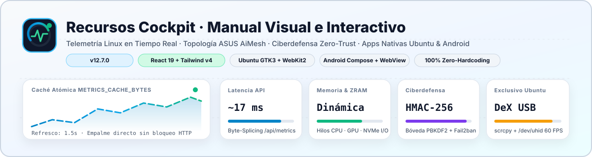
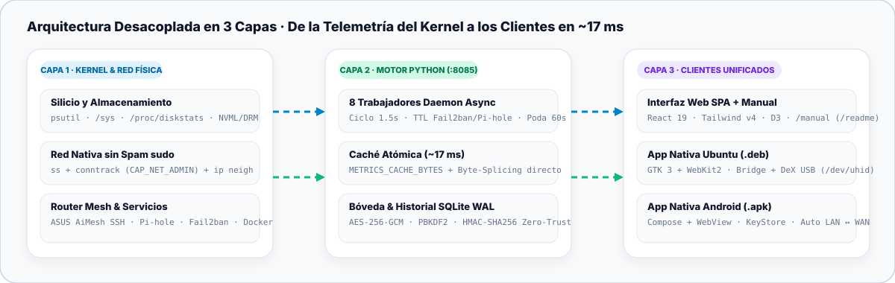
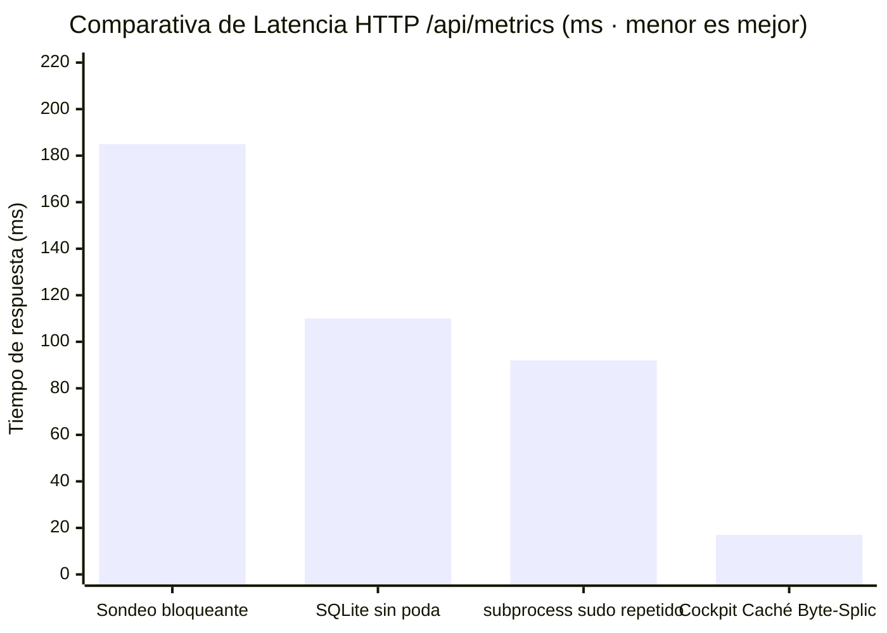
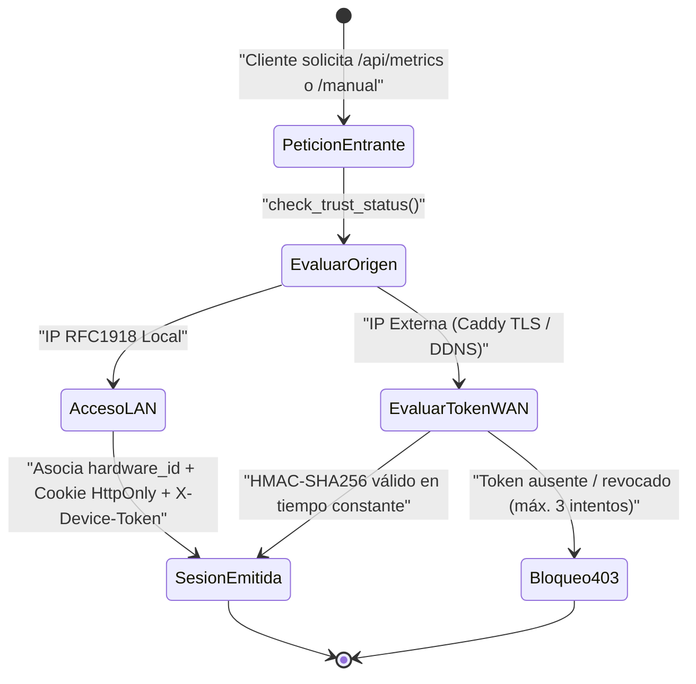
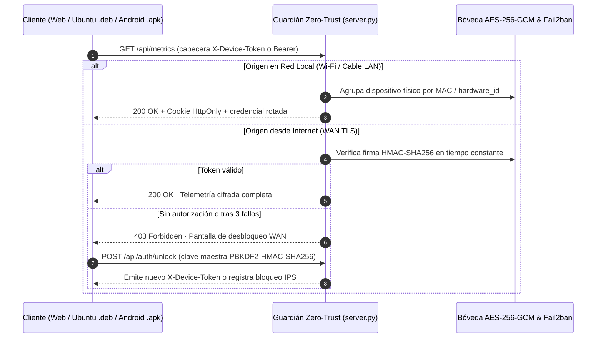
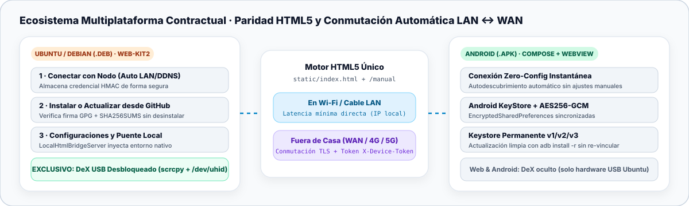

<div align="center">

<a href="./docs/index.html">
  
</a>

# Panel de Recursos · Manual Interactivo (`Recursos Cockpit`)

[](./VERSION)
[](./docs/index.html)
[](#-cap%C3%ADtulo-1--tour-visual-e-interactivo-por-las-5-pantallas)
[](#-cap%C3%ADtulo-4--manual-de-aplicaciones-nativas-deb--apk-y-dex-usb)
[](#-cap%C3%ADtulo-4--manual-de-aplicaciones-nativas-deb--apk-y-dex-usb)
[](#-cap%C3%ADtulo-3--topolog%C3%ADa-aimesh-mapa-geoip-y-zero-trust)

<p align="center">
  <b>Guía visual e interactiva paso a paso de Recursos Cockpit</b>: abre cualquier tarjeta desplegable de este documento para aprender a usar cada gráfica, simulador, herramienta de red, endpoint REST y cliente nativo. Si prefieres probar simuladores en vivo sobre <code>&lt;canvas&gt;</code> y consultar tu propio servidor en directo, accede al <a href="./docs/index.html"><b>Manual HTML5 Interactivo</b></a> (o visita <code>/manual</code> desde el panel).
</p>

</div>

---

## 🧭 Índice Interactivo del Manual

<table>
  <tr>
    <td width="33%" valign="top">
      <b>📺 1. Tour por las 5 Pantallas</b><br/>
      Aprende a interpretar cada tarjeta Bento, curva HiDPI, tooltip flotante y control de <code>/inicio</code>, <code>/equipo</code>, <code>/red</code>, <code>/programas</code> y <code>/mas</code>.<br/><br/>
      <a href="#-cap%C3%ADtulo-1--tour-visual-e-interactivo-por-las-5-pantallas">Ir al Capítulo 1 →</a>
    </td>
    <td width="33%" valign="top">
      <b>⚡ 2. Arquitectura y Caché ~17 ms</b><br/>
      Explora las 3 capas desacopladas, la comparativa visual de latencia, los 8 recolectores daemon y el acceso al kernel sin spam <code>sudo</code>.<br/><br/>
      <a href="#-cap%C3%ADtulo-2--motor-de-telemetr%C3%ADa-y-arquitectura-en-3-capas">Ir al Capítulo 2 →</a>
    </td>
    <td width="33%" valign="top">
      <b>🛡️ 3. Red Mesh y Zero-Trust</b><br/>
      Entiende el mapa GeoIP dinámico, la detección real <code>Cable LAN</code> / <code>5 GHz</code> / <code>2.4 GHz</code>, HMAC-SHA256 y la bóveda <code>AES-256-GCM</code>.<br/><br/>
      <a href="#-cap%C3%ADtulo-3--topolog%C3%ADa-aimesh-mapa-geoip-y-zero-trust">Ir al Capítulo 3 →</a>
    </td>
  </tr>
  <tr>
    <td width="33%" valign="top">
      <b>📱 4. Apps Nativas y DeX USB</b><br/>
      Domina el lanzador de Ubuntu (<code>.deb</code>), la conmutación automática <code>LAN ↔ WAN</code>, Android Zero-Config y <b>Pantalla móvil USB (DeX)</b>.<br/><br/>
      <a href="#-cap%C3%ADtulo-4--manual-de-aplicaciones-nativas-deb--apk-y-dex-usb">Ir al Capítulo 4 →</a>
    </td>
    <td width="33%" valign="top">
      <b>🔌 5. Explorador de API REST</b><br/>
      Despliega cada endpoint con su comando <code>curl</code> listo para probar y la estructura JSON exacta devuelta por el backend.<br/><br/>
      <a href="#-cap%C3%ADtulo-5--explorador-interactivo-de-endpoints-rest">Ir al Capítulo 5 →</a>
    </td>
    <td width="33%" valign="top">
      <b>📦 6. Descargas y Despliegue</b><br/>
      Descarga los instaladores oficiales publicados desde <a href="./VERSION"><code>./VERSION</code></a> (<code>releases/latest</code>), configura <code>systemd</code> con capacidades POSIX y consulta las diferencias clave de arquitectura.<br/><br/>
      <a href="#-cap%C3%ADtulo-6--descargas-oficiales-e-instalaci%C3%B3n-guiada">Ir al Capítulo 6 →</a>
    </td>
  </tr>
</table>

> [!TIP]
> **¿Buscas el manual interactivo con gráficos `<canvas>` ejecutándose en directo?**
> 1. **Desde tu servidor**: abre `http://<tu-nodo>:8085/manual` (o `/readme`), o entra dentro de la interfaz en **Más → Manual interactivo**.
> 2. **Offline o desde navegador**: abre [`./docs/index.html`](./docs/index.html) o el [**Manual Web en GitHub Pages**](https://cminewaria.github.io/recursos-ui/) con buscador instantáneo (`Ctrl+K`), simulador HiDPI de CPU/RAM/Disco, gráfico Donut interactivo y consola REST en vivo.

---

## 📺 Capítulo 1 · Tour Visual e Interactivo por las 5 Pantallas


Toda la plataforma se organiza en **5 vistas simétricas** conectadas por una barra inferior táctil fija. Su diseño de ancho completo (`.cockpit-shell`) aprovecha toda la pantalla en monitores medianos, grandes o ultrawide sin márgenes desperdiciados, adaptando automáticamente el número de widgets y tarjetas en paralelo (`.cockpit-auto-grid` y `.cockpit-auto-grid-cards`) mediante CSS Grid fluido y `ResizeObserver`, manteniendo la información cotidiana al frente y los detalles avanzados de ingeniería ordenados en desplegables (*Ver detalles técnicos*).

<details open>
<summary><b>🟢 Vista 1 · <code>/inicio</code> — Tablero Principal, Almacenamiento Independiente y Control de Equipos</b> <i>(Desplegado por defecto · Pulsa otras vistas para explorar)</i></summary>

1. **Cabecera Despejada sin Barra de Navegación Superior, Logotipo Ampliado y Tema**: Presenta el logotipo oficial **CMineWar** de gran formato (`80px` en móvil y `112px` en escritorio) con transparencia RGBA real directa sobre el lienzo (sin barra de navegación superior duplicada ni marco flotante que reste espacio vertical, concentrando toda la navegación en el dock inferior táctil), el modo de conexión (`LAN` directa o `WAN` cifrada TLS), transiciones animadas a `60 FPS` (`MorphPill`, `ViewStage`, valores tabulares animados) unificadas en las 4 interfaces (Web, Ubuntu GTK 3, Android Compose y Manual) y el botón para alternar entre diseño **Claro Minimalista** y **Modo Oscuro** (`recursos_theme`).
2. **Tarjetas KPI y Widgets Independientes en Paralelo Automático (`auto-fit`)**: Rejilla fluida simétrica (`1` columna en móvil, `2` en tablet/TV, `3` en portátil, `4` en monitores Full HD y más en QHD/Ultrawide) con gráficas HiDPI simultáneas de **5 minutos** para **Procesador (CPU)**, **Memoria RAM + ZRAM**, **GPU / Gráficos**, **Red e Internet** (4 curvas simultáneas segmentadas en tiempo real por IP destino/origen RFC1918: **Bajada Externa WAN**, **Subida Externa WAN**, **Bajada Interna LAN** y **Subida Interna LAN** con techo dinámico al pico máximo de 5 min, además del historial de consumo de 24 h) y **cada unidad de almacenamiento por separado** (discos internos NVMe/SATA, memorias extraíbles USB/SD y pool NAS deduplicado por `pool_key` sin multiplicar capacidad compartida) apareciendo y desapareciendo dinámicamente como widgets independientes completos.
3. **Gráficas HiDPI de 5 Minutos en Inicio con Curvas Limpias y Escalas X/Y**: Todas las gráficas de `/inicio` muestran los últimos **5 minutos** en cubetas de `5s` que preservan picos reales mediante interpolación monótona Fritsch–Carlson; mantienen la **curva fluida sin saturación de puntos**, mostrando el marcador vivo al final y el punto exacto de muestreo al inspeccionar **siempre encima de la línea**, con ejes X/Y visibles y la **Pantalla de Inspección Táctil** para ampliar o retroceder (`En vivo · 5 min`, `20 min`, `1 h`, `6 h`, `24 h`, `Todo`) por todo `recursos_history.db`.
4. **Encendido y Apagado Simétrico de Equipos**: Junto a cada equipo detectado dinámicamente en la LAN dispones de dos botones simétricos:
   - **`Encender`**: envía paquetes mágicos **Wake-on-LAN (WoL)** a todas las subredes activas.
   - **`Apagar`**: abre confirmación segura y lanza señal remota **Sleep-on-LAN / SSH `BatchMode` / RPC / Webhook**, protegiendo automáticamente al propio servidor anfitrión frente a auto-apagados accidentales.

</details>

<details>
<summary><b>🔵 Vista 2 · <code>/equipo</code> — Silicio por Núcleo, Multi-Gráfica GPU, ZRAM y Procesos por Recurso</b></summary>

1. **Descubrimiento Dinámico de Hardware (`Zero-Hardcoding`)**: Los hilos lógicos del procesador, sensores térmicos (`/sys/class/hwmon`, `/sys/class/thermal`), capacidades GPU (`nvidia-smi` XML + `pmon` / `sysfs DRM`) y particiones físicas (`psutil.disk_partitions(all=True)`) se detectan al vuelo sin listas estáticas.
2. **Multi-Gráfica Dinámica GPU y Desglose RAM + ZRAM**: En el apartado **Gráfica** se muestran sub-gráficas estilo monitor de sistema (**Cómputo 3D**, **VRAM y controlador**, **Video Enc/Dec**, **Potencia y temperatura**, **Relojes** y **Bus PCIe RX/TX**) activadas automáticamente según los sensores reales disponibles en la tarjeta gráfica instalada, mientras **Memoria** separa RAM ocupada, caché recuperable y tasa de compresión ZRAM.
3. **Procesos Consumidores Activos por Recurso e Inspección Táctil**: Debajo de cada gráfica en **Procesador**, **Memoria**, **Gráfica** y **Almacenamiento** —y también al pie de cada **ventana de inspección táctil** (`CPU`, `RAM`, `GPU`, `Almacenamiento` y `Red`)— se muestran los procesos que están consumiendo ese recurso concreto con su porcentaje (`%`) y magnitud real (núcleos/hilos, RAM privada, VRAM, tasa L/E por PID vía `/proc/<pid>/io` o sockets), además de la tabla completa ordenable en *Procesos* y detalles avanzados bajo *Ver detalles técnicos*.

</details>

<details>
<summary><b>🟣 Vista 3 · <code>/red</code> — Mapa Geoespacial, ASUS AiMesh, Pi-hole DNS y Escudo Fail2ban</b></summary>

1. **Mapa OpenStreetMap + Leaflet con Clustering Dinámico por Zoom, Polilíneas, Popup Maestro-Detalle y Tráfico por Conexión**: Agrupa y desagrupa dinámicamente las conexiones remotas públicas al acercar o alejar el mapa (`latLngToLayerPoint < 48px`, excluyendo IPs privadas LAN falsas), traza líneas de flujo (`L.polyline`) desde el nodo central del servidor, mantiene los popups abiertos durante los refrescos de telemetría mediante restauración multicriterio en 5 niveles (`clusterKey`, `remoteIp`, `representativeIp`, `clusterIps` y proximidad `< 5°`) e incorpora vista **Maestro-Detalle** para inspeccionar cada IP individual de un grupo (`◀ Ver todas las conexiones`), barra de filtros interactiva (`Todas`, `↓ Entrantes`, `↑ Salientes`, `Dispositivos`, `Bloqueadas`), buscador en vivo, traducción de dominios **Pi-hole** (`🌐 domain`) y dispositivos del hogar (`📱 local_hostname`), bloqueo/desbloqueo directo en **Fail2ban** y franja simétrica de velocidad en tiempo real (`↓ Descarga`, `↑ Carga`, `∑ Total`) por cada conexión.
2. **Auditoría ASUS AiMesh en 2 Pasadas**: Distingue con precisión clientes conectados por **`Cable LAN`** (via `brctl showmacs br0`), **`Wi-Fi 5 GHz / 6 GHz`** y **`Wi-Fi 2.4 GHz`**, ocultando interfaces virtuales de contenedor (`docker*`, `br-*`, `veth*`, `tailscale*`).
3. **Filtros DNS y Baneo en 1 Clic**: Integra estadísticas de **Pi-hole** (con caché TTL de `18s` para cero contención SQLite), estado de sincronización **DuckDNS** y listado de cárceles **Fail2ban** con botones de baneo/desbaneo inmediato.

</details>

<details>
<summary><b>🟠 Vista 4 · <code>/programas</code> — Docker, Unidades Systemd, qBittorrent, Emby y Bot Telegram</b></summary>

1. **Contenedores Docker e Hilos Systemd**: Monitoriza el estado real (`active` / `running`), consumo numérico seguro de CPU/RAM e imagen de cada contenedor, permitiendo reiniciar servicios autorizados con confirmación.
2. **Ecosistema Multimedia (`qBittorrent` y `Emby`)**: Muestra progreso porcentual normalizado (`0..100 %`), velocidades de descarga/subida, catálogo indexado y añadidos recientes.
3. **Control del Bot de Telegram**: Estado en vivo (`online`/`running`), marca temporal de última actividad, gestión de lista blanca autorizada y prueba de envío de alertas.

</details>

<details>
<summary><b>⚙️ Vista 5 · <code>/mas</code> — Actualizador GitHub OTA, Salud del Sistema, Dispositivos HMAC, Manual y DeX USB</b></summary>

1. **Actualizador GitHub OTA Resiliente y Salud del Sistema**: Compara la versión y el commit local/remoto de forma asíncrona (`get_version_info_cached_async()`), registra automáticamente `safe.directory` en Git, filtra artefactos de compilación (`static/index.html`, `dist/`, bases de datos SQLite y bóvedas JSON) para no bloquear jamás la auto-actualización local, y aplica un respaldo directo por tarball HTTPS (`codeload.github.com`) + reconstrucción del frontend si `git pull` falla o no existe `.git`; integra además la tarjeta de **Salud y avisos del sistema** con detalle de unidades `systemd` fallidas, bitácora `journalctl` y marcado persistente de revisión (`POST /api/system/logs/ack`).
2. **Inventario Agrupado de Dispositivos (`HMAC`)**: Agrupa clientes navegadores y apps nativas bajo el mismo dispositivo físico (`MAC` / `hardware_id`) mostrando su certificado vigente y nivel de acceso (`FULL_NATIVE_ACCESS` vs `WEB_SANDBOX`).
3. **Manual Interactivo Embebido**: Integra directamente `/manual` dentro del panel sin salir de la sesión y sincronizando el tema Claro/Oscuro vía `postMessage`.
4. **Pantalla Móvil USB (`DeX` — Exclusivo Ubuntu `.deb`)**: Desbloquea resolución, tasa a `60 FPS`, auto-conexión USB y pantalla completa únicamente en la aplicación nativa de Ubuntu Linux.

</details>

---

## ⚡ Capítulo 2 · Motor de Telemetría y Arquitectura en 3 Capas



Para evitar bloqueos cuando múltiples navegadores y aplicaciones consultan `/api/metrics` a la vez, [`server.py`](./server.py) separa completamente la **recolección en segundo plano** de la **respuesta HTTP**:



<details>
<summary><b>🔬 Inspeccionar los 3 mecanismos clave de optimización en <code>server.py</code></b></summary>

1. **Empalme Atómico de Bytes (`METRICS_CACHE_BYTES`)**:
   - El hilo recolector central `background_collector()` ensambla y serializa una única vez cada `1.5s` la instantánea completa de CPU, RAM, GPU, discos, red, Docker, `version_info`, `custom_logos` y `maps_engine`.
   - Cada petición `GET /api/metrics` responde en **~17 ms** inyectando únicamente el estado específico de sesión del cliente (*byte-splicing*) sin re-serializar todo el diccionario JSON.
2. **Erradicación del Spam `sudo` PAM mediante Capacidades POSIX**:
   - Al ejecutar `server.py` bajo `systemd` con `AmbientCapabilities=CAP_NET_ADMIN CAP_DAC_READ_SEARCH CAP_SYS_PTRACE`, el servidor lee sockets (`ss -tulpn -H`) y tabla de conexiones (`conntrack -L`) directamente a nivel kernel.
   - El uso de `sudo -n` queda estrictamente reservado como respaldo automático en entornos sin capacidades configuradas.
3. **Base de Datos Unificada SQLite WAL (`recursos_history.db`) + Persistencia Incremental**:
   - La base de datos `recursos_history.db` **se crea automáticamente al instalar** y **nunca se sobrescribe ni reinicia al actualizar**: cualquier actualización de código o del paquete `.deb` la mantiene intacta añadiendo únicamente nuevas filas en `geoip_locations`, `connection_history` y `telemetry_history` (y migrando sin pérdidas un `geoip_history.db` previo si existiera).
   - Opera en modo `WAL` con buffering de muestras y poda acotada cada `60s`, además de caché `/var/log/fail2ban.log` por par `(st_mtime, st_size)` y TTL de `18s` en consultas Pi-hole.

</details>

---

## 🛡️ Capítulo 3 · Topología AiMesh, Mapa GeoIP y Zero-Trust


### Flujo Interactivo de Autenticación `LAN ↔ WAN`





<details>
<summary><b>🔐 Cómo se protegen tus credenciales del router, claves maestras y tokens sin texto plano</b></summary>

1. **Bóveda Cifrada `AES-256-GCM` para ASUS AiMesh**:
   - Las credenciales SSH guardadas en `.router_credentials.json` (`0600`) nunca se leen desde valores fijos en el código ni pasan como argumentos visibles (`sshpass -p`), sino que se descifran en memoria usando una clave derivada vía `PBKDF2-HMAC-SHA256` (`200.000` iteraciones) ligada a `.admin_master_key` y `/etc/machine-id`, pasando al subproceso vía `SSHPASS` privado.
2. **Clave Maestra Generada Localmente y Modo Dual**:
   - Si no existe una clave maestra previa, el nodo genera automáticamente `.admin_master_key` (`0600`) única por instalación, junto con una clave secundaria protegida mediante hash salado `PBKDF2-HMAC-SHA256`.
3. **Tokens Nunca Expuestos**:
   - Endpoints sensibles como DuckDNS nunca devuelven el token completo al frontend, exponiendo únicamente indicadores seguros (`token_set` y `token_masked`).

</details>

---

## 📱 Capítulo 4 · Manual de Aplicaciones Nativas (`.deb` / `.apk`) y DeX USB



Las aplicaciones nativas siguen el **Principio Contractual de Paridad y Simetría Total**: todas ejecutan exactamente el mismo motor HTML5 (`static/index.html` y `static/manual.html`) dentro de un contenedor acelerado por hardware propio de cada sistema operativo.

| Característica | Interfaz Web SPA | App Nativa Ubuntu (`.deb`) | App Nativa Android &amp; Android TV (`.apk`) |
| :--- | :--- | :--- | :--- |
| **Contenedor Nativo** | Navegador Web Moderno | `GTK 3` + `WebKit2` + `LocalHtmlBridgeServer` | `Jetpack Compose` + `android.webkit.WebView` + `Leanback` |
| **Detección del Nodo** | Manual por URL / IP | Escaneo LAN / `mDNS` + Lanzador 3 tarjetas | Escaneo automático en segundo plano (Wi-Fi / Ethernet / TV) |
| **Almacén de Credenciales** | `Cookie HttpOnly` + `localStorage` | Configuración protegida / Keyring local | `Android KeyStore` + `EncryptedSharedPreferences` |
| **Conmutación `LAN ↔ WAN`** | Según ruta accedida | IP LAN mínima latencia ↔ DDNS WAN cifrado | Automática al cambiar entre red local (LAN/Wi-Fi) y WAN exterior |
| **Control y Ergonomía** | Ratón / Táctil | Ratón / Táctil / Atajos nativos | Táctil móvil/tablet + **D-Pad / Mando Android TV** (anillo cian + overscan) |
| **Actualización OTA en Sitio** | Refresco del servidor o botón unificado | Botón único inteligente (`check_github_app_update()` + `perform_unified_update()`) que compara App Ubuntu, Servidor web local y GitHub, y actualiza la web local en caliente si la app supera a GitHub o al servidor | Keystore oficial permanente (`v1/v2/v3`, sin desinstalar) + despliegue ADB en TV con `install_all.sh` |
| **Pantalla Móvil USB (`DeX`)** | Oculto por arquitectura | **Desbloqueado en exclusiva** (`adb`, `scrcpy`, `/dev/uhid`) | Oculto por arquitectura |

<details>
<summary><b>🐧 Guía paso a paso · App Nativa Ubuntu (<code>.deb</code>) y Lanzador en 3 Tarjetas</b></summary>

1. **Tarjeta 1 · Conectar con el nodo**: Busca automáticamente tu servidor en la red local o utiliza el dominio DDNS guardado para conmutar a WAN cuando sales de casa.
2. **Tarjeta 2 · Nodo local y actualización unificada en un clic**: Compara automáticamente las tres versiones (**App Ubuntu**, **Servidor web local** y **GitHub Releases**) mediante SemVer:
   - Si GitHub es superior a la App Ubuntu, descarga el `.deb` oficial con firma GPG + `SHA256SUMS.txt` y lo instala sin desinstalar ni perder tokens.
   - Si la **App Ubuntu y/o GitHub** superan al servidor local (incluso cuando tu App Ubuntu es más reciente que la publicada en GitHub), el mismo botón único sincroniza la web compilada directamente al servidor vía `POST /api/system/sync-web` en caliente sin sobrescribir `recursos_history.db`.
3. **Tarjeta 3 · Configuraciones y Verificación CLI**: Puedes verificar todo el entorno nativo y el puente loopback sin abrir ventana ejecutando:
   ```bash
   /usr/bin/recursos-cockpit --test-mode
   ```

</details>

<details>
<summary><b>📲 Guía paso a paso · Cómo usar Pantalla Móvil USB (Samsung DeX / Android Desktop) en Ubuntu</b></summary>

1. Conecta tu teléfono Android compatible mediante cable USB a tu equipo Ubuntu con **Depuración USB** activada y abre **Recursos Cockpit** desde el menú de aplicaciones (`.deb`).
2. Entra en **Más → Pantalla móvil USB (DeX)** *(este submenú permanece bloqueado en la versión web y Android por seguridad de acceso hardware)*.
3. Selecciona la resolución objetivo, activa si lo deseas **60 FPS**, **Auto-conexión USB** o **Pantalla completa** y pulsa **Iniciar**: `desktop_app/recursos_app.py` lanzará `scrcpy` en modo `--new-display` con entrada HID directa (`/dev/uhid`) encapsulada de forma segura.

</details>

---

## 🔌 Capítulo 5 · Explorador Interactivo de Endpoints REST

Despliega cualquiera de las rutas principales para ver su comando listo para ejecutar y la respuesta JSON de referencia:

<details>
<summary><b><code>GET /api/metrics</code></b> — Telemetría unificada completa en ~17 ms</summary>

```bash
curl -fsS -H "X-Device-Token: $TOKEN" http://127.0.0.1:8085/api/metrics | jq '{version_info, cpu: .cpu.usage_percent, memory: .memory.percent}'
```
```json
{
  "version_info": {
    "current_version": "<versión de ./VERSION>",
    "display_version": "<versión de ./VERSION>",
    "local_commit": "HEAD",
    "update_available": false
  },
  "cpu": { "usage_percent": 14.2, "temp_c": 43.0 },
  "memory": { "percent": 46.5 }
}
```

</details>

<details>
<summary><b><code>GET /api/metrics/history?window_sec=3600&amp;limit=240</code></b> — Historial persistente de consumo para Inspección Táctil</summary>

```bash
curl -fsS -H "X-Device-Token: $TOKEN" "http://127.0.0.1:8085/api/metrics/history?window_sec=3600&limit=240" | jq '{ok, db_file, total_samples, returned_samples, has_older}'
```
```json
{
  "ok": true,
  "db_file": "recursos_history.db",
  "total_samples": 18420,
  "returned_samples": 240,
  "has_older": true
}
```

</details>

<details>
<summary><b><code>GET /api/version</code></b> — Versión canónica desde <code>./VERSION</code>, commit Git y estado OTA</summary>

```bash
curl -fsS http://127.0.0.1:8085/api/version | jq .
```
```json
{
  "current_version": "<versión de ./VERSION>",
  "display_version": "<versión de ./VERSION>",
  "branch": "main",
  "local_commit": "HEAD",
  "update_available": false
}
```

</details>

<details>
<summary><b><code>GET /api/dictionary</code> · <code>/i18n/dictionary.csv</code></b> — Diccionario maestro en formato hoja de cálculo y normalización de hardware</summary>

```bash
curl -fsS http://127.0.0.1:8085/api/dictionary | jq '{meta, sample_keys: (.flat.es | keys[:5])}'
```
Expone en formato JSON y CSV directo el archivo [`./i18n/dictionary.csv`](./i18n/dictionary.csv) con todas las columnas de idioma definidas (actualmente columna `es` = `Español`) y metadatos de locale para React 19, Backend Python, App Ubuntu GTK3 y Android / Android TV.

</details>

<details>
<summary><b><code>GET /manual</code> · <code>/manual.html</code> · <code>/readme</code></b> — Manual Web Interactivo HTML5 con simuladores</summary>

```bash
curl -I http://127.0.0.1:8085/manual
```
Sirve [`static/manual.html`](./static/manual.html) (con respaldo [`docs/index.html`](./docs/index.html)) inyectando dinámicamente `window.__INITIAL_APP_VERSION__` desde [`./VERSION`](./VERSION), tanto desde `server.py` como desde el servidor puente nativo `LocalHtmlBridgeServer` de Ubuntu.

</details>

<details>
<summary><b><code>GET /api/system/logs?limit=10</code> y <code>POST /api/system/logs/ack</code></b> — Agregador unificado y revisión de avisos Systemd, Docker y Kernel</summary>

```bash
curl -fsS -H "X-Device-Token: $TOKEN" "http://127.0.0.1:8085/api/system/logs?limit=10" | jq .
curl -fsS -X POST -H "Content-Type: application/json" -H "X-Device-Token: $TOKEN" \
  -d '{}' http://127.0.0.1:8085/api/system/logs/ack | jq .
```
```json
{
  "ok": true,
  "total_errors": 0,
  "failed_units_count": 0,
  "failed_units": [],
  "counts_by_category": { "service": 0, "docker": 0, "kernel": 0, "system": 0, "total": 0 },
  "entries": []
}
```

</details>

<details>
<summary><b><code>POST /api/wol/wake</code> y <code>POST /api/wol/shutdown</code></b> — Encendido y apagado remoto multicanal</summary>

```bash
# Encender equipo remoto por MAC
curl -fsS -X POST -H "Content-Type: application/json" -H "X-Device-Token: $TOKEN" \
  -d '{"mac":"AA:BB:CC:DD:EE:FF","ip":"192.168.1.50"}' \
  http://127.0.0.1:8085/api/wol/wake

# Enviar señal de apagado remoto seguro (Webhook / SSH / RPC / Sleep-on-LAN)
curl -fsS -X POST -H "Content-Type: application/json" -H "X-Device-Token: $TOKEN" \
  -d '{"ip":"192.168.1.50","mac":"AA:BB:CC:DD:EE:FF"}' \
  http://127.0.0.1:8085/api/wol/shutdown
```

</details>

<details>
<summary><b><code>GET /api/dex/status</code> · <code>POST /api/dex/start</code> · <code>POST /api/fail2ban/ban</code></b> — Control USB DeX e IPS</summary>

```bash
# Comprobar dispositivos USB ADB / scrcpy en la app Ubuntu
curl -fsS http://127.0.0.1:8085/api/dex/status | jq .

# Bloquear una IP abusiva desde el mapa o panel IPS
curl -fsS -X POST -H "Content-Type: application/json" -H "X-Device-Token: $TOKEN" \
  -d '{"ip":"203.0.113.10","jail":"sshd"}' \
  http://127.0.0.1:8085/api/fail2ban/ban
```

</details>

---

## 📦 Capítulo 6 · Descargas Oficiales e Instalación Guiada

| Paquete Oficial | Plataforma | Descarga Directa ([`./VERSION`](./VERSION) / `latest`) | Integridad y Firma |
| :--- | :--- | :--- | :--- |
| **🐧 Recursos Cockpit (`.deb`)** | Ubuntu / Debian `amd64` | [**`recursos-cockpit.deb` (`latest`)**](https://github.com/cminewarIA/recursos-ui/releases/latest/download/recursos-cockpit.deb) | Firma GPG (`_gpgorigin` + `.asc`) · [`SHA256SUMS.txt`](https://github.com/cminewarIA/recursos-ui/releases/latest/download/SHA256SUMS.txt) |
| **🤖 Recursos Cockpit (`.apk`)** | Android 8.0+ &amp; Android TV (Leanback) | [**`recursos-cockpit.apk` (`latest`)**](https://github.com/cminewarIA/recursos-ui/releases/latest/download/recursos-cockpit.apk) | Keystore Permanente (`v1/v2/v3`) |
| **⚡ Releases Oficiales** | Todas las versiones | [`GitHub Releases`](https://github.com/cminewarIA/recursos-ui/releases/latest) | Etiqueta sincronizada con [`./VERSION`](./VERSION) |

<details>
<summary><b>🛠️ Asistente Paso a Paso · Instalar Apps Nativas o Desplegar el Servidor desde Cero (Zero-Hardcoding)</b></summary>

#### Opción A · Instalar o actualizar simultáneamente en Ordenador (`.deb`) y Android TV (`.apk`)
```bash
# Instalación unificada recomendada: compila e instala en el ordenador (.deb),
# genera la APK firmada y la instala automáticamente en cualquier Android TV de la LAN vía ADB
bash packaging/install_all.sh

# O paso a paso manualmente tomando la versión canónica desde ./VERSION:
VERSION="$(tr -d ' \r\n' < VERSION)"
sudo apt-get install --reinstall -y "./dist/recursos-cockpit_${VERSION}_amd64.deb"
/usr/bin/recursos-cockpit --test-mode
bash packaging/build_apk.sh
bash packaging/install_tv_apk.sh "./dist/recursos-cockpit_${VERSION}.apk"
```

#### Opción B · Desplegar tu propio Servidor en cualquier máquina Linux
```bash
git clone https://github.com/cminewarIA/recursos-ui.git /opt/recursos-cockpit
cd /opt/recursos-cockpit

pip3 install -r requirements.txt || pip3 install psutil
npm install --legacy-peer-deps && npm run build

# Generar el paquete .deb local desde ./VERSION e instalarlo (+ Android TV si hay ADB en LAN)
bash packaging/install_all.sh
```

#### Opción C · Unidad `systemd` sin spam `sudo` y Proxy TLS con `Caddy`
`/etc/systemd/system/system-dashboard.service`:
```ini
[Unit]
Description=Recursos Cockpit - Telemetría Linux y Ciberdefensa Zero-Trust
After=network-online.target
Wants=network-online.target

[Service]
Type=simple
User=servidor
WorkingDirectory=/opt/recursos-cockpit
AmbientCapabilities=CAP_NET_ADMIN CAP_DAC_READ_SEARCH CAP_SYS_PTRACE
CapabilityBoundingSet=CAP_NET_ADMIN CAP_DAC_READ_SEARCH CAP_SYS_PTRACE
ExecStart=/usr/bin/python3 /opt/recursos-cockpit/server.py
Restart=always
RestartSec=3

[Install]
WantedBy=multi-user.target
```

`/etc/caddy/Caddyfile`:
```caddy
tu-subdominio.duckdns.org {
    reverse_proxy 127.0.0.1:8085
}
```

</details>

---

## 📏 Capítulo 7 · Reglas de Ingeniería y Diferencias de Arquitectura

Todo el proyecto se rige por [`./GEMINI.md`](./GEMINI.md) manteniendo [`./VERSION`](./VERSION) como **única fuente de verdad** propagada automáticamente a [`package.json`](./package.json), [`packaging/debian/control`](./packaging/debian/control), Android Gradle, [`server.py`](./server.py), [`desktop_app/recursos_app.py`](./desktop_app/recursos_app.py), React 19 y [`static/manual.html`](./static/manual.html):

* **`X.0.0` (`MAJOR`)**: Rediseño completo global de toda la aplicación.
* **`0.X.0` (`MINOR`)**: Adición, retiro o rediseño completo de una funcionalidad o vista concreta.
* **`0.0.X` (`PATCH`)**: Optimización interna, corrección de errores, reglas o mejoras documentales.

<details open>
<summary><b>🔄 Diferencias Clave de la Versión Vigente (<a href="./VERSION"><code>./VERSION</code></a>) frente a Arquitecturas Anteriores</b></summary>

| Ámbito | Arquitectura Anterior | Versión Vigente ([`./VERSION`](./VERSION)) |
| :--- | :--- | :--- |
| **Cierre Determinista de Recursos, Paridad Dev e i18n Dinámica** | Algunos bloques SQLite/UPnP cerraban descriptores solo en la ruta feliz, `variants` gzip no tenía límite superior, el refresco periódico del modal reactivaba el spinner cada 5,5 s y quedaban etiquetas de marca estáticas y formatos `'es-ES'`. | **Saneamiento integral verificado en 3 ciclos consecutivos**: cierre incondicional en `finally` de todas las conexiones SQLite y sockets UDP UPnP en `server.py`, límite acotado de variantes serializadas gzip, guardas de desmontaje y polling silencioso en `NetworkDevicesModal`, fechas dinámicas según `locale` y eliminación de marcas fijas en diccionario y diagramas SVG. |
| **Banner Interactivo de Dispositivos y Velocidad Global del Router** | El contador de aparatos conectados y el indicador de velocidad del banner principal eran etiquetas estáticas que solo mostraban el tráfico local del servidor sin desglosar fuentes ni consumos por equipo. | **Widgets táctiles en el banner con modales estilo Inspección Táctil (`NetworkDevicesModal`)**: al pulsar en aparatos conectados consulta **Pi-hole · Router Mesh · Gateway (`GET /api/network/devices-db`)** con filtros por base de datos, fabricante y consultas DNS; la velocidad de Internet usa el **caudal global real del router** (`/proc/fcache/l2list` separado de LAN + UPnP IGD dinámico) y al pulsar lista todos los equipos ordenables al instante por **Descarga**, **Subida**, **Total WAN**, **Tráfico LAN** o **Nombre**. |
| **Eficiencia CPU/RAM, SQLite Acotado y HTTP Gzip** | Caché GeoIP cargaba miles de registros históricos en RAM sin límite ni poda en `geoip_locations`, duplicaba escaneos `net_connections`/`getpwuid`/`/proc/*/io` y serializaba JSON completo cada 1,5 s sin comprimir. | **Backend de bajísimo consumo y respuesta comprimida (`gzip`)**: índice `idx_geoip_updated_at` y poda automática (`<=12 000` en SQLite, `<=2 000` en RAM), instantánea compartida de sockets entre workers, caché UID y omisión de hilos sin RSS/CPU, GPU `pmon` bajo demanda, serialización perezosa + `Accept-Encoding: gzip` (**~83–89 % menos tráfico**), limpieza de timers Leaflet/React y Android Lint limpio. |
| **Fiabilidad Multimedia, Ejes Duales y Estabilidad Multi-Capa** | Filas vacías en multimedia Emby (`name` vs `title`), eje derecho dual fijo en `%`, secuencias `\x00` en registros DuckDNS, atributo `<svg height="auto">` no válido, avisos `__dirname` en Vite 8 ESM y riesgo de bloqueo de tuberías `scrcpy`. | **Normalización integral verificada extremo a extremo**: renderizado completo de Emby con claves minúsculas en `./i18n/dictionary.csv`, eje Y derecho dinámico (`°C`/`W`/`%`) autoajustado en anchura, saneamiento de bytes NUL en registros DDNS, enlaces WebKit2 `create` en Ubuntu, drenaje asíncrono seguro para `scrcpy`, iconos `AutoMirrored` en Compose y paridad `/api/system/logs` en Vite 8 (`ROOT_DIR` ESM) y App Ubuntu. |
| **Punto Único de Verdad (`./VERSION`)** | Cadena de versión repetida en `package.json`, componentes React, script Ubuntu, HTML estático, badges y documentación. | **Llamada única e inmutable a [`./VERSION`](./VERSION)**: propagada dinámicamente mediante [`i18n_catalog.py`](./i18n_catalog.py), [`vite.config.ts`](./vite.config.ts), [`src/utils/version.ts`](./src/utils/version.ts), `build.gradle.kts`, `/api/version`, `LocalHtmlBridgeServer`, badges Shields.io dinámicos y el hidratador de `manual.html`. |
| **Procesos por Recurso y Multi-Gráfica Reactiva GPU** | `/equipo` y las ventanas de inspección táctil únicamente mostraban gráficas aisladas (y una sola curva total de GPU), obligando a cambiar de pestaña para ver el Top global de procesos sin medición de E/S por PID. | **Panel simétrico de procesos consumidores activos (`%` + consumo real: núcleos, RAM privada, VRAM GPU, E/S `/proc/<pid>/io` en B/s y conexiones) debajo de cada gráfica en `/equipo` y en las ventanas de inspección táctil**, junto a **sub-gráficas GPU estilo monitor de sistema** (`Cómputo 3D`, `VRAM`, `Video Enc/Dec`, `Energía/Temp`, `Relojes`, `PCIe`) habilitadas dinámicamente según las capacidades reales detectadas en el hardware (`gpu.capabilities`). |
| **Diccionario en Hoja de Cálculo (`./i18n/dictionary.csv`) y Hardware** | Textos en español y etiquetas descriptivas de hardware incrustados en componentes `.tsx`, `.py` y `.kt`. | **Diccionario maestro compatible con Excel / Calc / Google Sheets ([`./i18n/dictionary.csv`](./i18n/dictionary.csv))** marcado con columna base `es` (`Español`, delimitador `;` o `,` con BOM UTF-8 auto-detectado) y normalización semántica de hardware (`transport_key`, `label_key`, `fstype`, `band_key`, `vendor`, `role_key`, procesos GPU y estados Emby/Systemd). Basta añadir una nueva columna de idioma en la hoja de cálculo para que aparezca automáticamente en **Más → Aspecto** sin tocar código. |
| **Layout Fluido Ancho Completo y Rejilla Paralela Automática** | Contenedor estrecho fijo (`max-w-6xl` = `1152px`) con márgenes laterales inmensos en monitores maximizados y widgets limitados a 2 columnas (`md:grid-cols-2`) o listas verticales largas. | **Contenedor simétrico de ancho completo (`.cockpit-shell`) y sistema de rejillas CSS Grid `auto-fit` (`.cockpit-auto-grid`, `.cockpit-auto-grid-cards`, `.cockpit-cores-grid`) que aprovecha toda la pantalla y distribuye widgets y tarjetas en paralelo automáticamente (`1` col en móvil, `2` en tablet/TV, `3` en portátil, `4` en Full HD `1920px` y más en QHD/Ultrawide) junto con modal de gráfica ampliado (`max-w-6xl`) y mapa GeoIP panorámico.** |
| **Identidad Visual, Transparencia RGBA y Banner Android TV** | Logotipo pequeño en barra superior dentro de cápsula opaca, iconos Android/Ubuntu con cajas blancas o recorte circular opaco y banner Leanback sin emblema CMineWar. | **Logotipo oficial CMineWar ampliado en la barra superior (`Web`, `Manual` y `Nativa`) con transparencia RGBA real directa sin cajas ni fondos opacos, iconos transparentes nativos en Ubuntu (`.desktop`/`hicolor`/`pixmaps`) y Android (`mipmap` + `drawable/app_logo.png`), y banner Leanback Android TV (`640×360` y `960×540`) transparente con el logotipo oficial y el nombre de la aplicación (`Recursos Cockpit · Panel del Servidor`)**. |
| **Widgets Independientes de Almacenamiento Plug-and-Play** | Almacenamiento consolidado en un único contenedor ancho (`md:col-span-2`) que mezclaba discos locales, USB y montajes de red. | **Cada unidad física y pool NAS único cuenta con su propio widget `1×1` completo e idéntico en estructura al principal (`%`, L/E reales vía `/proc/diskstats` y `/proc/fs/cifs/Stats`, barra spring y gráfica individual ampliable)**, apareciendo y desapareciendo dinámicamente con `AnimatePresence` al conectar o desconectar discos/memorias USB o montajes NAS sin duplicar capacidad compartida. |
| **Paquetes Mágicos Wake-on-LAN y Sleep-on-LAN Multivía** | El envío WoL retornaba éxito sin verificar sockets, saturaba interfaces virtuales Docker y ocultaba dispositivos LAN offline cuando expiraba la tabla ARP. | **Transmisión multivía verificada (`udp_broadcast` vinculado a cada NIC física real excluyendo Docker/túneles, `udp_unicast`, trama `L2 0x0842`, `wakeonlan` filtrado y refuerzo SSH `ether-wake` en el router)** con propagación real de errores HTTP (`400`/`500`) y **retención de equipos LAN recientes vía Pi-hole (24 h)** incluso tras expirar ARP. |
| **App Nativa Ubuntu (`.deb`), WebKit2 y Puente HTTP** | La vista de inicio mantenía animaciones WebKit2 pesadas en segundo plano (~98 % CPU), ejecutaba `lspci` en cada sondeo y ocultaba errores `4xx`/`5xx` tras `503`. | **Carga diferida WebKit2 + pausa de bucle cuando está en reposo (~0 % CPU), caché estática DMI/GPU, sustitución de `Gdk.Screen` obsoleto por `Gdk.Display`, limpieza del puente `LocalHtmlBridgeServer` (reenvío HTTP real + `404` + `/api/dex/devices` + `PUT/DELETE/PATCH`)** y sincronización web directa con reinicio limpio tras actualizar `.deb`. |
| **Android TV (Leanback / D-Pad) y Despliegue Simultáneo** | La APK Android estaba limitada al launcher táctil móvil, carecía de banner TV y requería instalación manual separada tras actualizar el PC. | **Compatibilidad universal móvil + Android TV (`LEANBACK_LAUNCHER`, banner transparente `640×360`/`960×540` con logotipo + nombre de la app, detección dinámica `UiModeManager`, overscan y navegación con mando D-Pad + anillo de foco en Compose y React 19)** junto con **`packaging/install_all.sh`**, que compila e instala `.deb` en el PC y descubre dinámicamente televisores Android vía ADB en la LAN para actualizarlos automáticamente al mismo tiempo. |
| **Estética SVG Unificada y Animaciones 60 FPS** | Estilos visuales heterogéneos entre Web, Ubuntu GTK 3 y Android Compose, transiciones CSS estáticas y sin motor coreografiado de layout compartido. | **Lenguaje visual 100 % unificado a los SVG oficiales** en las 4 interfaces (Web React 19, Ubuntu GTK 3, Android Jetpack Compose y Manual) con animaciones fluidas a **60 FPS** (`Motion v12` con `MorphPill`, `ViewStage`, tarjetas Bento con física de resorte, pulso radar GeoIP y barrido horizontal luminoso en gráficas). |
| **Banner de Red + Almacenamiento Separado y Deduplicación NAS** | El tráfico de red aparecía como tarjeta KPI compacta fuera de la cuadrícula principal; los almacenamientos extraíbles desmontados no se listaban y múltiples carpetas compartidas de un mismo NAS sumaban su capacidad varias veces (p. ej. 4× RAID). | **Gráfica principal dedicada de Red e Internet** (`5m` Rx/Tx) integrada en la cuadrícula `2x2` + detección física real mediante **`lsblk -J -b` y `/sys/class/hwmon`**: separa discos internos (NVMe/SATA), memorias extraíbles USB/SD (montadas o desmontadas) y **deduplica automáticamente por `pool_key` los montajes que comparten el mismo servidor/RAID NAS** evitando multiplicar el total de terabytes. |
| **Gráficas HiDPI, Trazado Limpio y Escalas** | Gráficas limitadas sin escalas claras o saturadas con decenas de puntos intermedios sobre la curva interpolada. | **Curva monótona `Fritsch–Carlson` sin saturación de puntos intermedios + marcador activo/inspección estrictamente sobre la línea en capa superior** + ventana exacta de **5 minutos en Inicio** (`20 min–Todo` en **Inspección Táctil** sobre `recursos_history.db`), ejes X/Y visibles con segundos en ventanas cortas y techo dinámico al pico máximo en red/disco. |
| **Actualización Triple y Sincronización Web Ubuntu** | La app de Ubuntu comprobaba únicamente GitHub frente al paquete `.deb` instalado y requería `git pull` en el servidor para actualizar la interfaz web. | **Detección Triple (`App Ubuntu · Servidor web local · GitHub`) en un solo botón**: detecta si la App Ubuntu y/o GitHub superan al servidor local y sincroniza la web local en caliente mediante `POST /api/system/sync-web` con SHA-256 sin tocar `recursos_history.db`. |
| **Persistencia Unificada (`SQLite`)** | Base de datos dedicada únicamente a DNS/GeoIP (`geoip_history.db`) sin series temporales de hardware. | Base de datos unificada **`recursos_history.db` (SQLite WAL)** creada al instalar e intacta tras cada actualización (nunca se sobrescribe; solo añade/actualiza registros en `geoip_locations`, `connection_history` y `telemetry_history`), consultable vía `GET /api/metrics/history`. |
| **Mapa Geoespacial GeoIP y Seguridad** | Dependencia de API Key o proveedores con marca de agua (`basemaps.cartocdn.com`), marcadores diminutos apilados que cerraban el popup cada 3 s, invocaciones periódicas de `sudo` y credenciales planas. | **Leaflet sobre OpenStreetMap + ArcGIS Canvas vía proxy cacheado `/api/maps/tile/`** (100 % libre y sin API Key) con **clusters dinámicos por coordenada, zona clicable ampliada (`>= 48 px`), insignia numérica, tooltips al pasar el ratón, actualización incremental sin cerrar popups y enfoque animado desde tarjetas inferiores**, radar, `CAP_NET_ADMIN`, bóveda **AES-256-GCM** y **HMAC-SHA256**. |
| **Consola de Depuración IDE (`debugpy` + Vite + Chrome)** | Sin configuraciones de depuración en `.vscode/`, fallo CORS/MIME en `vite dev` al importar `i18n/dictionary.csv?raw` y colisión de puerto con el servicio `8085`. | **Suite completa en [`.vscode/launch.json`](./.vscode/launch.json) y [`.vscode/tasks.json`](./.vscode/tasks.json)**: depuración Python con `debugpy` (`RECURSOS_PORT=8095`), app nativa GTK3 (`--test-mode` / GUI), Vite HMR (`5173`, preservando `?raw`/`?import`) y compuestos Full-Stack conectados a la Consola de Depuración interna del IDE. |
| **Documentación y Manual** | `README.md` extenso con listados acumulados de versiones pasadas. | **Manual Visual e Interactivo** en `README.md` y app web autocontenida (`/manual`, `/readme`, `docs/index.html`) enfocada únicamente en la versión vigente y sus diferencias arquitectónicas. |

</details>

---

<div align="center">
  Distribuido bajo licencia <b>MIT</b> · Consulta el <a href="./docs/index.html"><b>Manual HTML5 Interactivo</b></a> para probar simuladores HiDPI y la API REST en directo.
</div>
