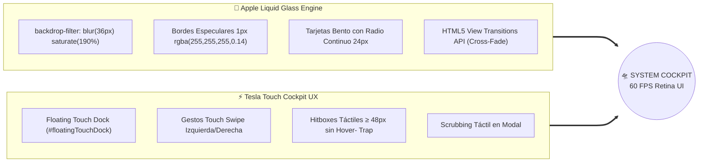
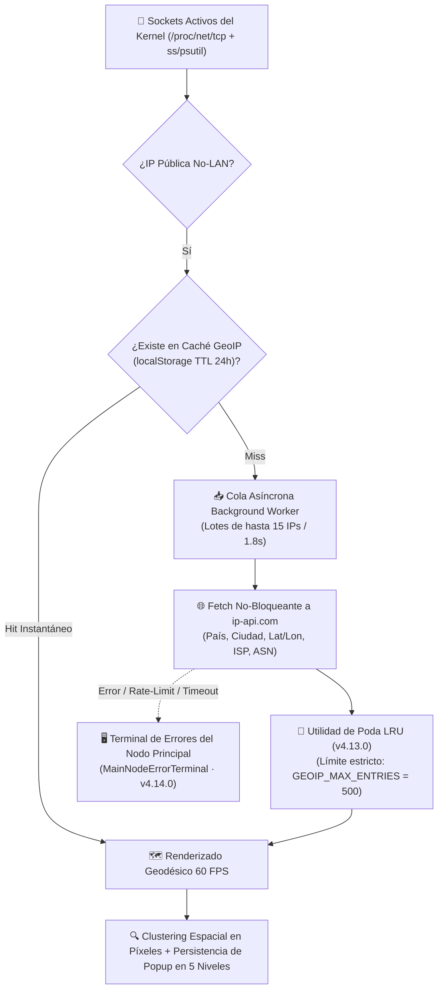
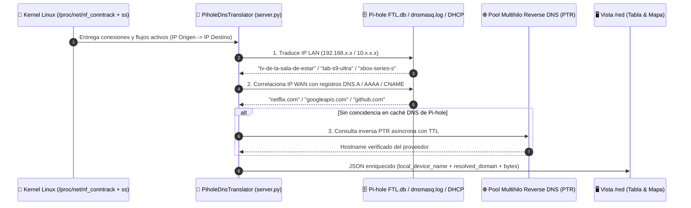
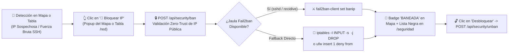
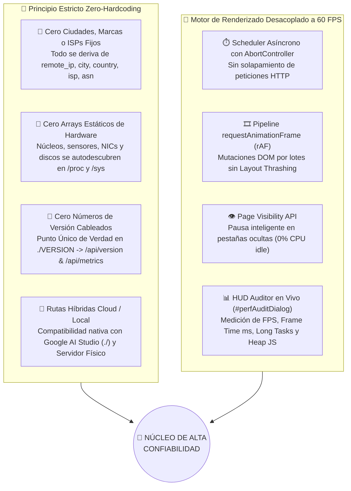

<div align="center">

<a id="slide-01"></a>

# 🛸 SYSTEM COCKPIT · TELEMETRÍA & CONTROL DE MISIÓN
### *Apple Liquid Glass meets Tesla Touch Cockpit — Presentación Interactiva de Ingeniería (v4.14.0)*

<p align="center">
  
  
  
  
  
</p>

---

### 🎛️ CONTROLES DEL DECK INTERACTIVO (KEYNOTE NAVIGATION)

| 🎬 Diapositiva Actual | 🧭 Navegación Rápida por el Deck | ⏭️ Siguiente |
| :--- | :---: | ---: |
| **SLIDE 01 DE 10**<br><sub>Portada & Visión General</sub> | [`01`](#slide-01) · [`02`](#slide-02) · [`03`](#slide-03) · [`04`](#slide-04) · [`05`](#slide-05) · [`06`](#slide-06) · [`07`](#slide-07) · [`08`](#slide-08) · [`09`](#slide-09) · [`10`](#slide-10) | [**Slide 02: Lenguaje de Diseño ▶**](#slide-02) |

</div>

```
╔══════════════════════════════════════════════════════════════════════════════════════════════════════╗
║  🟢 NODO ACTIVO: SERVIDOR CENTRAL   │  ⚡ 60 FPS RAF  │  🛡️ IPS ACTIVO  │  📡 PI-HOLE DNS  │ v4.14.0 ║
╠══════════════════════════════════════════════════════════════════════════════════════════════════════╣
║                                                                                                      ║
║   ┌──────────────────────┐  ┌──────────────────────────────────────────┐  ┌──────────────────────┐   ║
║   │  🧠 CPU TELEMETRÍA    │  │     🌍 MAPA MUNDIAL DE TRÁFICO EN VIVO    │  │  🍩 D3.JS SUBREDES   │   ║
║   │  ████████░░░  74.2%  │  │         . _..::__:  ,-"-"._              │  │      ╭────────╮      │   ║
║   │  3.80 GHz · 52.0°C   │  │       /  🌍 GRAN CANARIA ──► 🗽 NY       │  │    ╭─┤ 192.168├─╮    │   ║
║   ├──────────────────────┤  │       \      ╰──────────► 🗼 TOKIO       │  │    │ ╰────────╯ │    │   ║
║   │  💾 RAM + ZRAM       │  │        `._ .._,-'                        │  │    ╰─── 68.4% ──╯    │   ║
║   │  ██████░░░░░  58.1%  │  │  [!] ALERTA UMBRAL NIC: eth0 > 150 Mbps  │  │  Transición 550ms    │   ║
║   └──────────────────────┘  └──────────────────────────────────────────┘  └──────────────────────┘   ║
║                                                                                                      ║
║           ╔══════════════════════════════════════════════════════════════════════════════╗           ║
║           ║  🏠 Vista   🧠 CPU   💾 RAM   🎮 GPU   💿 Discos   🌐 Red   🛡️ IPS   🐳 Docker ║           ║
║           ╚══════════════════════════════════════════════════════════════════════════════╝           ║
║                                  ▲ FLOATING TOUCH DOCK (TESLA UI)                                    ║
╚══════════════════════════════════════════════════════════════════════════════════════════════════════╝
```

<details>
<summary>🎙️ <b>Notas del Orador — Slide 01: ¿Qué es System Cockpit? (Haz clic para desplegar)</b></summary>
<br>

> **Bienvenidos a la presentación oficial de System Cockpit (`v4.14.0`).**
> Este proyecto nace con una premisa radical: **¿Por qué los paneles de administración de servidores Linux parecen hojas de cálculo de los años 90 cuando conducimos vehículos con pantallas táctiles de 60 fotogramas por segundo?**
>
> System Cockpit fusiona dos filosofías de diseño líderes en el mundo:
> 1. **Apple visionOS / macOS Liquid Glass**: Superficies translúcidas multicapa, desenfoque gaussiano profundo (`backdrop-filter: blur(36px) saturate(190%)`), bordes especulares y tipografía con interletraje negativo milimétrico.
> 2. **Tesla Touch Cockpit**: Controles táctiles sobredimensionados (`≥ 48px`), navegación gestual *Touch Swipe*, dock flotante inferior y gráficas interactivas que se expanden a pantalla completa con scrubbing táctil en tiempo real.
>
> Utiliza la barra de controles superior o inferior de cada diapositiva para recorrer las **10 láminas interactivas** de esta presentación técnica.

</details>

---
---

<a id="slide-02"></a>

<div align="center">

| ⏮️ Anterior | 🎬 **SLIDE 02 DE 10 — LENGUAJE DE DISEÑO & EXPERIENCIA TÁCTIL** | ⏭️ Siguiente |
| :--- | :---: | ---: |
| [**◀ Slide 01: Portada**](#slide-01) | [`01`](#slide-01) · [`02`](#slide-02) · [`03`](#slide-03) · [`04`](#slide-04) · [`05`](#slide-05) · [`06`](#slide-06) · [`07`](#slide-07) · [`08`](#slide-08) · [`09`](#slide-09) · [`10`](#slide-10) | [**Slide 03: Inteligencia Geoespacial ▶**](#slide-03) |

</div>

## 🎨 SLIDE 02 · Apple Liquid Glass + Tesla Touch Cockpit (`v4.0.0`)

### La Convergencia entre Cristal Esmerilado y Control Automotriz

System Cockpit abandona las interfaces planas convencionales e introduce una arquitectura visual basada en **física óptica translúcida** y **ergonomía táctil de grado automotriz**.



### 🌓 Dualidad de Acabados de Titanio (Temas Adaptativos Instantáneos)

| Característica Óptica | 🌑 **Space Black Titanium** (Modo Oscuro) | 🌕 **Natural Brushed Titanium** (Modo Claro) |
| :--- | :--- | :--- |
| **Lienzo Base (`--bg`)** | `#07090E` (Obsidiana espacial con profundidad OLED) | `#EEF2F7` (Aluminio anodizado y sílice perlado) |
| **Superficie Liquid Glass** | `rgba(18, 23, 35, 0.65)` + `blur(36px) saturate(190%)` | `rgba(255, 255, 255, 0.72)` + `blur(36px) saturate(180%)` |
| **Iluminación Ambiental** | Gradientes radiales sutiles (`#0A84FF`, `#30D158`, `#BF5AF2`) | Refracción limpia de alto contraste para exteriores |
| **Acentos Semánticos** | Azul `#0A84FF` · Verde `#30D158` · Ámbar `#FF9F0A` · Rojo `#FF453A` | Azul `#0066CC` · Verde `#248A3D` · Ámbar `#C93400` · Rojo `#D70015` |

### 👆 4 Pilares de Interacción Táctil Directa
1. **Floating Touch Dock (`#floatingTouchDock`)**: Barra de navegación inferior flotante estilo macOS/iPadOS con retroalimentación elástica `cubic-bezier(0.22, 1, 0.36, 1)` que acompaña al operador en cualquier resolución.
2. **Navegación Gestual (*Touch Swipe*)**: Desliza el dedo horizontalmente en móviles o tablets para cambiar entre las 12 vistas operativas sin tocar ningún botón, con detección inteligente que respeta el paneo del mapa mundial y el scroll horizontal de tablas.
3. **Tarjetas Bento Expandibles (`<dialog>`)**: Cualquier tarjeta con gráfica (*CPU, RAM, GPU, Almacenamiento, Red*) se abre en un modal panorámico al tocarla, permitiendo deslizar el dedo sobre las últimas **60 muestras históricas** con mira telescópica (*crosshair*) e inspección de pico, media y mínimo.
4. **Command Palette (`⌘K` / `Ctrl+K`)**: Buscador universal instantáneo para saltar a cualquier vista, ejecutar diagnósticos, alternar el tema de titanio o abrir el auditor de fotogramas.

<details>
<summary>🎙️ <b>Notas del Orador — Slide 02: Decisiones de Diseño e Interacción (Haz clic para desplegar)</b></summary>
<br>

> **¿Por qué diseñamos un sistema con estándares de pantalla de vehículo eléctrico?**
> Cuando administras tu servidor desde un teléfono móvil o una tablet en el sofá, los botones diminutos de 20 píxeles y los menús que dependen del ratón (`:hover`) fallan.
> En la versión `4.0.0` (salto `MAJOR`), reescribimos toda la maquetación bajo el paradigma **Bento Grid Liquid Glass**. Cada tarjeta tiene capacidad de expansión nativa mediante el elemento `<dialog>` de HTML5, proyectando un lienzo Canvas de alta densidad (`devicePixelRatio`) donde el dedo actúa como un osciloscopio sobre la telemetría.

</details>

---
---

<a id="slide-03"></a>

<div align="center">

| ⏮️ Anterior | 🎬 **SLIDE 03 DE 10 — INTELIGENCIA GEOESPACIAL EN TIEMPO REAL** | ⏭️ Siguiente |
| :--- | :---: | ---: |
| [**◀ Slide 02: Lenguaje de Diseño**](#slide-02) | [`01`](#slide-01) · [`02`](#slide-02) · [`03`](#slide-03) · [`04`](#slide-04) · [`05`](#slide-05) · [`06`](#slide-06) · [`07`](#slide-07) · [`08`](#slide-08) · [`09`](#slide-09) · [`10`](#slide-10) | [**Slide 04: Analítica D3.js & Alertas ▶**](#slide-04) |

</div>

## 🌍 SLIDE 03 · Mapa Mundial de Tráfico, Clustering Dinámico y Motor GeoIP (`v4.1.0` – `v4.14.0`)

### Visibilidad Planetaria desde el Nodo Central en Gran Canaria

La vista `/red` incorpora un centro de mando cartográfico interactivo sobre **OpenStreetMap** que traza arcos geodésicos animados desde el servidor local (**Gran Canaria, España**) hacia cada nodo remoto conectado en el planeta.



### 🧠 Innovaciones Cartográficas Clave

* **🔍 Clustering Espacial Dinámico por Zoom**:
  * Al alejar el mapa (*zoom out*), los nodos cercanos en distancia de pantalla (píxeles reales proyectados) se fusionan automáticamente en **burbujas de cluster multi-IP** con contador numérico.
  * Al acercar el mapa (*zoom in*), los clusters se desagregan suavemente en nodos individuales con su bandera e icono de proveedor/servicio.
* **📌 Persistencia Inteligente de Popups en 5 Niveles (`v4.1.0`)**:
  * A diferencia de los mapas tradicionales donde el globo de información desaparece cada vez que entra un nuevo paquete de red o una IP cambia de cluster, System Cockpit aplica un algoritmo de **5 niveles de fallback en tiempo real**:
    1. **Nivel 1 — Clave Exacta**: Coincidencia directa de firma de nodo.
    2. **Nivel 2 — IP Individual**: Rastreo de la IP primaria aunque el cluster haya cambiado de tamaño.
    3. **Nivel 3 — Proximidad de Coordenadas (`< 0.15°`)**: Anclaje geográfico si el grupo se desplaza ligeramente.
    4. **Nivel 4 — Firma de País + Ciudad**: Reubicación semántica regional.
    5. **Nivel 5 — Selección de Grupo Activo**: Mantiene el panel de inspección enfocado sin parpadeos.
* **⚡ Background Worker GeoIP + Poda Automática LRU (`v4.13.0`)**:
  * **Worker Asíncrono No Bloqueante**: Resuelve direcciones IP remotas contra `ip-api.com` en segundo plano en lotes de hasta **15 IPs cada 1.8 segundos**, enriqueciendo los nodos en vivo sin congelar jamás el hilo principal.
  * **Limpieza Automática de `localStorage` (`pruneGeoIpCacheStorage`)**: Cuando la caché supera el umbral `GEOIP_MAX_ENTRIES = 500`, el recolector elimina primero las entradas expiradas (`TTL > 24h`) y después desaloja las entradas más antiguas por marca de tiempo (`ts`), protegiendo la cuota de almacenamiento del navegador incluso ante tormentas de miles de IPs P2P/BitTorrent.
* **🖥️ Terminal del Nodo Principal: Captura en Tiempo Real de Errores GeoIP & Red (`v4.14.0`)**:
  * **Telemetría Unificada Cliente + Servidor**: El módulo `MainNodeErrorTerminal` intercepta en tiempo real fallos de peticiones HTTP (`4xx/5xx/429`), caídas de red (`NET_ERR`), tiempos de espera agotados (`TIMEOUT`) con medición de latencia en milisegundos, excepciones del **Worker GeoIP** (`ip-api.com/batch` y `/api/net/geoip/resolve`) y el historial de errores del worker backend (`geoip_worker.error_history`).
  * **Triple Punto de Inspección Sincronizado**: Integrado bajo el banner de comando del Nodo Principal en *Vista General*, en la tarjeta del mapa de la pestaña *Red* y directamente dentro del popup interactivo de `🖥️ NODO CENTRAL DEL SERVIDOR` en el mapa mundial, con filtros por origen (*Todos*, *GeoIP Worker*, *Peticiones Red*) y botón **`🗑️ Limpiar historial`** sincronizado con `POST /api/net/geoip/clear-errors`.

<details>
<summary>🎙️ <b>Notas del Orador — Slide 03: Ingeniería del Mapa y Memoria GeoIP (Haz clic para desplegar)</b></summary>
<br>

> **El reto de los mapas de red en tiempo real:**
> En un servidor con qBittorrent, Emby y servicios web expuestos, pueden abrirse y cerrarse cientos de conexiones por minuto. Si consultáramos la geolocalización de forma síncrona o redibujáramos los popups desde cero en cada ciclo de 2 segundos, la interfaz sería inutilizable.
> Con el **Worker GeoIP por lotes** y la **poda LRU a 500 entradas (`v4.13.0`)**, logramos latencia de 0 ms para IPs recurrentes y una huella de memoria constante en `localStorage`, mientras el sistema de persistencia de 5 niveles permite inspeccionar y bloquear una IP en el mapa sin que el popup se cierre jamás bajo tu dedo.

</details>

---
---

<a id="slide-04"></a>

<div align="center">

| ⏮️ Anterior | 🎬 **SLIDE 04 DE 10 — ANALÍTICA DE RED D3.JS & ALERTAS VISUALES** | ⏭️ Siguiente |
| :--- | :---: | ---: |
| [**◀ Slide 03: Inteligencia Geoespacial**](#slide-03) | [`01`](#slide-01) · [`02`](#slide-02) · [`03`](#slide-03) · [`04`](#slide-04) · [`05`](#slide-05) · [`06`](#slide-06) · [`07`](#slide-07) · [`08`](#slide-08) · [`09`](#slide-09) · [`10`](#slide-10) | [**Slide 05: Traductor DNS Pi-hole ▶**](#slide-05) |

</div>

## 🍩 SLIDE 04 · Gráfico de Pastel Animado D3.js & Alerta de Umbral NIC (`v4.10.0` – `v4.12.0`)

### De Números Crudos a Proporciones Cinemáticas de Ancho de Banda

Para responder al instante *"¿Qué subred o grupo de dispositivos está consumiendo mi caudal de red ahora mismo?"*, la pestaña **Red (`/red`)** integra un motor de visualización vectorial **D3.js v7** sincronizado con la telemetría viva del servidor.

```
┌───────────────────────────────────────────────────────────────────────────────────────────────┐
│  🍩 DISTRIBUCIÓN DE ANCHO DE BANDA / ACTIVIDAD POR SUBRED Y DISPOSITIVO                       │
│  Agrupar por:  [ ◉ Subred (/24) ]   [ ○ Tipo de Enlace ]   [ ○ Rol / Dispositivo ]            │
├───────────────────────────────────────┬───────────────────────────────────────────────────────┤
│                                       │  🟢 192.168.1.0/24 (LAN Doméstica)    64.2%  118 Mbps │
│             ╭───────────╮             │  ████████████████████████████░░░░░░   14 nodos        │
│          ╭──┤  TOTAL    ├──╮          │                                                       │
│        ╭─╯  │ 183.8 Mbps│  ╰─╮        │  🔵 WAN / Nodos Cloud Externos        24.8%   45 Mbps │
│        │    │ 42 Flujos │    │        │  ██████████░░░░░░░░░░░░░░░░░░░░░░░░   19 nodos        │
│        ╰─╮  ╰───────────╯  ╭─╯        │                                                       │
│          ╰────────┬────────╯          │  🟣 Docker Bridge (172.17.0.0/16)     11.0%   20 Mbps │
│       Interpolación Polar D3.js       │  █████░░░░░░░░░░░░░░░░░░░░░░░░░░░░░    9 nodos        │
│       (attrTween · 550ms cubic-out)   │                                                       │
└───────────────────────────────────────┴───────────────────────────────────────────────────────┘
```

### 🎬 Animación Polar Continua con D3.js (`v4.10.0` & `v4.11.0`)
* **3 Modos de Agrupación Dinámica**:
  1. **Por Subred (`/24`)**: Calcula en tiempo de ejecución el prefijo de red (`192.168.x.0/24`, `10.x.x.0/24`, `172.x.x.0/24` o segmentos WAN) sin una sola cadena hardcodeada.
  2. **Por Tipo de Enlace**: Clasifica el caudal entre tráfico local LAN, túneles/contenedores y tráfico exterior WAN.
  3. **Por Rol / Dispositivo**: Agrupa según la identidad resuelta de las máquinas (*Smart TVs, móviles, consolas, contenedores, clientes remotos*).
* **Interpolación Matemática de Arcos (`d3.interpolate` + `attrTween`)**:
  * Cada sector del donut conserva su ángulo previo (`_current`) en el nodo DOM SVG.
  * Al cambiar de modo de agrupación o al variar el tráfico en tiempo real, los sectores **giran y se redimensionan suavemente durante `550ms` con curva `d3.easeCubicOut`**, mientras la etiqueta central interpola numéricamente el caudal o volumen de conexiones activas.
  * Incluye **resaltado cruzado bidireccional**: pasar el cursor o tocar un sector ilumina su fila en la leyenda y atenúa el resto.

### 🚨 Indicador Visual de Alerta por Umbral de Ancho de Banda (`v4.12.0`)
* En la esquina del mapa mundial de conexiones y junto al selector de interfaces NIC, el operador dispone de un **control numérico de umbral en Mbps** (persistido en `localStorage`).
* Si el caudal agregado (`RX + TX`) de la interfaz seleccionada (o el agregado global) supera el límite configurado:
  * Se activa un **badge de alerta pulsante en rojo neón (`#FF453A`)** directamente en la leyenda del mapa mundial mostrando la interfaz infractora y el pico exacto en Mbps (`⚠️ UMBRAL SUPERADO: eth0 · 184.5 Mbps`).

<details>
<summary>🎙️ <b>Notas del Orador — Slide 04: Por qué elegimos D3.js v7 para la distribución de subredes (Haz clic para desplegar)</b></summary>
<br>

> **Fluidez visual frente a datos cambiantes:**
> Si destruyes y recreas un SVG cada 2 segundos cuando llegan métricas nuevas, el ojo humano percibe un salto brusco y pierde la referencia espacial de qué subred creció.
> Mediante el patrón **Data Join (`selection.join`) de D3.js v7** y la interpolación en coordenadas polares (`startAngle` y `endAngle`), los sectores se deslizan orgánicamente como agujas de un instrumento aeronáutico. Y con la alerta de umbral NIC (`v4.12.0`), cualquier saturación de ancho de banda salta a la vista sobre el propio mapa mundial.

</details>

---
---

<a id="slide-05"></a>

<div align="center">

| ⏮️ Anterior | 🎬 **SLIDE 05 DE 10 — TRADUCTOR DNS PI-HOLE & FLUJOS LAN/WAN** | ⏭️ Siguiente |
| :--- | :---: | ---: |
| [**◀ Slide 04: Analítica D3.js & Alertas**](#slide-04) | [`01`](#slide-01) · [`02`](#slide-02) · [`03`](#slide-03) · [`04`](#slide-04) · [`05`](#slide-05) · [`06`](#slide-06) · [`07`](#slide-07) · [`08`](#slide-08) · [`09`](#slide-09) · [`10`](#slide-10) | [**Slide 06: Ciberdefensa Fail2ban IPS ▶**](#slide-06) |

</div>

## 📡 SLIDE 05 · `PiholeDnsTranslator` y Telemetría de Dispositivos del Hogar (`v4.7.0` – `v4.9.0`)

### Traducción Automática de Direcciones IP Crudas a Nombres Humanos Reales

Ver `192.168.1.142 -> 142.250.184.14` no le dice nada a un administrador a primera vista. System Cockpit integra el motor **`PiholeDnsTranslator`** en el backend (`server.py`) para cruzar en tiempo real las tablas del kernel con **Pi-hole** y **DHCP**.



### 🏠 Dos Niveles de Visibilidad de Red Sin Precedentes

| Dimensión de Análisis | 🔍 Qué Resuelve Exactamente | 💡 Ejemplo Real en Pantalla |
| :--- | :--- | :--- |
| **1. Identidad de Dispositivos LAN (`v4.8.0`)** | Cruza `/etc/hosts`, concesiones DHCP (`dhcp.leases`), tabla `network_addresses` de `pihole-FTL.db` y tabla ARP/vecinos (`ip neigh`). | En lugar de `192.168.1.45`, muestra **`📱 tab-s9-ultra`**, **`📺 tv-de-la-sala-de-estar`**, **`🎮 xbox-series-s`** o **`📡 deco-m4`**. |
| **2. Dominios Exactos de IPs WAN (`v4.7.0`)** | Inspecciona qué dominio consultó cualquier cliente antes de abrir el socket hacia esa IP pública mediante `pihole-FTL.db` y `pihole.log`. | En lugar de `104.18.32.7`, muestra **`🌐 cloudflare.com`** o el subdominio exacto consultado. |
| **3. Flujos de Dispositivos del Hogar (`v4.9.0`)** | La función `fetch_active_device_flows()` lee `/proc/net/nf_conntrack`, sesiones proxy/Caddy y consultas DNS recientes de Pi-hole. | Permite ver el tráfico de **todos los dispositivos de la casa** (móviles, tablets, Smart TVs), no solo los sockets del propio servidor Linux. |

<details>
<summary>🎙️ <b>Notas del Orador — Slide 05: Cómo logramos visibilidad de toda la red doméstica (Haz clic para desplegar)</b></summary>
<br>

> **Más allá de `netstat`:**
> Normalmente, un monitor instalado en un servidor Linux solo ve las conexiones que nacen o terminan en ese servidor. Sin embargo, como nuestro servidor actúa como servidor DNS central con **Pi-hole** y puerta de enlace/proxy para servicios clave, en `v4.9.0` diseñamos `fetch_active_device_flows()`.
> Este motor combina las sesiones NAT (`nf_conntrack`) con la actividad DNS reciente de `pihole-FTL.db`, mostrando en la tabla y en el gráfico D3.js qué está haciendo cada televisor, consola o teléfono de la red local en tiempo real, con una caché TTL de 10 segundos para no sobrecargar SQLite.

</details>

---
---

<a id="slide-06"></a>

<div align="center">

| ⏮️ Anterior | 🎬 **SLIDE 06 DE 10 — CIBERDEFENSA ACTIVA & MITIGACIÓN IPS** | ⏭️ Siguiente |
| :--- | :---: | ---: |
| [**◀ Slide 05: Traductor DNS Pi-hole**](#slide-05) | [`01`](#slide-01) · [`02`](#slide-02) · [`03`](#slide-03) · [`04`](#slide-04) · [`05`](#slide-05) · [`06`](#slide-06) · [`07`](#slide-07) · [`08`](#slide-08) · [`09`](#slide-09) · [`10`](#slide-10) | [**Slide 07: Los 5 Pilares de Hardware ▶**](#slide-07) |

</div>

## 🛡️ SLIDE 06 · Centro de Seguridad IPS: Fail2ban + Firewall en 1 Clic (`v4.4.0` – `v4.6.0`)

### De la Observación Pasiva a la Neutralización Instantánea de Amenazas

System Cockpit no es un visor pasivo: integra un **Sistema de Prevención de Intrusiones (IPS)** interactivo que conecta el mapa mundial, la tabla de conexiones y la vista `/seguridad` directamente con **`fail2ban-client`**, **`iptables`** y **`ufw`**.



### 🔐 Capacidades de Blindaje y Defensa Activa

1. **Neutralización Directa desde el Mapa Mundial y Tabla (`v4.5.0`)**:
   * Al tocar cualquier marcador en el mapa mundial o fila en la tabla de conexiones, aparece el botón de acción táctica **`🚫 Bloquear IP`** (o **`🔓 Desbloquear`** si ya se encuentra en la lista negra).
   * Seguridad preventiva integrada: el backend rechaza automáticamente cualquier intento accidental de bloquear direcciones loopback (`127.0.0.1`), enlaces locales o subredes privadas LAN (`192.168.x.x`, `10.x.x.x`), evitando que el administrador se corte el acceso a sí mismo.
2. **Auditoría de Intrusiones en `/seguridad` (`v4.4.0`)**:
   * **Jaulas Activas de Fail2ban**: Recuento en vivo de IPs bloqueadas por servicio (`sshd`, `nginx-http-auth`, `recidive`, etc.) y total de intentos fallidos acumulados.
   * **Registro de Ataques SSH (`journalctl` / `auth.log`)**: Identificación de fuerza bruta, usuarios inválidos probados por bots y puertos escaneados.
   * **Puertos Expuestos en Escucha**: Auditoría continua de sockets `LISTEN` abiertos en todas las interfaces (`0.0.0.0` / `::`).
3. **Hardening Zero-Trust en Backend (`v4.6.0`)**:
   * **Cero Inyección de Comandos**: Ninguna ruta ejecuta `shell=True`. Todos los subprocesos utilizan vectores de argumentos tipados y listas blancas estrictas de servicios (`ALLOWED_CONTROL_SERVICES`), contenedores (`^[a-zA-Z0-9_.-]+$`) e IPs validadas con el módulo `ipaddress`.
   * **Cabeceras de Seguridad HTTP**: Inyección nativa de `Content-Security-Policy` (CSP), `X-Frame-Options`, `X-Content-Type-Options: nosniff` y `Referrer-Policy: no-referrer`.

<details>
<summary>🎙️ <b>Notas del Orador — Slide 06: Respuesta táctica en menos de un segundo (Haz clic para desplegar)</b></summary>
<br>

> **Imagina este escenario real:**
> Abres el mapa mundial en tu tablet y observas un nodo desconocido abriendo múltiples conexiones contra tu puerto SSH o tus servicios web. En lugar de abrir una terminal SSH, recordar la sintaxis de `fail2ban-client` o `iptables` y teclear la IP a mano, simplemente tocas el nodo en el mapa y pulsas **`🚫 Bloquear IP`**.
> En menos de 300 milisegundos, el backend inyecta la regla en la jaula activa de Fail2ban (con fallback directo a `iptables DROP`), corta el tráfico a nivel de kernel y marca el nodo como **BANEADO** en toda la interfaz.

</details>

---
---

<a id="slide-07"></a>

<div align="center">

| ⏮️ Anterior | 🎬 **SLIDE 07 DE 10 — LOS 5 PILARES DE HARDWARE & ECOSISTEMA** | ⏭️ Siguiente |
| :--- | :---: | ---: |
| [**◀ Slide 06: Ciberdefensa Fail2ban IPS**](#slide-06) | [`01`](#slide-01) · [`02`](#slide-02) · [`03`](#slide-03) · [`04`](#slide-04) · [`05`](#slide-05) · [`06`](#slide-06) · [`07`](#slide-07) · [`08`](#slide-08) · [`09`](#slide-09) · [`10`](#slide-10) | [**Slide 08: Zero-Hardcoding & 60 FPS ▶**](#slide-08) |

</div>

## ⚙️ SLIDE 07 · Los 5 Pilares de Hardware, Contenedores y Catálogo Multimedia (`v4.0.0` – `v4.3.0`)

### Telemetría Profunda Directa desde el Kernel Linux (`/proc`, `/sys`, `psutil`)

```
╔════════════════════════════════════════════════════════════════════════════════════════════════════╗
║                               LOS 5 PILARES DEL NÚCLEO DE HARDWARE                                 ║
╠══════════════════╦══════════════════╦══════════════════╦═════════════════════╦═════════════════════╣
║   1. 🧠 CPU      ║   2. 💾 RAM      ║   3. 🎮 GPU      ║   4. 💿 DISCOS      ║   5. 🌐 RED + DNS   ║
╠══════════════════╬══════════════════╬══════════════════╬═════════════════════╬═════════════════════╣
║ • Uso por Hilo   ║ • Usada / Libre  ║ • NVIDIA SMI     ║ • Particiones Reales║ • Caudal RX/TX Vivo ║
║ • Reloj MHz/GHz  ║ • Caché / Buffers║ • DRM / Sysfs    ║ • IOPS Lectura/Escr.║ • Sparklines 2h     ║
║ • Gobernador     ║ • Swap & Zram    ║ • VRAM Dedicada  ║ • Latencia ms       ║ • Mapa Geodésico    ║
║ • Temp Package   ║ • Presión PSI    ║ • Temp & Vatios  ║ • Salud S.M.A.R.T.  ║ • D3.js + Pi-hole   ║
║ • Top Procesos   ║ • Top Procesos   ║ • Motores Vídeo  ║ • Top I/O Procesos  ║ • IPS Fail2ban      ║
╚══════════════════╩══════════════════╩══════════════════╩═════════════════════╩═════════════════════╝
```

### 🧩 Ecosistema Completo de Servicios, Contenedores y Multimedia

* **🐳 Orquestación Docker (`/docker`)**:
  * Inspección en vivo de todos los contenedores activos e inactivos: consumo individual de CPU %, memoria RAM, tráfico de red, puertos publicados, tiempo de actividad (*uptime*) y botones táctiles para **Iniciar, Detener o Reiniciar** contenedores al vuelo.
* **🎬 Suite Multimedia qBittorrent + Emby (`/descargas` & `/emby`)**:
  * **qBittorrent**: Supervisión de torrents activos, velocidad de bajada/subida, progreso porcentual, ETA, ratio de compartición y espacio libre en el volumen de descargas.
  * **Emby Media Server**: Escaneo de bibliotecas de **Películas, Series y Música**, sesiones de reproducción activas (transcodificación vs. *Direct Play*), dispositivos conectados y carátulas de últimos estrenos añadidos.
* **🦆 Automatización DuckDNS (`/duckdns`)**:
  * Verificación de sincronización entre la IP pública WAN actual del router y el dominio dinámico DuckDNS, historial de renovaciones y botón de **Forzar Actualización Inmediata**.
* **🎨 Motor de Logos Inteligente y Personalizable (`v4.2.0` & `v4.3.0`)**:
  * Detección automática en alta definición (SVG/SimpleIcons) para el **Sistema Operativo** (`/etc/os-release`), **Fabricante de NIC** (`lspci`/OUI: Intel, Realtek, Broadcom, Mellanox, Tailscale, WireGuard, Docker) y **Dispositivos de Red**.
  * Al hacer clic en cualquier logo de servicio, proceso, contenedor o tarjeta del sistema, se abre un **selector modal con biblioteca curada + subida de imagen propia** persistida en el servidor (`custom_logos.json` vía `POST /api/logos`).

<details>
<summary>🎙️ <b>Notas del Orador — Slide 07: Control total sin salir del navegador (Haz clic para desplegar)</b></summary>
<br>

> **Un único panel para reemplazar 6 herramientas distintas:**
> Antes necesitabas `htop` para la CPU, `iotop` para discos, `nvidia-smi` para la gráfica, Portainer para Docker, la web de Pi-hole para DNS y la consola de Fail2ban para seguridad.
> System Cockpit consolida todo en una única SPA coherente. Incluso los detalles visuales están cuidados al extremo: en `v4.3.0` añadimos reconocimiento real de hardware para que la tarjeta de tu sistema operativo muestre automáticamente el emblema oficial de Ubuntu, Debian o Arch Linux leyendo `/etc/os-release`, y tus tarjetas de red muestren el logo de Intel, Realtek o WireGuard según su driver del kernel.

</details>

---
---

<a id="slide-08"></a>

<div align="center">

| ⏮️ Anterior | 🎬 **SLIDE 08 DE 10 — ARQUITECTURA ZERO-HARDCODING & MOTOR 60 FPS** | ⏭️ Siguiente |
| :--- | :---: | ---: |
| [**◀ Slide 07: Los 5 Pilares de Hardware**](#slide-07) | [`01`](#slide-01) · [`02`](#slide-02) · [`03`](#slide-03) · [`04`](#slide-04) · [`05`](#slide-05) · [`06`](#slide-06) · [`07`](#slide-07) · [`08`](#slide-08) · [`09`](#slide-09) · [`10`](#slide-10) | [**Slide 09: Comparativa & Rutas API ▶**](#slide-09) |

</div>

## ⚡ SLIDE 08 · Filosofía Estricta Zero-Hardcoding y Motor de 60 FPS

### Regla de Oro de Ingeniería: Cero Suposiciones Estáticas, 100% Telemetría Viva

System Cockpit está construido bajo la directiva constitucional de **Cero Hardcoding (`GEMINI.md` Regla 7)** y **Control de Versión Unificado (`GEMINI.md` Regla 5)**:



### 🔬 Ingeniería de Rendimiento Verificable en Tiempo Real
* **Desacoplamiento Total entre Red y Pantalla**:
  * Las peticiones a `/api/metrics` se ejecutan en ciclos asíncronos controlados por `AbortController` (2000 ms), mientras que las animaciones de gráficas Canvas, transiciones D3.js y el mapa mundial corren de forma independiente en el bucle de **`requestAnimationFrame` a 60 FPS**.
* **Cachés con TTL Escalonado en Backend (`server.py`)**:
  * Las operaciones pesadas del sistema operativo (inspección de demonios `systemd`, listado de contenedores Docker, escaneo de puertos y consultas SQLite a `pihole-FTL.db`) utilizan **cachés en memoria con TTL de 5 a 15 segundos**, garantizando que `/api/metrics` responda en **menos de 25 milisegundos**.
* **Auditor de Rendimiento Integrado (`#perfAuditDialog`)**:
  * Accesible desde la barra superior o mediante la paleta de comandos (`⌘K`), permite auditar en vivo:
    * **FPS instantáneos y estabilidad de fotograma (`Frame Time < 16.6 ms`)**.
    * **Latencia de red del endpoint `/api/metrics`**.
    * **Conteo de nodos DOM activos y consumo de memoria `JS Heap`**.

<details>
<summary>🎙️ <b>Notas del Orador — Slide 08: Por qué la arquitectura Zero-Hardcoding garantiza longevidad (Haz clic para desplegar)</b></summary>
<br>

> **Adaptabilidad universal:**
> Si mañana migras System Cockpit de un servidor de 4 núcleos con una sola tarjeta de red a un servidor rack de 64 núcleos, 8 discos NVMe en RAID, 4 tarjetas de red de 10 Gbps y 2 GPUs dedicadas, **no tienes que cambiar ni una sola línea de código HTML, CSS o Python**.
> Toda la interfaz se genera dinámicamente a partir de los descriptores del kernel. Además, el archivo canónico `./VERSION` gobierna automáticamente todas las insignias de la interfaz, los endpoints de la API y el archivo `package.json`.

</details>

---
---

<a id="slide-09"></a>

<div align="center">

| ⏮️ Anterior | 🎬 **SLIDE 09 DE 10 — COMPARATIVA EVOLUTIVA & MAPA DE RUTAS** | ⏭️ Siguiente |
| :--- | :---: | ---: |
| [**◀ Slide 08: Zero-Hardcoding & 60 FPS**](#slide-08) | [`01`](#slide-01) · [`02`](#slide-02) · [`03`](#slide-03) · [`04`](#slide-04) · [`05`](#slide-05) · [`06`](#slide-06) · [`07`](#slide-07) · [`08`](#slide-08) · [`09`](#slide-09) · [`10`](#slide-10) | [**Slide 10: Historial de Versiones & Inicio ▶**](#slide-10) |

</div>

## ⚖️ SLIDE 09 · Tabla Comparativa Interactiva (*Antes vs. Ahora*) y Mapa de Arquitectura

### Evolución del Sistema: De Monitor Clásico a Cockpit de Misión (`v4.13.1`)

| Dimensión Técnica | 🕰️ **Antes (Monitor Tradicional / v1–v3)** | 🛸 **Ahora (System Cockpit v4.13.1)** |
| :--- | :--- | :--- |
| **Interfaz & Estética** | Paneles planos estáticos sin jerarquía óptica ni soporte táctil dedicado. | **Apple Liquid Glass** (`blur(36px)`) + **Tesla Touch Cockpit** con temas de Titanio Oscuro y Claro. |
| **Navegación Móvil / Tablet** | Menú lateral convencional dependiente de clics precisos. | **Floating Touch Dock** inferior + gestos **Touch Swipe** horizontales + **HTML5 View Transitions**. |
| **Inspección de Gráficas** | Sparklines pequeñas de solo lectura sin historial interactivo. | **Modales `<dialog>` expandibles** con scrubbing táctil de 60 muestras y **Sparklines Retina de 2 horas (240 muestras)**. |
| **Mapa Mundial de Red** | Marcadores simples cuyos popups se cerraban en cada refresco de datos. | **Clustering espacial por zoom** + **Persistencia de Popup en 5 niveles** + **Alerta de umbral Mbps en vivo (`v4.12.0`)**. |
| **Motor de Geolocalización** | Consultas síncronas o caché sin control de crecimiento en el navegador. | **Worker GeoIP asíncrono por lotes (`ip-api.com`)** + **Poda automática LRU (`GEOIP_MAX_ENTRIES = 500`, `v4.13.0`)**. |
| **Analítica de Subredes** | Solo listado tabular de sockets individuales. | **Gráfico de Pastel D3.js v7** con transiciones polares fluidas (`550ms cubic-out`, `v4.10.0`–`v4.11.0`). |
| **Identidad de Red & DNS** | Direcciones IP numéricas crudas (`192.168.1.x` / `142.250.x.x`) y solo sockets del host. | **`PiholeDnsTranslator` (`FTL.db` + DHCP + PTR)** + **Flujos de todos los dispositivos del hogar (`v4.7.0`–`v4.9.0`)**. |
| **Ciberseguridad** | Sin capacidad de respuesta; requería entrar por consola SSH para bloquear ataques. | **Centro IPS Fail2ban (`/seguridad`)** + botón **`🚫 Bloquear IP` en 1 clic** desde el mapa o la tabla (`v4.4.0`–`v4.6.0`). |

---

### 🗺️ Mapa Completo de las 12 Vistas SPA y Endpoints REST

<details open>
<summary>🧭 <b>Explorar las 12 Vistas Operativas del Cockpit (History API SPA)</b></summary>
<br>

| Ruta SPA | Vista Operativa | Capacidades Principales |
| :--- | :--- | :--- |
| `/` | **🏠 Vista General** | Resumen ejecutivo Bento de los 5 pilares, salud global, servicios críticos y accesos directos. |
| `/cpu` | **🧠 Procesador (CPU)** | Carga por núcleo lógico, frecuencias en MHz/GHz, gobernador, temperatura y top procesos por CPU. |
| `/ram` | **💾 Memoria (RAM)** | Desglose física/caché/buffers, presión PSI, uso de Swap/Zram y procesos intensivos en memoria. |
| `/gpu` | **🎮 Gráficos (GPU)** | Telemetría NVIDIA (`nvidia-smi`) y DRM/Sysfs, VRAM dedicada, temperatura, potencia y motores de vídeo. |
| `/almacenamiento` | **💿 Almacenamiento** | Capacidad de particiones reales, IOPS de lectura/escritura, tiempos de espera y salud S.M.A.R.T. |
| `/red` | **🌐 Red & Mapa Mundial** | Mapa geodésico OpenStreetMap, terminal de errores GeoIP/Red del nodo principal, gráfico D3.js, flujos Pi-hole y bloqueo IP. |
| `/seguridad` | **🛡️ Seguridad / IPS** | Jaulas Fail2ban, bloqueo/desbloqueo manual y en 1 clic, intentos SSH fallidos y puertos `LISTEN`. |
| `/servicios` | **⚙️ Servicios Linux** | Estado de demonios `systemd`, memoria por servicio, logs recientes y control de reinicio/parada. |
| `/docker` | **🐳 Contenedores Docker** | Estadísticas en vivo por contenedor (CPU, RAM, Red, Puertos) y acciones de ciclo de vida. |
| `/descargas` | **⬇️ qBittorrent** | Cola de descargas y subidas P2P, velocidades en tiempo real, progreso, ratio y espacio disponible. |
| `/emby` | **🎬 Emby Media** | Catálogo de películas y series, sesiones de streaming activas, usuarios conectados y últimos añadidos. |
| `/duckdns` · `/version` | **🦆 DuckDNS & 📦 Versión** | Estado de sincronización de IP pública dinámica y auditoría de la versión canónica activa (`v4.14.0`). |

</details>

<details>
<summary>🔌 <b>Explorar el Catálogo de Endpoints del Backend (`server.py` + `server.ts`)</b></summary>
<br>

| Método | Endpoint | Función Técnica |
| :--- | :--- | :--- |
| `GET` | `/api/metrics` | Payload maestro unificado (CPU, RAM, GPU, Discos, Red, Flujos Pi-hole, Worker GeoIP + Errores, Seguridad, Servicios, Logos y Versión). |
| `GET` | `/api/version` | Devuelve la versión canónica leída dinámicamente desde `./VERSION` (`4.14.0`). |
| `POST` | `/api/net/geoip/resolve` | Resuelve lotes de IPs públicas contra `ip-api.com/batch` con caché LRU/TTL y telemetría del Worker GeoIP. |
| `POST` | `/api/net/geoip/clear-errors` | Limpia el historial de errores en memoria del Worker GeoIP del nodo principal (`GEOIP_ERROR_HISTORY`). |
| `POST` | `/api/security/ban` | Bloquea una IP pública maliciosa en Fail2ban (`fail2ban-client`) o firewall (`iptables` / `ufw`). |
| `POST` | `/api/security/unban` | Retira el bloqueo de una IP previamente sancionada en todas las jaulas y reglas activas. |
| `POST` | `/api/service/action` | Ejecuta acciones autorizadas (`restart`, `start`, `stop`) sobre servicios en lista blanca. |
| `POST` | `/api/docker/action` | Gestiona el ciclo de vida de contenedores Docker validados mediante expresión regular estricta. |
| `POST` | `/api/duckdns/update` | Fuerza la actualización inmediata del dominio dinámico DuckDNS y registra el resultado. |
| `GET/POST` | `/api/logos` | Obtiene o almacena logos personalizados por el usuario en `custom_logos.json`. |

</details>

---
---

<a id="slide-10"></a>

<div align="center">

| ⏮️ Anterior | 🎬 **SLIDE 10 DE 10 — HISTORIAL DE VERSIONES & DESPLIEGUE** | 🏠 Inicio |
| :--- | :---: | ---: |
| [**◀ Slide 09: Comparativa & Rutas API**](#slide-09) | [`01`](#slide-01) · [`02`](#slide-02) · [`03`](#slide-03) · [`04`](#slide-04) · [`05`](#slide-05) · [`06`](#slide-06) · [`07`](#slide-07) · [`08`](#slide-08) · [`09`](#slide-09) · [`10`](#slide-10) | [**⏮ Volver a Slide 01: Portada**](#slide-01) |

</div>

## 📜 SLIDE 10 · Historial de Versiones (`Changelog`), Estructura y Puesta en Marcha

### Criterio Estricto de Versionado (`MAJOR.MINOR.PATCH` en `./VERSION`)
* **`X.0.0` (`MAJOR`)**: Rediseño visual, maquetación, temas o arquitectura de interfaz.
* **`0.X.0` (`MINOR`)**: Adición de una nueva funcionalidad o retiro de una función existente.
* **`0.0.X` (`PATCH`)**: Corrección de bugs, optimizaciones de detalle o actualización de documentación interactiva.

<details open>
<summary>🏆 <b>Serie v4.10.0 – v4.14.0: Inteligencia GeoIP, Terminal de Errores del Nodo Principal, Analítica D3.js y Presentación Keynote (Actual)</b></summary>
<br>

* **`v4.14.0` (MINOR — Terminal de Errores en Tiempo Real del Nodo Principal para Worker GeoIP y Peticiones de Red)**:
  * Nuevo componente **`MainNodeErrorTerminal`** integrado en el **Nodo Principal** (*Vista General*, tarjeta del mapa en *Red* y popup interactivo `🖥️ NODO CENTRAL DEL SERVIDOR` en el mapa mundial).
  * Captura en tiempo real de errores del **Worker GeoIP** (`ip-api.com/batch`, rate-limits HTTP 429, fallos de resolución DNS/GeoIP en `server.py` y Web Worker en cliente) y de **peticiones de red HTTP** (`window.fetch` no-2xx, caídas de red y timeouts con latencia en `ms`).
  * Filtros rápidos por origen (*Todos*, *GeoIP Worker*, *Peticiones Red*), persistencia acotada en `localStorage` y botón **`🗑️ Limpiar historial`** conectado al nuevo endpoint `POST /api/net/geoip/clear-errors`.
* **`v4.13.1` (PATCH — Presentación Interactiva Keynote en `README.md`)**:
  * Transformación integral de `README.md` en una presentación interactiva de **10 diapositivas estilo Apple Keynote & Tesla Cockpit** con barra de controles, diagramas Mermaid de arquitectura y secuencia, wireframes ASCII, notas del orador desplegables y comparativa evolutiva.
  * Almacenamiento de planes y walkthroughs de verificación en `./planes/`.
* **`v4.13.0` (MINOR — Utilidad de Limpieza y Poda LRU de Caché GeoIP en `localStorage`)**:
  * Nuevo recolector `pruneGeoIpCacheStorage()` con límite `GEOIP_MAX_ENTRIES = 500` que purga entradas caducadas (`TTL 24h`) y desaloja las más antiguas por timestamp (`ts`), protegiendo el rendimiento y la cuota de `localStorage` junto al worker asíncrono de `ip-api.com`.
* **`v4.12.0` (MINOR — Indicador de Alerta por Umbral de Ancho de Banda NIC en Mapa Mundial)**:
  * Selector interactivo de límite en Mbps y badge de alerta pulsante en la leyenda del mapa mundial cuando el tráfico RX/TX de la interfaz supera el umbral configurado.
* **`v4.11.0` (MINOR — Transiciones Polares Animadas con D3.js en Gráfico de Pastel)**:
  * Integración de **D3.js v7** con interpolación continua de ángulos (`d3.interpolate` + `attrTween`, `550ms cubic-out`) y conteo animado central al cambiar de modo de agrupación o variar el tráfico en la pestaña *Red*.
* **`v4.10.0` (MINOR — Visualización de Distribución de Ancho de Banda por Subredes y Dispositivos)**:
  * Incorporación del componente de gráfico de pastel/donut en la vista `/red` con agrupación dinámica por Subred (`/24`), Tipo de Enlace y Rol/Dispositivo.

</details>

<details>
<summary>📡 <b>Serie v4.7.0 – v4.9.1: Traductor DNS Pi-hole y Flujos de Dispositivos del Hogar</b></summary>
<br>

* **`v4.9.1` (PATCH — Fix `ReferenceError: setText is not defined`)**:
  * Incorporación del helper global `setText(elOrId, text)` evitando excepciones al conmutar o actualizar la vista `/red`.
* **`v4.9.0` (MINOR — Visibilidad de Tráfico de Todos los Dispositivos de la Red Local)**:
  * Nueva función `fetch_active_device_flows()` en `server.py` que correlaciona `/proc/net/nf_conntrack`, consultas recientes en `pihole-FTL.db` y logs de proxy para mostrar el tráfico de Smart TVs, móviles, tablets y consolas de toda la red doméstica.
* **`v4.8.0` (MINOR — Traducción de IPs Locales a Nombres de Dispositivos vía Pi-hole)**:
  * Resolución automática de direcciones LAN (`192.168.x.x`, `10.x.x.x`) a nombres reales (`tv-de-la-sala-de-estar`, `tab-s9-ultra`, `xbox-series-s`, `deco-m4`) usando `/etc/hosts`, DHCP leases, `pihole-FTL.db` y tabla ARP.
* **`v4.7.0` (MINOR — Motor `PiholeDnsTranslator` para IPs Externas WAN)**:
  * Traducción automática de direcciones IP públicas remotas al nombre de dominio exacto consultado mediante SQLite `pihole-FTL.db`, `pihole.log`, API de Pi-hole y DNS inverso multihilo (`PTR`).

</details>

<details>
<summary>🛡️ <b>Serie v4.0.0 – v4.6.0: Rediseño Liquid Glass, Logos Dinámicos y Ciberdefensa IPS</b></summary>
<br>

* **`v4.6.0` (MINOR — Auditoría de Ciberseguridad y Hardening Zero-Trust)**:
  * Eliminación total de ejecución shell insegura, listas blancas estrictas, cabeceras HTTP CSP/X-Frame-Options y sanitización DOM (`escapeHtml`).
* **`v4.5.0` (MINOR — Bloqueo Activo de IPs en 1 Clic desde Mapa y Tabla)**:
  * Endpoints `POST /api/security/ban` y `/api/security/unban` integrados con `fail2ban-client`, `iptables` y `ufw`.
* **`v4.4.0` (MINOR — Centro de Seguridad e Intrusiones IPS `/seguridad`)**:
  * Nueva vista dedicada para monitorizar jaulas Fail2ban, ataques SSH fallidos y puertos abiertos.
* **`v4.3.0` (MINOR — Logos Automáticos para Sistema Operativo y Tarjetas NIC)**:
  * Detección dinámica de la distribución Linux (`/etc/os-release`) y del fabricante de cada interfaz de red (`lspci` / driver).
* **`v4.2.0` (MINOR — Motor de Logos Inteligente y Selector Personalizable)**:
  * Reconocimiento visual de más de 50 servicios y selector modal con persistencia en `custom_logos.json`.
* **`v4.1.0` (MINOR — Sparklines de 2 Horas y Persistencia de Popups en 5 Niveles)**:
  * Buffer circular de 240 muestras (2 horas) y algoritmo de 5 niveles para mantener abiertos los popups del mapa mundial.
* **`v4.0.0` (MAJOR — Rediseño Integral Apple Liquid Glass & Tesla Touch Cockpit)**:
  * Nueva arquitectura visual con temas de Titanio, Floating Touch Dock, gestos Touch Swipe y tarjetas Bento expandibles.

</details>

---

### 📂 Estructura del Proyecto y Despliegue Rápido

```text
.
├── VERSION                  # Punto Único de Verdad de la versión activa (4.14.0)
├── README.md                # Deck Interactivo Keynote de 10 Diapositivas (este documento)
├── GEMINI.md                # Constitución del proyecto y reglas Zero-Hardcoding
├── server.py                # Backend principal Python (Telemetría Kernel, Pi-hole DNS, Fail2ban IPS)
├── server.ts                # Servidor Express/Vite de integración y simulación en Google AI Studio
├── index.html               # Entrada principal SPA (Apple Liquid Glass + Tesla Touch Cockpit)
├── static/
│   └── index.html           # Espejo sincronizado de producción para el servidor local
├── custom_logos.json        # Persistencia de logotipos personalizados por el operador
└── planes/                  # Bitácora obligatoria de planes de implementación y walkthroughs
```

```bash
# 1. Sincronizar siempre los últimos cambios desde GitHub (Regla 1 GEMINI.md)
git pull origin main

# 2A. Ejecución en Servidor Linux de Producción (Backend Python Nativo)
python3 server.py

# 2B. Ejecución en Entorno de Desarrollo / Simulador Google AI Studio
npm install && npm run dev
```

<div align="center">
<br>

| ⏮️ Anterior | 🛸 **FIN DE LA PRESENTACIÓN — SYSTEM COCKPIT v4.14.0** | 🏠 Inicio |
| :--- | :---: | ---: |
| [**◀ Slide 09: Comparativa & Rutas API**](#slide-09) | *Diseñado con precisión óptica Liquid Glass y telemetría 100% Zero-Hardcoding* | [**⏮ Volver a Slide 01: Portada**](#slide-01) |

</div>
