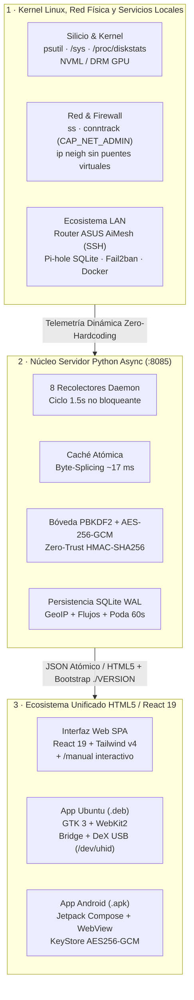
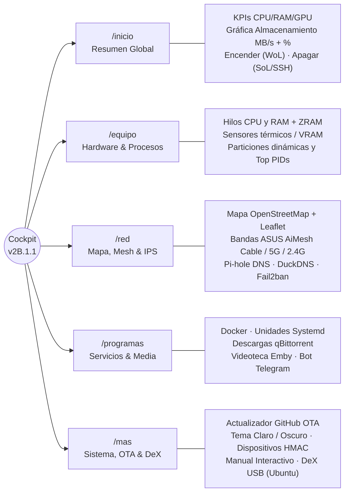
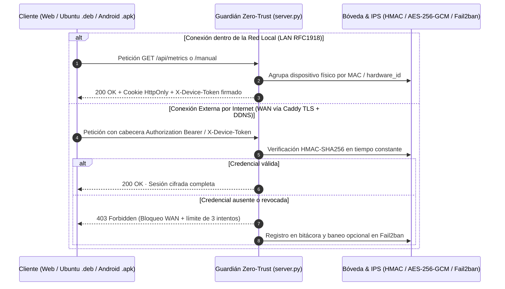

<div align="center">

# Panel de Recursos · Recursos Cockpit (`v2B.1.1`)

### *Telemetría Linux en Tiempo Real, Topología Mesh, Ciberdefensa Zero-Trust y Ecosistema Nativo Multiplataforma*

[-0284C7?style=for-the-badge)](./VERSION)
[](./docs/index.html)
[](#-mapa-de-las-5-vistas-t%C3%A1ctiles-y-m%C3%B3dulos)
[](#-arquitectura-general-en-3-capas)
[](#-descargas-oficiales-e-instalaci%C3%B3n-directa-v2b11--1211)
[](#-descargas-oficiales-e-instalaci%C3%B3n-directa-v2b11--1211)
[](#-seguridad-zero-trust-y-ciberdefensa-activa)
[](#-historial-semver-y-licencia)

<p align="center">
  Plataforma unificada en español (<code>es-ES</code>) de observabilidad de hardware, auditoría de red y control remoto multiplataforma. Construida bajo principio estricto <b>100% Zero-Hardcoding</b> sobre <b>Python Asíncrono + React 19 + TypeScript + Tailwind CSS v4</b>, con estética simétrica <b>Claro Minimalista / Modo Oscuro</b> y aplicaciones nativas para <b>Ubuntu Linux (.deb)</b> y <b>Android (.apk)</b>.
</p>

> [!TIP]
> **Manual Web Interactivo integrado (`v2B.1.1`)**
> Toda la documentación técnica cobra vida con simuladores HiDPI, gráficos SVG y consola REST en tiempo real:
> - **En tu nodo activo**: visita **`http://<ip-o-dominio>:8085/manual`** (o **`/readme`**), o entra desde la app en **Más → Manual interactivo**.
> - **Sin servidor local**: abre [`docs/index.html`](./docs/index.html) o consulta el [**Manual Web en GitHub Pages**](https://cminewaria.github.io/recursos-ui/).

</div>

---

## 🧭 Índice Rápido

1. [Arquitectura General en 3 Capas](#-arquitectura-general-en-3-capas)
2. [Mapa de las 5 Vistas Táctiles y Módulos](#-mapa-de-las-5-vistas-t%C3%A1ctiles-y-m%C3%B3dulos)
3. [Arquitectura Contractual de Aplicaciones Nativas (LAN ↔ WAN)](#-arquitectura-contractual-de-aplicaciones-nativas-lan--wan)
4. [Seguridad Zero-Trust y Ciberdefensa Activa](#-seguridad-zero-trust-y-ciberdefensa-activa)
5. [Descargas Oficiales e Instalación Directa (`v2B.1.1` · `12.1.1`)](#-descargas-oficiales-e-instalaci%C3%B3n-directa-v2b11--1211)
6. [Referencia Rápida de API REST y Rutas Web](#-referencia-r%C3%A1pida-de-api-rest-y-rutas-web)
7. [Guía de Despliegue 100% Zero-Hardcoding](#-gu%C3%ADa-de-despliegue-100-zero-hardcoding)
8. [Historial SemVer y Licencia](#-historial-semver-y-licencia)

---

## 🏛 Arquitectura General en 3 Capas

El colector en Python ([`server.py`](./server.py)) desacopla la lectura del kernel del servidor HTTP: 8 trabajadores en segundo plano serializan el árbol de telemetría en una caché atómica en memoria (`METRICS_CACHE_BYTES`), sirviendo `/api/metrics` mediante empalme directo de bytes en **~17 ms** sin contención ni bloqueos.



---

## 📱 Mapa de las 5 Vistas Táctiles y Módulos

Toda la interfaz comparte la misma estructura simétrica en **5 bloques principales** de navegación inferior fija, adaptándose mediante `ResizeObserver` a escritorio, tablet y móvil:



| Vista / Ruta | Capacidades Principales | Interacción Destacada |
| :--- | :--- | :--- |
| **`/inicio`** | Salud global del servidor, gráficas en vivo HiDPI Canvas de CPU, RAM, GPU y **Almacenamiento dual (`MB/s` + `%`)**, servicios rápidos y tarjetas de equipos en red. | Encendido (**Wake-on-LAN**) y apagado simétrico (**Sleep-on-LAN / SSH / Webhook**) con confirmación segura. |
| **`/equipo`** | Desglose por hilo lógico CPU, memoria RAM + ZRAM, sensores térmicos dinámicos (`/sys`), estado GPU/VRAM, almacenamiento por montaje y tabla de procesos. | Detalles técnicos avanzados ocultos bajo desplegables limpios (*Ver detalles técnicos*). |
| **`/red`** | Mapa geoespacial **OpenStreetMap + Leaflet** con clustering dinámico por coordenadas reales, bandas **ASUS AiMesh** (`Cable LAN`, `5 GHz`, `2.4 GHz`), consultas DNS **Pi-hole**, **DuckDNS** y cárceles **Fail2ban**. | Filtrado por dispositivo físico y baneo/desbaneo inmediato de IPs en 1 clic. |
| **`/programas`** | Estado y consumo CPU/RAM en vivo de contenedores **Docker**, servicios **Systemd**, actividad **qBittorrent**, catálogo **Emby** y actividad del **Bot de Telegram**. | Reinicio de servicios, prueba y envío de notificaciones desde la interfaz. |
| **`/mas`** | **Actualizador OTA GitHub**, selector **Claro / Oscuro**, dispositivos agrupados por certificado HMAC, visor embebido de **`Manual interactivo` (`/manual`)** y panel **DeX USB**. | **Pantalla móvil USB (`DeX`)** desbloqueada en exclusiva al ejecutar la app nativa de Ubuntu. |

---

## 🧩 Arquitectura Contractual de Aplicaciones Nativas (`LAN ↔ WAN`)

Las aplicaciones nativas de Ubuntu y Android no duplican pantallas ni divergen visualmente: ambas envuelven la misma UI HTML5 acelerada por hardware con un **Puente Nativo** específico del sistema operativo:

| Capacidad | Navegador Web SPA | App Nativa Ubuntu (`.deb`) | App Nativa Android (`.apk`) |
| :--- | :--- | :--- | :--- |
| **Motor de Renderizado** | Navegador estándar (Chrome/Firefox/Safari) | `GTK 3` + `WebKit2` acelerado + `LocalHtmlBridgeServer` | `Jetpack Compose` + `android.webkit.WebView` |
| **Identidad y Paridad Visual** | Diseño Claro Minimalista / Oscuro | Idéntica (comparte UI HTML5 canónica) | Idéntica (comparte UI HTML5 canónica) |
| **Autodescubrimiento LAN** | Acceso directo por IP/hostname | Escaneo dinámico LAN / `mDNS` + Lanzador en 3 tarjetas | Escaneo automático transparente en Wi-Fi sin configuración |
| **Almacén Criptográfico** | `Cookie HttpOnly` + `localStorage` | Configuración protegida / Keyring local (`X-Device-Token`) | `Android KeyStore` + `EncryptedSharedPreferences` |
| **Conmutación `LAN ↔ WAN`** | Según URL visitada | Automática (IP local mínima latencia ↔ DDNS WAN TLS) | Automática transparente entre Wi-Fi local y red móvil |
| **Modo Escritorio Android (`DeX`)** | Bloqueado pasivamente | **Desbloqueado en exclusiva** (`adb`, `scrcpy` y `/dev/uhid`) | Bloqueado pasivamente |

---

## 🛡️ Seguridad Zero-Trust y Ciberdefensa Activa



* **Bóveda Cifrada para el Router (`AES-256-GCM`)**: Las credenciales SSH del router ASUS AiMesh en `.router_credentials.json` se cifran en reposo con clave derivada vía `PBKDF2-HMAC-SHA256` (`200.000` iteraciones) vinculada a `.admin_master_key` y `/etc/machine-id`, viajando en memoria mediante `SSHPASS` sin quedar expuestas en `/proc/<pid>/cmdline`.
* **Cero Spam de `sudo` en `journalctl`**: `ss` y `conntrack` se ejecutan de forma nativa mediante capacidades POSIX del servicio (`CAP_NET_ADMIN`, `CAP_DAC_READ_SEARCH`, `CAP_SYS_PTRACE`), reservando `sudo -n` únicamente como respaldo.
* **Principio Estricto 100% Zero-Hardcoding**: Cero IPs fijas, ciudades o marcas embebidas en código; cada disco, sensor térmico, núcleo CPU, interfaz física (`ip neigh` filtrando `docker*`, `br-*`, `veth*`, `tailscale*`) y coordenada GeoIP se resuelve en tiempo real.

---

## 📥 Descargas Oficiales e Instalación Directa (`v2B.1.1` · `12.1.1`)

| Paquete Oficial | Plataforma / Arquitectura | Descarga Directa | Verificación y Firma |
| :--- | :--- | :--- | :--- |
| **🐧 Recursos Cockpit (`.deb`)** | Ubuntu / Debian 64-bit (`amd64`) | [**`recursos-cockpit_12.1.1_amd64.deb`**](https://github.com/cminewarIA/recursos-ui/releases/download/v12.1.1/recursos-cockpit_12.1.1_amd64.deb) | Firma GPG (`_gpgorigin` + `.asc`) · [SHA256SUMS.txt](https://github.com/cminewarIA/recursos-ui/releases/download/v12.1.1/SHA256SUMS.txt) |
| **🤖 Recursos Cockpit (`.apk`)** | Android 8.0+ (Móviles y Tablets) | [**`recursos-cockpit_12.1.1.apk`**](https://github.com/cminewarIA/recursos-ui/releases/download/v12.1.1/recursos-cockpit_12.1.1.apk) | Keystore Oficial Permanente (`v1/v2/v3`) |
| **⚡ Enlaces Permanentes (`latest`)** | Última Release Estable | [`.deb Latest`](https://github.com/cminewarIA/recursos-ui/releases/latest/download/recursos-cockpit.deb) · [`.apk Latest`](https://github.com/cminewarIA/recursos-ui/releases/latest/download/recursos-cockpit.apk) | Actualización limpia sin desinstalar |

### Comandos Rápidos de Instalación / Actualización en Sitio

```bash
# Ubuntu / Debian (conserva configuración, autodescubrimiento y vinculación)
sudo apt-get install --reinstall -y ./dist/recursos-cockpit_12.1.1_amd64.deb
/usr/bin/recursos-cockpit --test-mode

# Android vía ADB (conserva credenciales cifradas en KeyStore)
adb install -r dist/recursos-cockpit_12.1.1.apk
```

---

## 🔌 Referencia Rápida de API REST y Rutas Web

| Método | Ruta / Endpoint | Propósito | Autenticación |
| :---: | :--- | :--- | :--- |
| `GET` | `/` | Interfaz principal React 19 SPA con versión inyectada dinámicamente | LAN / Token HMAC |
| `GET` | `/manual`, `/manual.html`, `/readme` | **Manual Web Interactivo** autocontenido con simuladores e inspector en vivo | LAN / Token HMAC |
| `GET` | `/api/metrics` | Snapshot completo en ~17 ms (`METRICS_CACHE_BYTES`) de hardware, red, Docker y versión | LAN / Token HMAC |
| `GET` | `/api/version` | Versión canónica (`./VERSION`), nombre comercial `2B.x`, commit Git y estado OTA | LAN / Token HMAC |
| `GET` | `/api/system/logs` | Agregador unificado de alertas y fallos de Systemd, Docker y Kernel | LAN / Token HMAC |
| `GET` | `/api/auth/devices` | Inventario agrupado de dispositivos físicos conectados y sus certificados HMAC | LAN / Token HMAC |
| `POST` | `/api/auth/unlock` | Desbloqueo desde WAN mediante clave maestra y bloqueo tras 3 intentos fallidos | WAN protegido |
| `POST` | `/api/fail2ban/ban`, `.../unban` | Bloqueo o liberación instantánea de IPs en Fail2ban | LAN / Token HMAC |
| `POST` | `/api/wol/wake`, `/api/wol/shutdown` | Encendido Wake-on-LAN y apagado remoto seguro (Webhook / SSH / RPC / SoL) | LAN / Token HMAC |
| `GET`/`POST` | `/api/dex/status`, `.../start`, `.../stop` | Control USB Samsung DeX / Android Desktop (`scrcpy` + `/dev/uhid`) | Solo Nativo Ubuntu |
| `GET` | `/download/recursos-cockpit.deb`, `...apk` | Descarga directa de instaladores desde el nodo anfitrión | Público |

---

## 🛠️ Guía de Despliegue 100% Zero-Hardcoding

### 1. Puesta en Marcha del Servidor y Compilación de Assets

```bash
# Clonar el repositorio en el directorio de servicio elegido
git clone https://github.com/cminewarIA/recursos-ui.git /opt/recursos-cockpit
cd /opt/recursos-cockpit

# Instalar dependencias Python
pip3 install -r requirements.txt || pip3 install psutil

# Compilar la SPA React 19 -> ./static/index.html (opcional si editas src/)
npm install && npm run build

# Compilar, firmar e instalar el paquete nativo Ubuntu (.deb) desde ./VERSION
bash packaging/build_deb.sh
sudo apt-get install --reinstall -y ./dist/recursos-cockpit_$(cat VERSION)_amd64.deb
```

### 2. Servicio `systemd` con Capacidades POSIX y Proxy TLS (`Caddy`)

<details>
<summary><strong>Ver plantilla de unidad <code>system-dashboard.service</code> y configuración <code>Caddyfile</code></strong></summary>

Archivo `/etc/systemd/system/system-dashboard.service`:
```ini
[Unit]
Description=Recursos Cockpit - Telemetría Linux y Ciberdefensa Zero-Trust
After=network-online.target
Wants=network-online.target

[Service]
Type=simple
User=servidor
WorkingDirectory=/opt/recursos-cockpit
AmbientCapabilities=CAP_NET_ADMIN CAP_DAC_READ_SEARCH CAP_SYS_PTRACE
CapabilityBoundingSet=CAP_NET_ADMIN CAP_DAC_READ_SEARCH CAP_SYS_PTRACE
ExecStart=/usr/bin/python3 /opt/recursos-cockpit/server.py
Restart=always
RestartSec=3

[Install]
WantedBy=multi-user.target
```

Archivo `/etc/caddy/Caddyfile` para acceso cifrado desde WAN (opcional, configurado vía variables de entorno o `.env`):
```caddy
tu-subdominio.duckdns.org {
    reverse_proxy 127.0.0.1:8085
}
```

</details>

---

## 📜 Historial SemVer y Licencia

La versión única reside exclusivamente en [`./VERSION`](./VERSION) y se propaga automáticamente hacia [`package.json`](./package.json), [`packaging/debian/control`](./packaging/debian/control), Android Gradle, [`server.py`](./server.py), [`desktop_app/recursos_app.py`](./desktop_app/recursos_app.py), React 19 y el Manual Interactivo:

* **`X.0.0` (`MAJOR`)**: Rediseño completo integral de la aplicación o cambio global de arquitectura visual.
* **`0.X.0` (`MINOR`)**: Adición o retiro de funciones, o rediseño de un componente concreto de la interfaz.
* **`0.0.X` (`PATCH`)**: Corrección de errores, optimizaciones internas, ajustes menores o renovación documental.

### Hitos Principales Recientes

| Versión | Tipo | Resumen de Cambios |
| :--- | :---: | :--- |
| **`v12.1.1` (`v2B.1.1`)** | `PATCH` | Reescritura completa desde cero de `README.md` con 3 diagramas Mermaid actualizados, arquitectura contractual multiplataforma, guía Zero-Hardcoding sin rutas fijas ni lastre histórico y sincronización en el Manual Interactivo. |
| **`v12.1.0` (`v2B.1.0`)** | `MINOR` | Nuevo Manual Web Interactivo autocontenido (`static/manual.html` y `docs/index.html`) con explorador SVG, simuladores HiDPI, consola API REST en vivo e integración en `/manual`, `/readme`, **Más → Manual interactivo** y paquete `.deb`. |
| **`v12.0.6` (`v2B.0.6`)** | `PATCH` | Erradicación de spam `sudo` PAM mediante `CAP_NET_ADMIN`, caché atómica `METRICS_CACHE_BYTES` (~17 ms), serie histórica real `disk_pct` y sincronización reactiva de subpestañas en React 19. |
| **`v12.0.5` (`v2B.0.5`)** | `PATCH` | Cifrado `AES-256-GCM` + `PBKDF2-HMAC-SHA256` en reposo para credenciales del router ASUS AiMesh, `SSHPASS` sin exposición en `cmdline` y filtrado de puentes Docker en `ip neigh`. |
| **`v12.0.4` (`v2B.0.4`)** | `PATCH` | Detección real de clientes `Cable LAN`, `5 GHz` y `2.4 GHz` en topología ASUS AiMesh y alineación de esquemas en `Programas` (`Docker`, `qBittorrent`, `Emby`, `Telegram`). |
| **`v12.0.1`–`v12.0.3`** | `PATCH` | Firma GPG en `.deb` (`_gpgorigin`), keystone permanente `v1/v2/v3` en `.apk`, actualización directa desde GitHub en Ubuntu, controles de ventana con alto contraste y resolución `esbuild`/`vite` en CI. |
| **`v12.0.0` (`v2B.0.0`)** | `MAJOR` | Reescritura integral desde cero en **React 19 + TypeScript + Tailwind CSS v4**, diseño **Claro Minimalista / Modo Oscuro**, español cotidiano, tooltips HiDPI universales, gráfica dual de almacenamiento y nuevo emblema CMineWar. |
| **`v11.3.0`** | `MINOR` | Controles simétricos de encendido (`Wake-on-LAN`) y apagado remoto seguro multicanal (`Webhook` / `SSH` / `RPC` / `Sleep-on-LAN`). |
| **`v11.0.0`–`v11.2.1`** | `MAJOR`/`PATCH` | Transición integral a arquitectura **100% Zero-Hardcoding**, eliminación total de rutas/credenciales fijas y paridad entre servidor, Vite y apps nativas. |
| **`v10.0.0`** | `MAJOR` | Lanzamiento del ecosistema multiplataforma con app nativa Ubuntu (`GTK 3 + WebKit2` + modo DeX USB) y Android (`Compose + WebView`) enlazadas por Zero-Trust. |

Para explorar el registro completo por tipo SemVer con consola en vivo, abre [**Manual Web Interactivo (`docs/index.html`)**](./docs/index.html) o visita **`/manual`** en tu servidor.

### Licencia
Distribuido bajo licencia **MIT**.
