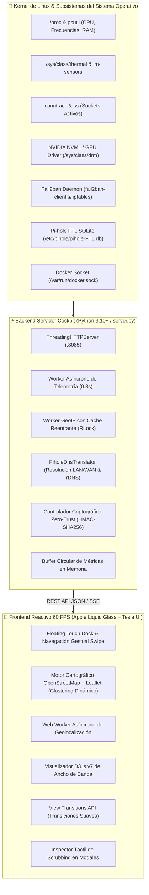

<div align="center">

# 🛸 SYSTEM COCKPIT · TELEMETRÍA & CONTROL DE MISIÓN
### *Centro de Mando de Alto Rendimiento para Servidores Linux & Homelabs*

[](./VERSION)
[](#-filosof%C3%ADa-de-dise%C3%B1o)
[](#-principio-estricto-100-zero-hardcoding)
[](#-rendimiento-y-motor-desacoplado)
[](#-ciberdefensa-activa-ips-y-seguridad-zero-trust)
[](#-licencia)

<p align="center">
  <b>System Cockpit</b> es una plataforma integral de monitorización y ciberdefensa en tiempo real que transforma la gestión de servidores Linux y entornos homelab en una experiencia táctil fluida, combinando la óptica multicapa de <b>Apple Liquid Glass</b> con la ergonomía automotriz de <b>Tesla Touch Cockpit</b>.
</p>

</div>

---

```
╔══════════════════════════════════════════════════════════════════════════════════════════════════════════════╗
║  🟢 NODO PRINCIPAL ACTIVO  │  ⚡ 60 FPS RAF  │  🛡️ IPS ACTIVO (FAIL2BAN)  │  📡 PI-HOLE DNS FLOWS  │ v4.16.0 ║
╠══════════════════════════════════════════════════════════════════════════════════════════════════════════════╣
║                                                                                                              ║
║   ┌──────────────────────┐  ┌──────────────────────────────────────────────┐  ┌──────────────────────────┐   ║
║   │  🧠 CPU TELEMETRÍA   │  │       🌍 MAPA MUNDIAL GEOESPACIAL EN VIVO    │  │  🍩 D3.JS TRÁFICO DE RED │   ║
║   │  ████████░░░  74.2%  │  │         . _..::__:  ,-"-"._                  │  │      ╭────────────╮      │   ║
║   │  3.80 GHz · 52.0°C   │  │       /  🌍 NODO LOCAL ──► 🗽 WAN DESTINO    │  │    ╭─┤ 192.168.50 ├─╮    │   ║
║   ├──────────────────────┤  │       \      ╰──────────► 🗼 SERVICIOS NUBE  │  │    │ ╰────────────╯ │    │   ║
║   │  💾 RAM + ZRAM       │  │        `._ .._,-'                            │  │    ╰─── 68.4% RX ───╯    │   ║
║   │  ██████░░░░░  58.1%  │  │  [✓] OpenStreetMap Libre · Cluster Dinámico │  │  Interpolación Cúbica    │   ║
║   └──────────────────────┘  └──────────────────────────────────────────────┘  └──────────────────────────┘   ║
║                                                                                                              ║
║           ╔══════════════════════════════════════════════════════════════════════════════════════╗           ║
║           ║  🏠 Cockpit   🧠 CPU   💾 RAM   🎮 GPU   💿 Discos   🌐 Red   🛡️ IPS   🐳 Docker ║           ║
║           ╚══════════════════════════════════════════════════════════════════════════════════════╝           ║
║                                     ▲ FLOATING TOUCH DOCK (TESLA UI)                                         ║
╚══════════════════════════════════════════════════════════════════════════════════════════════════════════════╝
```

---

## 📑 Tabla de Contenidos

1. [Arquitectura General](#-arquitectura-general)
2. [Filosofía de Diseño: Apple Liquid Glass + Tesla UI](#-filosofía-de-diseño)
3. [Características Principales](#-características-principales)
   - [Pilares de Telemetría de Hardware](#1-pilares-de-telemetría-de-hardware)
   - [Inteligencia Geoespacial en Vivo (100% Libre)](#2-inteligencia-geoespacial-en-vivo-100-libre)
   - [Flujos de Red de Dispositivos del Hogar (Pi-hole DNS)](#3-flujos-de-red-de-dispositivos-del-hogar-pi-hole-dns)
   - [Ciberdefensa Activa IPS y Seguridad Zero-Trust](#4-ciberdefensa-activa-ips-y-seguridad-zero-trust)
   - [Analítica de Ancho de Banda con D3.js](#5-analítica-de-ancho-de-banda-con-d3js)
   - [Ecosistema Multimedia y Docker](#6-ecosistema-multimedia-y-docker)
   - [Centro Unificado de Registro de Fallos del Sistema (Apps, Servicios & Kernel)](#7-centro-unificado-de-registro-de-fallos-del-sistema-apps-servicios--kernel)
4. [Principio Estricto 100% Zero-Hardcoding](#-principio-estricto-100-zero-hardcoding)
5. [Mapa de Vistas SPA (12 Pantallas)](#-mapa-de-vistas-spa-12-pantallas)
6. [Referencia de la API REST](#-referencia-de-la-api-rest)
7. [Guía de Instalación y Despliegue](#-guía-de-instalación-y-despliegue)
8. [Historial de Versiones](#-historial-de-versiones)
9. [Licencia](#-licencia)

---

## 🏛 Arquitectura General

El sistema opera bajo un modelo **desacoplado y de latencia ultrabaja**, donde el backend en Python orquesta múltiples hilos especializados que interactúan directamente con subsistemas del kernel de Linux, volcando la telemetría en cachés atómicas en memoria consumidas de forma reactiva por el cliente web:



---

## 🎨 Filosofía de Diseño

System Cockpit rompe con la estética tradicional de paneles de administración y adopta una interfaz inspirada en dos referentes de clase mundial:

### 🍏 Apple visionOS / macOS Liquid Glass
- **Óptica Translúcida Multicapa**: Fondos de cristal esmerilado impulsados por aceleración de GPU (`backdrop-filter: blur(36px) saturate(190%)`).
- **Bordes Especulares**: Reflejos de luz dinámicos en los contornos (`border: 1px solid rgba(255, 255, 255, 0.14)`).
- **Tarjetas Bento Grid**: Disposición geométrica modular con radios continuos (`border-radius: 24px`).
- **Temas de Titanio**: *Space Black Titanium* (por defecto, negro profundo con acentos esmeralda/zafiro) y *Natural Brushed Titanium* (modo claro de alta legibilidad).

### ⚡ Tesla Touch Cockpit Ergonomics
- **Floating Touch Dock**: Barra de navegación flotante inferior (`#floatingTouchDock`) adaptada ergonómicamente al alcance del pulgar en pantallas móviles o consolas táctiles.
- **Hitboxes Táctiles Generosos**: Todos los botones interactivos cuentan con una zona de impacto táctil `≥ 48px`, eliminando la dependencia del puntero de ratón.
- **Navegación Gestual (Touch Swipe)**: Deslizamiento lateral con inercia para alternar fluidamente entre las 12 vistas del sistema.
- **Scrubbing Táctil en Tiempo Real**: Gráficas históricas con inspección interactiva continua punto a punto en modales `<dialog>`.

---

## 🚀 Características Principales

### 1. Pilares de Telemetría de Hardware
* **CPU en Tiempo Real**: Monitorización de uso global y por núcleo independiente, detección dinámica de frecuencias (`psutil.cpu_freq()`) y sensores térmicos de silicio leídos directamente desde `/sys/class/thermal` y controladores `coretemp`.
* **Memoria RAM & ZRAM**: Desglose visual instantáneo de memoria física activa, en búfer, en caché, SWAP en disco y compresión ultra-rápida ZRAM.
* **GPU Heterogénea**: Detección dinámica automática para GPUs dedicadas (NVIDIA NVML) e integradas (Intel / AMD Radeon), mostrando carga de cómputo, VRAM consumida, potencia en vatios y temperatura.
* **Almacenamiento & Rendimiento I/O**: Detección dinámica de todas las particiones montadas (`df`), uso porcentual, espacio libre y tasa de transferencia I/O en tiempo real (MB/s de lectura/escritura e IOPS).

### 2. Inteligencia Geoespacial en Vivo (100% Libre)
* **Motor Cartográfico OpenStreetMap + Leaflet**: Sistema cartográfico 100% libre, sin cuotas ni dependencias de APIs propietarias de pago como Google Maps.
* **Clustering Dinámico Inteligente**: Los nodos geográficos se agrupan o separan de forma fluida y natural al ajustar el zoom, evaluando distancias relativas en pantalla sin ubicaciones predefinidas.
* **Popups Persistentes Multinivel**: Arquitectura de retención de popups de hasta 5 niveles que previene cierres involuntarios al navegar, interactuar o refrescar datos.
* **Resolución GeoIP Asíncrona sin Bloqueos**: Motor de resolución en segundo plano protegido con cerrojos reentrantes (`threading.RLock()`), caché LRU acotada en el navegador y almacenamiento persistente en disco en el servidor (`geoip_cache.json`).

### 3. Flujos de Red de Dispositivos del Hogar (Pi-hole DNS)
* **Traducción Dinámica de IPs (`PiholeDnsTranslator`)**: Módulo avanzado que analiza la base de datos `/etc/pihole/pihole-FTL.db`, listas estáticas y tablas DHCP para traducir IPs locales anónimas a nombres de dispositivos reconocibles (`tv-de-la-sala-de-estar`, `xbox-series-s`, `Redmi-A3`, etc.).
* **Visibilidad Total de la Red Doméstica**: Permite observar en el mapa mundial y en la tabla de conexiones qué destinos remotos están consumiendo los distintos dispositivos del hogar.
* **Filtros Segmentados en Vivo**: Conmutador rápido entre conexiones locales del servidor, flujos de dispositivos del hogar y tráfico global consolidado.

### 4. Ciberdefensa Activa IPS y Seguridad Zero-Trust
* **Integración Nativa con Fail2ban**: Monitorización de cárceles activas (`sshd`, `recidive`, etc.), registro cronológico de intrusiones e inspección de direcciones IP hostiles.
* **Bloqueo / Desbloqueo en 1 Clic**: Acciones directas para expulsar atacantes o revocar sanciones directamente desde el mapa geográfico o desde la tabla de conexiones.
* **Arquitectura Zero-Trust**:
  - **Acceso en LAN**: Emparejamiento automático transparente para dispositivos conectados a la red local.
  - **Acceso WAN (Exterior / Móvil)**: Verificación estricta mediante credenciales criptográficas HMAC-SHA256 (`X-Device-Token` / `_sysmon_trust`). Los dispositivos deben haber sido vinculados previamente en LAN o desbloqueados mediante clave maestra protegida contra fuerza bruta.

### 5. Analítica de Ancho de Banda con D3.js
* **Gráfico de Anillo Animado con D3.js v7**: Renderizado vectorial fluido con interpolación cúbica suave (`d3.interpolate` + `attrTween`, 550ms cubic-out).
* **Alerta Visual por Umbral NIC**: Notificaciones visuales en tiempo real configurables cuando una interfaz de red sobrepasa un caudal de tráfico determinado (por ejemplo, `eth0 > 150 Mbps`).

### 6. Ecosistema Multimedia y Docker
* **Contenedores Docker**: Estado de salud, tiempo de actividad, CPU y consumo de memoria por contenedor consultando directamente el socket de Docker.
* **Descargas qBittorrent & Emby**: Seguimiento de torrents activos, velocidades de descarga/subida, ratios de compartición y sesiones activas en el servidor multimedia.
* **DuckDNS & Proxy Inverso Caddy**: Integración con DNS dinámico DuckDNS y proxy inverso Caddy con certificados SSL TLS automáticos.

### 7. Centro Unificado de Registro de Fallos del Sistema (Apps, Servicios & Kernel)
* **Agregador Global de Diagnóstico**: Recolecta en tiempo real todos los eventos con nivel de severidad `emerg`, `alert`, `crit`, `err` (y opcionalmente `warning`) generados por:
  - **Contenedores de Aplicaciones**: Registros de salida estándar y error de Docker (`Immich`, `Postgres`, `Nextcloud`, `Collabora`, `HomeAssistant`, etc.) capturados por el journal de Docker.
  - **Servicios del Sistema Systemd**: Fallos y excepciones de daemons como `pxe-dnsmasq`, `fail2ban`, `caddy`, `smbd`, `systemd-resolved`, etc., junto con la detección en tiempo real de unidades en estado `failed`.
  - **Núcleo del Sistema Operativo (Kernel)**: Eventos de I/O de almacenamiento, errores de módulos, `dmesg`, eventos térmicos y del subsistema de red.
* **Decodificación Binaria Segura**: Resiliente ante buffers de salida de aplicaciones (como Postgres o Collabora) que emiten secuencias de bytes binarios en JSON.
* **Diseño Plegable y Modal Panorámico**:
  - Indicador rápido en la cabecera de la Vista General (`📋 Fallos: X detectados`) con resaltado de color dinámico ante incidencias.
  - Tarjeta Bento colapsable (`#systemLogsCenterCard`) con filtros por categoría (`🐳 Apps & Docker`, `⚙️ Servicios`, `🐧 Kernel`), búsqueda en vivo y cambio de severidad.
  - Visor nativo HTML5 `<dialog>` a pantalla completa para auditorías exhaustivas.

---

## 🧭 Principio Estricto 100% Zero-Hardcoding

System Cockpit se rige por una regla arquitectónica absoluta: **cero valores estáticos o suposiciones cableadas en el código fuente**.

1. **Ubicaciones, Ciudades y Proveedores**: Queda prohibido codificar nombres de ciudades, países o proveedores fijos. Todo dato geográfico se calcula dinámicamente en tiempo de ejecución a partir de la telemetría viva de red (`remote_ip`, `city`, `country`, `isp`, `asn`).
2. **Hardware e Interfaces**: El número de núcleos, sensores térmicos, discos duros, tarjetas de red (NICs), particiones y aceleradoras GPU se detectan y renderizan en base a las lecturas reales del sistema en `/sys` y `/proc`.
3. **Clustering y Agrupamientos**: Los clusters del mapa se computan matemáticamente por proximidad en pantalla según el nivel de zoom actual, sin identificadores artificiales.

---

## 📱 Mapa de Vistas SPA (12 Pantallas)

El frontend opera como una Single Page Application (SPA) desacoplada con animaciones mediante **View Transitions API**:

| Ruta | Nombre de Vista | Descripción Operativa |
| :--- | :--- | :--- |
| `/` | **Vista General** | Cockpit panorámico con los 4 pilares de hardware, banner de estado y accesos rápidos. |
| `/procesador` | **CPU & Frecuencias** | Monitor detallado por núcleo, frecuencias dinámicas y termografía de silicio. |
| `/memoria` | **RAM & ZRAM** | Desglose de memoria física, caché de páginas, búferes y compresión ZRAM. |
| `/grafica` | **GPU & Aceleración** | Carga de GPU, reloj de núcleo, temperatura y consumo de memoria VRAM. |
| `/almacenamiento` | **Discos & Particiones** | Monitor de espacio en disco, particiones montadas y tasas de I/O en MB/s. |
| `/red` | **Mapa Mundial & Tráfico** | Cartografía interactiva OpenStreetMap, flujos de Pi-hole y sockets del kernel. |
| `/procesos` | **Gestor de Procesos** | Monitor de procesos activos por CPU/RAM con capacidad de filtrado y señales. |
| `/servicios` | **Servicios Systemd** | Catálogo interactivo de servicios del sistema, estados y reinicios. |
| `/contenedores` | **Docker Runtime** | Monitor de contenedores Docker activos, memoria, CPU y tiempos de actividad. |
| `/seguridad` | **Ciberdefensa IPS** | Centro de control Fail2ban, cárceles, IPs bloqueadas y gestión Zero-Trust. |
| `/descargas` | **Multimedia & Torrents**| Panel unificado para descargas qBittorrent y sesiones de streaming Emby. |
| `/version` | **Control de Versión** | Información de versión canónica, hash de Git y estado de sincronización. |

---

## 🔌 Referencia de la API REST

El servidor expone una API REST ligera en formato JSON:

| Método | Endpoint | Descripción | Acceso / Auth |
| :--- | :--- | :--- | :--- |
| `GET` | `/api/metrics` | Telemetría consolidada del sistema (CPU, RAM, GPU, Red, Discos). | Público (LAN / Token WAN) |
| `GET` | `/api/version` | Versión canónica activa (`VERSION`), hash Git y estado del repo. | Público |
| `GET` | `/api/system/logs` | Registro unificado de fallos y errores (filtros: `level`, `category`, `limit`, `refresh`). | Público (LAN / Token WAN) |
| `POST` | `/api/net/geoip/resolve` | Resolución en lote de coordenadas geográficas para el mapa. | Abierto para clientes del mapa |
| `POST` | `/api/net/geoip/clear-errors`| Limpia el historial de eventos del Worker GeoIP en el servidor. | Requiere sesión de confianza |
| `POST` | `/api/fail2ban/ban` | Bloquea una dirección IP maliciosa en una cárcel de Fail2ban. | Requiere sesión de confianza |
| `POST` | `/api/fail2ban/unban` | Desbloquea una IP previamente sancionada en Fail2ban. | Requiere sesión de confianza |
| `POST` | `/api/auth/unlock` | Desbloqueo remoto de cliente WAN mediante clave maestra HMAC. | Protegido contra fuerza bruta |
| `GET` | `/api/trust/status` | Comprueba el estado de confianza y emparejamiento del cliente. | Público |
| `POST` | `/api/custom-logos` | Actualiza o restablece logos personalizados de servicios/equipos. | Requiere sesión de confianza |

---

## 🛠 Guía de Instalación y Despliegue

### Requisitos del Sistema
- **Sistema Operativo**: Linux (Ubuntu 22.04+, Debian 12+, Arch Linux o similar).
- **Python**: Versión 3.10 o superior.
- **Herramientas del Sistema**: `conntrack`, `fail2ban`, `iproute2`, `sqlite3` (para Pi-hole).

### 1. Clonar el Repositorio
```bash
git clone https://github.com/cminewarIA/recursos-ui.git /home/servidor/servicios/dashboard
cd /home/servidor/servicios/dashboard
```

### 2. Instalar Dependencias de Python
```bash
pip3 install -r requirements.txt || pip3 install psutil
```

### 3. Configuración de Variables de Entorno (`.env`)
Crea un archivo `.env` en el directorio raíz si deseas personalizar puertos o credenciales maestras:
```env
PORT=8085
ADMIN_MASTER_KEY=tu_clave_maestra_segura_aqui
DUCKDNS_DOMAIN=tu-dominio.duckdns.org
DUCKDNS_TOKEN=tu-token-duckdns
```

### 4. Despliegue como Servicio Systemd
Crea el archivo de servicio `/etc/systemd/system/system-dashboard.service`:
```ini
[Unit]
Description=System Cockpit - Telemetría y Ciberdefensa en Tiempo Real
After=network.target

[Service]
Type=simple
User=servidor
WorkingDirectory=/home/servidor/servicios/dashboard
ExecStart=/usr/bin/python3 /home/servidor/servicios/dashboard/server.py
Restart=always
RestartSec=3

[Install]
WantedBy=multi-user.target
```

Habilita e inicia el servicio:
```bash
sudo systemctl daemon-reload
sudo systemctl enable --now system-dashboard.service
```

### 5. Configuración con Caddy (Proxy Inverso SSL)
Ejemplo de directiva para `/etc/caddy/Caddyfile`:
```caddy
tu-dominio.duckdns.org {
    reverse_proxy 127.0.0.1:8085
}
```
Recarga Caddy:
```bash
sudo systemctl reload caddy
```

---

## 📜 Historial de Versiones

El proyecto sigue un criterio estricto de incremento semántico (`MAJOR.MINOR.PATCH`):
* `X.0.0`: Cambios de diseño visual, maquetación o estilo general.
* `0.X.0`: Adición o retiro de funcionalidades.
* `0.0.X`: Ajustes de rendimiento, corrección de errores (bugfixes) o actualización documental.

| Versión | Tipo | Descripción de Cambios |
| :--- | :---: | :--- |
| **`v4.16.0`** | `MINOR` | **Centro Unificado de Registro de Fallos (Apps, Servicios & Kernel)**: Agregador de diagnósticos en tiempo real que recolecta fallos de contenedores Docker (Immich, Postgres, Nextcloud, Collabora), servicios Systemd y eventos críticos del kernel en una sola vista unificada; decodificación resiliente de buffers binarios en streams de contenedores; categorización 100% dinámica sin nombres fijos; nuevo endpoint REST `/api/system/logs` con filtrado por categoría y nivel de severidad; visor Bento colapsable en Vista General y modal a pantalla completa. |
| **`v4.15.0`** | `MINOR` | **Corrección de Deadlock GeoIP & Limpieza de Interfaz**: Se reemplazó `GEOIP_LOCK` por un cerrojo reentrante (`threading.RLock()`) resolviendo el bloqueo que congelaba el servidor; se retiraron los volcados invasivos de logs y tarjetas de terminal de la Vista General y Red; se desactivó el interceptor global de fetch; se eliminó el fallback inseguro a ip-api.com desde el navegador; rediseño integral del README a nivel de ingeniería de producción. |
| **`v4.14.0`** | `MINOR` | Adición del terminal de errores en tiempo real del nodo principal y endpoints de diagnóstico del worker. |
| **`v4.13.1`** | `PATCH` | Ajustes de documentación y sincronización de planes en el repositorio. |
| **`v4.13.0`** | `MINOR` | **Ingesta de Flujos de Red vía Pi-hole**: Integración de conexiones activas de dispositivos del hogar mediante lectura de `/etc/pihole/pihole-FTL.db` y filtro dinámico de dispositivos en el mapa. |
| **`v4.12.0`** | `MINOR` | Traducción en tiempo real de IPs locales y externas mediante Pi-hole DNS y alertas por umbral en tarjetas NIC. |
| **`v4.11.2`** | `PATCH` | Solución a la desaparición involuntaria de popups en el mapa mundial e incorporación de la regla de Zero-Hardcoding. |
| **`v4.11.0`** | `MINOR` | Integración de gráfico interactivo tipo donut con D3.js v7 con animaciones cubic-out de 550ms. |
| **`v4.10.0`** | `MINOR` | Implementación de persistencia de popups en 5 niveles e historial de navegación geoespacial. |
| **`v4.9.0`** | `MINOR` | Detección de dispositivos domésticos por tabla DHCP y resolución rDNS inversa. |
| **`v4.5.0`** | `MINOR` | Módulo de Ciberdefensa Activa con bloqueo en 1 clic mediante Fail2ban e iptables. |
| **`v4.0.0`** | `MAJOR` | **Rediseño Completo Apple Liquid Glass + Tesla UI**: Introducción del Floating Touch Dock, óptica translúcida y navegación por gestos táctiles. |

---

## 📄 Licencia

Este proyecto está bajo la Licencia **MIT**. Consulta el archivo `LICENSE` para más detalles.

---

<div align="center">
  <b>System Cockpit</b> · Desarrollado con pasión para la comunidad de Linux y Homelab.
</div>
