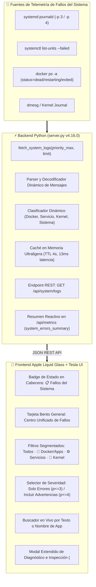

# Plan de Implementación v4.16.0: Centro Unificado de Registro y Monitor de Fallos del Sistema (Todas las Apps y Servicios)

El usuario solicita:
> *"podemos hacer que en ese log salga todos los fallos de todas las apps del sisteme y todos los servicios para ver una vista general de todo"*

---

## 1. Objetivo y Alcance

Diseñar e implementar un **Centro Unificado de Registro y Monitor de Fallos del Sistema** que recolecte, clasifique y visualice en tiempo real los errores, fallos y eventos críticos procedentes de **todas las aplicaciones y servicios de la máquina**:
1. **Contenedores y Aplicaciones Docker**: Errores y caídas de `immich_server`, `immich_postgres`, `nextcloud_app`, `nextcloud_collabora`, `homeassistant`, `tesseract_ocr`, `caddy_proxy`, etc.
2. **Servicios del Sistema (Systemd Units)**: Unidades caídas o fallidas (`systemctl --failed`), fallos de arranque, excepciones y advertencias de servicios (`pxe-dnsmasq.service`, `fail2ban.service`, `pihole-FTL.service`, `caddy.service`, `smbd.service`, etc.).
3. **Subsistemas del Kernel y Hardware**: Errores del núcleo Linux, montajes CIFS/NFS, E/S de discos, GPU drivers y eventos térmicos.
4. **Daemons y Procesos del Sistema**: `dockerd`, `sshd`, `cron`, etc.

Todo bajo el **Principio Estricto 100% Zero-Hardcoding** (sin nombres ni listas estáticas cableadas; detección y clasificación 100% dinámica en tiempo de ejecución).

---

## 2. Arquitectura Técnica

---

## 3. Cambios Propuestos

### Componente 1: Backend (`server.py`)
- **Módulo `SystemLogsAggregator`**:
  - Función `fetch_system_logs(priority_max=3, limit=80, category='all')`:
    - Ejecuta `journalctl -p {priority_max} -n {limit} --no-pager -o json` de forma ultraligera (~13 ms).
    - Decodifica mensajes complejos (incluyendo arrays de bytes emitidos por contenedores como Collabora/Postgres).
    - Extrae metadatos dinámicos:
      - `id`: identificador único por cursor/timestamp.
      - `ts`: marca de tiempo epoch en milisegundos.
      - `time_str`: hora formateada (`HH:MM:SS`).
      - `unit`: nombre dinámico de la aplicación o servicio (`CONTAINER_NAME`, `_SYSTEMD_UNIT`, `SYSLOG_IDENTIFIER`, `_COMM`).
      - `category`: deducción dinámica entre `'docker'` (apps/contenedores), `'service'` (unidades systemd), `'kernel'` (núcleo/hardware) y `'system'` (daemons base).
      - `level`: etiqueta de severidad (`EMERG`, `ALERT`, `CRIT`, `ERR`, `WARN`).
      - `priority`: valor numérico de journald (0 a 4).
      - `message`: texto limpio del error.
  - Comprobación de unidades en fallo mediante `systemctl list-units --failed --no-pager --plain`.
  - Caché de corta duración (TTL 4s) con cerrojo para evitar saturar el subproceso ante múltiples peticiones simultáneas.
- **Nuevo Endpoint REST**:
  - `GET /api/system/logs`: Admite parámetros de consulta `?level=err|warn`, `?category=all|docker|service|kernel`, `?limit=100`.
- **Inyección en `/api/metrics`**:
  - Incorporar `system_errors_summary` con contadores consolidados (`total`, `failed_units_count`, `by_category`) para que la cabecera se actualice en tiempo real sin polling adicional.

### Componente 2: Frontend (`static/index.html` e `index.html`)
- **Acceso Rápido en Cabecera**:
  - Botón de estado en la barra de herramientas de la Vista General:
    - Si hay 0 fallos: `✓ Sistema Saludable` (insignia verde esmeralda).
    - Si hay fallos: `📋 Fallos: X detectados` (insignia ámbar/roja con acceso directo al visor).
- **Tarjeta Bento de Monitoreo en la Vista General**:
  - Componente integrado en la vista principal con estética *Apple Liquid Glass*:
    - Encabezado con título claro: `📋 CENTRO DE EVENTOS & FALLOS DEL SISTEMA (APPS & SERVICIOS)`.
    - Selector segmentado: `Todos (N)`, `🐳 Apps & Docker (N)`, `⚙️ Servicios Systemd (N)`, `🐧 Kernel & Hardware (N)`.
    - Conmutador de severidad: `Solo Errores (Críticos/Fallos)` vs `Incluir Advertencias`.
    - Buscador reactivo para filtrar por palabra clave o nombre de servicio/app en tiempo real.
    - Botón `🔄 Actualizar` y botón para abrir en modal expandido.
    - Lista visual de fallos: cada fila incluye hora, badge de origen, píldora de severidad con color distintivo y mensaje del fallo.
- **Modal de Diagnóstico Extendido (`<dialog id="systemLogsModal">`)**:
  - Permite inspeccionar mensajes largos, trazas completas y copiar eventos al portapapeles con ergonomía táctil *Tesla Touch*.
- **Sincronización Canónica**:
  - Copiar `static/index.html` a `index.html`.

### Componente 3: Documentación y Versión
- **Actualizar `VERSION` y `package.json`**:
  - De acuerdo con la **Regla 5 de `GEMINI.md`**, la adición de una funcionalidad completa corresponde a un incremento **`MINOR` (`0.X.0`)** con restablecimiento del tercer dígito a 0:
    - Versión actual: `4.15.0`
    - Nueva versión: **`4.16.0`**
- **Actualizar `README.md`**:
  - Incorporar la sección del *Centro Unificado de Fallos del Sistema*, su arquitectura y el nuevo endpoint `/api/system/logs`.
- **Respaldar en `planes/`**:
  - Guardar `planes/implementation_plan_v4.16.0.md` y `planes/walkthrough_v4.16.0.md`.

---

## 4. Plan de Verificación

### Pruebas Automatizadas y de Backend
- Validar sintaxis con `python3 -m py_compile server.py`.
- Reiniciar `system-dashboard.service` con `sudo systemctl restart system-dashboard.service`.
- Probar endpoint `GET /api/system/logs` con `curl` verificando estructura JSON, tiempos de respuesta (< 50ms) y categorización de logs reales del sistema (`pxe-dnsmasq.service`, `immich_postgres`, `kernel`, etc.).
- Comprobar que `/api/metrics` expone `system_errors_summary` con conteos reactivos exactos.

### Pruebas de Interfaz y Experiencia de Usuario
- Verificar en navegador que la tarjeta en la Vista General renderiza los fallos reales con diseño Liquid Glass impecable.
- Comprobar filtros por origen (`Docker`, `Servicios`, `Kernel`) y selector de nivel (`Solo Errores` vs `Advertencias`).
- Probar el buscador en vivo y el modal extendido táctil.
